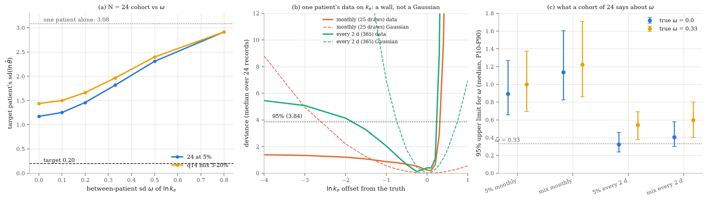
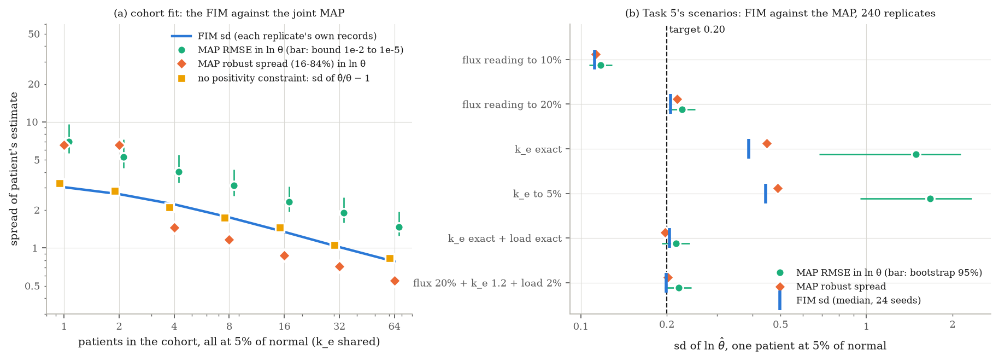
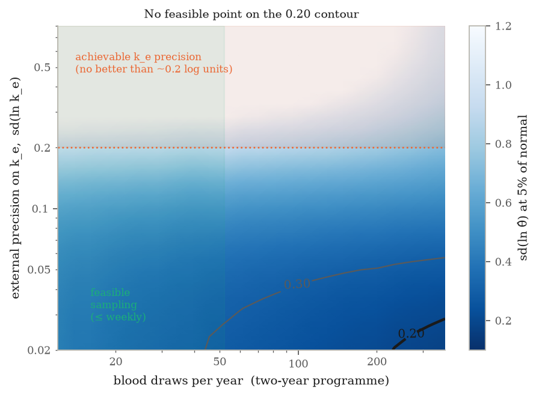
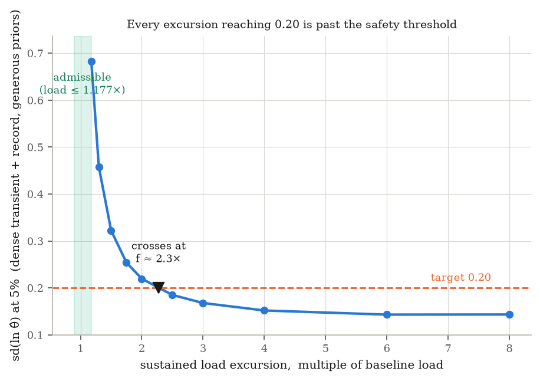
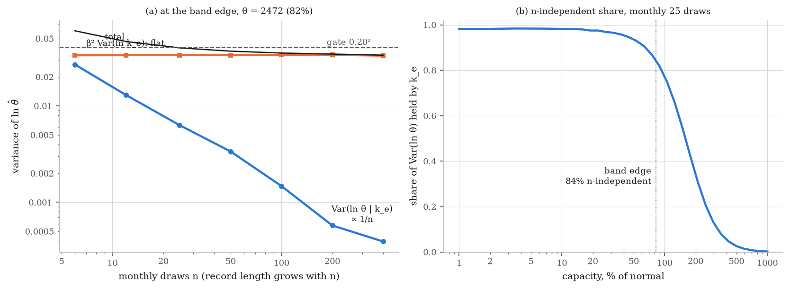

# Practical identifiability of enzyme capacity at 5% of normal

**Brief of 1 October 2026, worked on the repository's own footing, over three rounds (the original eight tasks, a six-point follow-up, and a nine-point round on conditioning, specification, and feasibility).** Every number comes from a script in this directory. `out/<script>.txt` holds each script's printed output and `fig/` its figures. The follow-up scripts (`t8`–`t11`, `t6c`, `t6d`) and the round-3 scripts (`t13`–`t19`) were re-derived by independent verifiers, by routes sharing no code with them; `t12` (the flux crossing) was not. Repository constants and the `n6` output this report quotes are printed in `out/t0_footing.txt` and `out/n6_profile_vs_crb.txt`. The footing is imported from `audit/n4_theta_scope.py`, not restated, and `core.fim` reproduces `n4.sd_ln_theta` to 1e-13. Claims that are assumed or not verified are collected in the [last section](#unverified-or-assumed).

> **Both headlines survive the parameters.** The two load-bearing conclusions — "no feasible design reaches 0.20 on the marker" and the ~19% flux contour — were stress-tested against K_m over a 4× range (50–200), assay CV 3–8%, load scatter 2–10%, the k_e-prior width, and the repo-vs-per-draw noise model: **both hold** (the feasibility sd stays ≥ 0.34; the flux crossing stays 18.8–20.2%) (R-B). The caveat that makes that test necessary: this is a **design study on a specified, simulated model, not an analysis of a cohort** — the repository holds no patient data (item 10; the brief's "24 patient records" was a mislabelling), so every number is conditional on the model and its constants. The saturation regime that governs which approximations hold is in R-A (at 5%, m/K_m ≈ 0.54, g ≈ 0.35 — sub-saturated).

## The decision

**The answer splits by clinical use.**

**1. Classifying absolute capacity — cross-sectional.** One route reaches sd(ln θ̂) = 0.20 at 5%: a single, absolutely-calibrated, off-therapy reading of the enzymatic flux to ~18% (the 0.20 contour is √(Y² + Z²) ≤ 18–19% in reading precision Y and calibration Z). **No marker-only cross-sectional design reaches it** — not a cohort, a washout, a drug burst at clinical assay quality, a load excursion within the safety limit, nor any amount of sampling at an achievable k_e. The table below is the cross-sectional picture.

**2. Monitoring within-patient change — longitudinal.** Here the marker reaches target *on its own*. The contrast sd(ln θ₂ − ln θ₁) is **≈ 0.13 for two weekly windows and ≈ 0.10 for two 6-month daily windows**, because the shared k_e, load calibration and K_m cancel — enough to detect a **+45% rise or −30% fall at 80% power** (weekly), needing no new assay (R-D). It depends on draws-*per-window*, not calendar span, so short dense windows suffice; but it holds only while k_e and the load calibration are stable between windows.

**3. The one recommendation that costs nothing: record antibiotic status.** It is a precondition for *both* routes and is currently absent from the load record. Gut-flora propionate is antibiotic-suppressible (~40% load swing under metronidazole), so an unrecorded antibiotic course between two monitoring windows fakes a capacity change of **+1 to +3 ln units (a 3–20× apparent rise)**, destroying the contrast, and it collapses the cross-sectional estimate as well (R-E). Recording it is free and mandatory.

The cross-sectional routes, for completeness — everything but the flux reading rests on an unobtainable premise, research-grade hardware, or is clinically inadmissible:

| route | verdict at 5% |
|---|---|
| **one calibrated flux reading (O ∝ θ·g) to Y ≤ ~18%** | **reaches 0.20** — but only if absolutely calibrated. The 0.20 contour is **√(Y² + Z²) ≤ ~18–19%** in the reading precision Y and the calibration precision Z (`t16`, R11). The requirement is flat at ~19% across capacities ~1–20% and only loosens above ~50% where the record alone nears 0.20 (`t21`, R-B). The repository's breath test reads a *fraction oxidised* with unknown recovery, which is off this contour until calibrated. |
| k_e known **exactly** + hundreds of draws | reaches 0.20 in principle (309 draws/2 yr) but **not feasibly**: k_e is achievable only to ~0.2 log units, and at that precision no sampling intensity reaches 0.20 (R12). |
| drug-forcing burst, peak 1500 | reaches 0.20 (0.131) only with a **research-grade 0.5% assay CV and κ known exactly** (`t10`). |
| load excursions large enough to reach 0.20 | **inadmissible** — every one sits past the parent model's crisis threshold of 1.177× baseline load (R15). |
| a cohort, a washout, a second-reading average, measuring the load | **none reach 0.20.** |

**Everything bottoms out at the load L.** The chain of failures has one root — the unrecorded load is never known well enough — and it appears in four places: (1) k_e's achievable precision is set by L₀: L₀ to 5% (the repo's prior) gives k_e to ~0.2, and the k_e ≈ 0.05 the target needs would require L₀ to ~1% (R-B); (2) L is 62% of the 0.39 variance partition at 25 draws (F1); (3) L₀ is the binding intercept of every washout design (Task 7); (4) the fraction-oxidised route reaches target only once L is measured to turn s into an absolute flux (R11). The one route that sidesteps the load entirely is the calibrated flux reading, which measures θ·g directly.

**And measuring L to 1% is still not enough on its own.** If L₀ were known to 1%, the safe transient pins k_e to ~0.06; combined with daily sampling for two years that reaches only **0.33** — short of 0.20. Reaching the target by this route needs k_e within ~0.04 of exact (L₀ essentially exact) *and* ~300 draws, which is not feasible. So tightening the load helps, but does not open a marker-only path to 0.20.

**If no calibrated flux assay exists, the deliverable is set identification, not a point estimate** (R16): the record pins a one-sided ceiling **θ ≤ 30.7% of normal** (balance + non-negativity + K_m), tightening to **22–25%** with the k_e prior, and it pins K_m (~6%), the clearance slope b = θg′+k_e (~28%), and a k_e-dominated combination (~8%) — but not θ itself, nor the untreated flux or fraction oxidised, which all inherit θ's ~3.0. A defensible ceiling beats an unreachable target.

*(Monitoring, claim 2 above, is detailed with its stress tests — minimum programme, detectable change, drift and antibiotic breaking points — in R-D.)*

### Supporting findings
- **The confounding.** ln θ and ln k_e are confounded (correlation −0.99 at 5%); k_e carries 98% of Var(ln θ̂). The likelihood already conditions on the per-draw recorded load L(t_k) and drug dose Δ(t_k), so the L–m covariation is inside the 3.07 (R9); the only load lever left is the systematic bias, worth little (R13).
- **No floor only when k_e is exact; otherwise there is a floor.** In one sentence: *with k_e exact the fall is 1/√n and crosses 0.20 near n ≈ 300 draws, but at the achievable sd(ln k_e) = 0.2 no sampling rate reaches even 0.30* (R12, R13). The 0.39 is not an n-floor in the first clause; the feasibility wall is the second. "k_e achievable to ~0.2" is itself not an external measurement — it is what a safe transient delivers when the unrecorded load L₀ is known to 5% (the repo's load prior); reaching the k_e ≈ 0.05 the target needs would require L₀ to ~1% (R-B).
- **Task 2 is closed as a negative result** (R14): at 24 patients with k_e shared the per-patient sd is 1.17 (still a factor 3.2 either way), and ω is unidentifiable from the available records under every likelihood tried.
- **The two-stage design is safe but short.** A mild, safe transient pins k_e to ~0.2 log units where it is nowhere near pinning θ, but k_e to 0.2 is not tight enough: the two-stage lands near 0.9, not 0.20 (R15).
- **The specification is untested, and largely untestable here.** All data is simulated from the one-compartment model; the monthly record is nearly blind to a second compartment and to saturable non-enzymatic clearance, though it can catch a time-varying load drift (R10).

## What changed across the three rounds

Several round-1 claims were overturned by later rounds. The causes:

| claim (round) | corrected to | what caused the change |
|---|---|---|
| "the 0.39 is an n-independent floor" (R1 framing) | **not a floor**: ~1/√n with k_e exact, no positive asymptote (R13) | decomposing bias vs scatter and pushing n → 10⁵; both load terms are learned from the dose-modulated operating point |
| "the washout is the safe route to 0.20" (R1) | **the washouts that reach 0.20 add substrate past the 1.177× crisis threshold; inadmissible** (R15, F3) | making the safety threshold a hard constraint and sourcing it to `boundary.tex` / Model C |
| "the one-pass EKF is a bug" (R2 suspicion) | **linearisation error, not a bug**; dropped as unfair (F5) | the exact information identity at the truth + error growth with prior width |
| "the FIM misleads in both directions" (R2 suspicion) | **exact in linear θ; a lower bound only in ln θ where θ̂→0** (F6) | 150–300-replicate Monte Carlo against the FIM |
| best washout "0.237, fails" (R2, 40 replicates) | **0.199, straddles** (F3) | the verifier's 150-replicate re-run |
| "flux ≫ k_e ≫ load; flux reaches 0.20 alone" (R1/R2) | holds, **but only if absolutely calibrated**: √(Y²+Z²) ≤ ~19% (R11) | the generic-observable + (s, L) analysis, and the breath-test reparameterisation |
| "at n=25 the load scatter costs more than the bias" (R3 draft) | **reversed**: the bias is modestly more binding (R13) | the item-13 verifier caught a `core.fim` coupling that silently pinned the bias in the scatter-off run |
| "a dense excursion detects saturable clearance at ~100% power" (R3 draft) | **overstated**: that test is size-invalid at large N; only strong saturation is detected at a size-valid N (R10) | the item-10 verifier found the true MM model is rejected at ~100% too (errors-in-variables) |
| "no feasible design reaches 0.20 on the marker" (R3) | **split in two**: true for cross-sectional classification; **monitoring within-patient change reaches ~0.13** (R-D) | asking for the longitudinal contrast, where the shared nuisances cancel |

## What the repository contains, and where the brief departs from it

| the brief says | the repository has | consequence |
|---|---|---|
| "~24 patient records" (and, in the follow-up, "the real cohort is 24 patients") | `design.run.SEEDS = range(24)`: **24 draws of one simulated patient's intake sequence**, all with k_e = 5. There is no patient data anywhere in the repository (README: "parameter values are illustrative, not fitted"). | Nothing can be "fit jointly across patients", and ω cannot be estimated from them: their between-record spread of k_e is 0 by construction (`t9`). There are no complete-deficiency records (`t5`). |
| "steady state only" | The 3.07 carries the **booked dose train**: Δ(t), D = 6000 every 14 d, 3.5 d half-life, known, acting on the enzyme channel. Draws are quasi-steady, and the recorded load varies by 10% day to day (`t0`). | Without the dose train the 5% figure is **8.59**. With constant load too, the FIM is singular. |
| FIM over (θ, k_e, K_m, L) of ln m | Flux-space FIM over (ln θ, ln K_m, b, ln k_e). b is a load-recording bias with a 5%·L prior; K_m has **no prior**; σ combines a 5% assay CV and a 5% load-record scatter. | Equivalent to first order. The finite-difference ln m route agrees to 3.9e-8 (`t0`); per-draw ln m noise gives 3.045 against 3.067. |
| "m/K_m ~ 10 at normal" | m = 10, K_m = 100: **m/K_m = 0.1**, ε = 0.909. | Untreated, the enzyme runs at 9% saturation at normal and 35% at 5%. Under therapy it runs at 3–10% at normal and 4–30% at 5% (`t0`). |
| "figure caption: median and range across records" | `n4_theta_scope.py` → `tab_S_scope`. Each seed is scored by its own FIM **at the truth**; nothing is fitted. | |
| "upper bound ruling out capacity above ~25%" | `n6_profile_vs_crb.py`: the median upper end of a **profile-likelihood** 95% interval, on 6 records with the k_e prior in force: 708, 24% (`out/n6_profile_vs_crb.txt`). | Prior-driven, not set identification (Task 4). |
| — | `design.run.delta` **stops after 200 doses** (day 2786), so draws on n4's GRID beyond about the 93rd are untreated. | Affects any "longer monthly record" result. `t8` uses a continued train; Task 3's n·Var figures are corrected below. |

The fixed parameters are normal θ = 3000, K_m = 100 and k_e = 5 /d, with L = 322.73 held as capacity falls (convention A). At 5% (θ = 150), m = 54.0 and s = θg/L = 0.163. Time is in days.

## Scenario table: sd(ln θ̂) at θ = 5% of normal

**For one patient, the FIM is right about the likelihood in linear θ, and is attained there in every single-patient scenario checked (`t11`, `t12`).** In ln θ it is optimistic wherever θ̂ can reach 0: on the current record, and with k_e exact or to 5%. There, ln θ Monte Carlo summaries depend on how θ̂ ≤ 0 is bounded. **In cohorts it errs both ways:** it understates the ln θ RMSE but overstates the robust spread, because the other patients' positivity constrains the shared k_e (F6). **Use the FIM for ranking. Treat its absolute values at 5% as optimistic for RMSE unless a Monte Carlo column says otherwise.**

Monte Carlo verdicts follow one rule: **pass** if the interval lies wholly below 0.20, **fail** if wholly above, **straddles** otherwise. Intervals are 90% bootstrap unless marked 95%.

| scenario | FIM | Monte Carlo (MAP) | source |
|---|---|---|---|
| **current design**: 25 monthly draws, therapy on, k_e prior 0.8 | **3.07** [2.66, 3.26] | RMSE 7.1 and robust 6.6, both set by the θ ≥ 1e-3 bound (35% of fits sit on it) | t1, t2, t11 |
| … with no therapy ("steady state only") | 8.59 | — | t1 |
| … plus one untreated baseline draw | 2.31 | — | t5 |
| … with k_e exact | 0.388 | robust 0.39–0.45; RMSE 0.64–1.49 across three independent Monte Carlos (heavy lower tail): fails | t8 recheck, t11, t11 recheck |
| … with k_e exact and the load measured exactly | 0.204 | 0.215–0.218 (t11: 95% [0.192, 0.240]): straddles | t8 recheck, t11 |
| k_e exact, **365 draws every 2 days** for 2 years | 0.195 | 0.219 (robust 0.199) | t8, t8 recheck |
| k_e exact, **730 daily draws** for 2 years | **0.151** | **0.151** | t8, t8 recheck |
| **joint cohort, 24 patients at 5%**, k_e shared exactly (ω = 0) | **1.17** | RMSE 2.34, robust 0.75 | t9 |
| joint cohort, 24 patients, ω = 0.33 | 1.82 | RMSE 3.90, robust 1.39 | t9 |
| joint cohort, 64 patients, ω = 0 | 0.81 (0.78 on the Monte Carlo's own records) | patient 0: RMSE 1.33, robust 0.52 (200 replicates) | t2, t11 |
| **washout**: diet withdrawn, hourly for 48 h, k_e prior 0.8 | **9.4** (383 with no priors) | — | t7 |
| washout + the monthly record + unrecorded load L₀ known to 1% | 0.62 | — | t7 |
| washout at 0.5% CV, every 5 min for 48 h, L₀ to 1% | 0.195 | 0.199 [0.179, 0.219] (150 replicates; t10's 40 gave 0.237): straddles | t10, t10 recheck |
| load ×3, every 5 min for 72 h, 5% CV, K_m from the record (inadmissible load) | 0.193 | 0.211 [0.191, 0.230] (150 replicates): straddles | t10, t10 recheck |
| load ×2, every 15 min for 72 h, 5% CV, L₀ to 1%, joined (inadmissible load) | 0.199 | 0.217 [0.201, 0.232] (300 replicates): **fails** | t10, t10 recheck |
| **drug burst** at the admissible peak (2850), every 15 min for 72 h, 0.5% CV, κ exact | 0.194 | **0.204 [0.185, 0.222]** (300 replicates): straddles | t10, t10 recheck |
| drug burst, peak 1500, every 5 min for 72 h (N = 865), 0.5% CV, κ exact | **0.124** | **0.131 [0.114, 0.149]** (150 replicates): passes | t10, t10 recheck |
| **direct enzymatic flux**: one untreated reading to 10% | **0.112** | **0.113 [0.110, 0.116]** (2000 replicates): passes | t5, t12 |
| … to 15% | 0.159 | 0.163 [0.158, 0.168]: passes | t5, t12 |
| … to 20% | 0.206 | 0.218 [0.211, 0.225]: **fails** | t5, t12 |
| … crossing of 0.20 | 19.3% | **18.4%** [17.9, 19.0] by RMSE; 19.35% by robust spread | t12 |
| … with the reading's recovery factor known only to 10% | crossing 16.5% | crossing **16.0%** [15.4, 16.6] | t12 |
| … three readings averaged, each to 15% | 0.097 | 0.097 | t12 |
| flux to 20% + k_e to 1.2 + load to 2% | 0.199 | 0.221, 95% [0.197, 0.244]: straddles | t5, t11 |
| k_e known to 5% (monthly record) | 0.445 | robust 0.49, RMSE 1.67: fails | t5, t11 |

## Which hypotheses held

| # | hypothesis | verdict |
|---|---|---|
| 1 | sd ≈ 0.17 at normal, ≈ 3.07 at 5%, band 82–627% | **Held exactly**: 0.1699, 3.0673 and 82.4–627.1%. It is on the dose-train footing, for one simulated patient. |
| 2 | U-shape with its minimum near 200–250% | **Held**: minimum 0.1226 at 212%. |
| 3 | corr(θ, k_e) → −1 as s falls | **Held**: −0.879 at normal, −0.991 to −0.992 at ≤10%. The high-capacity arm of the U is a different confounder: corr(θ, K_m) → +0.98. |
| 4 | amplification (1−s)/s = 5.1 at s = 0.16 | **Held** as the fixed-(m, L, K_m) derivative. The posterior's effective factor is β = −4.44 (−4.50 in the cohort limit with K_m known). |
| 5 | the binding constraint is k_e, not assay noise | **Partly wrong.** k_e is the dominant term, but exact k_e leaves 0.39. In that 0.39 the load record holds 62% and the assay 29% (`t8`). |
| 6 | elasticity −s/(sε + 1 − s) | **Held** to 3e-10. |
| 7 | m/K_m ≈ 10 at normal | **Wrong**: 0.1 (ε = 0.909). |
| 8 | the 24 records are fit one at a time | **They are not patients and are not fitted.** Each is scored by an FIM at the truth. |
| 9 | borrowing k_e across the cohort buys a lot for nothing | **Partly.** At N = 24 it buys 3.08 → 1.17 (FIM, for the same target patient) if k_e is genuinely shared, and 3.08 → 1.82 at ω = 0.33. It never reaches 0.20. |
| 10 | ~83% of the variance at the band edge is n-independent | **Held**: 84.3% exact, 83.9% from the sd(n) fit. The implied Var(ln k_e) is 0.638, which is the prior itself. |
| 11 | 15× sampling moves the edge only a few percent (82 → 75%) | **Held**: 82.4% → 75.1%. |
| 12 | set identification reproduces the ~25% upper bound | **No.** Non-negativity alone gives 30%, and only because the record pins K_m. The 22.4% (`t4`; n6's 24% on 6 records) is the k_e prior's lower tail. |
| 13 | direct flux > k_e > load, in value | **Held by FIM.** Monte Carlo confirms flux > k_e (`t11`, `t12`); no load-only scenario was run by Monte Carlo. |
| 14 | a complete-deficiency record gives k_e for free | **No such record exists.** In the parent model θ = 0 has no steady state. |
| 15 | λ → k_e because the enzyme is saturated | **Premise wrong**: the enzyme is not saturated. λ ≈ k_e at 5% only because θ is small, and θg′ is still 11–16% of λ. |
| 16 | FD regression: EIV attenuation and an MA(1) correlation of −0.5 | **MA(1) held**: −0.47 to −0.49 in the equation error. The bias is **not** classical EIV in m: noisy ψ sits on both sides and flips signs. **IV and bias-compensated LS do not fix it; generalised TLS with the MA(1) covariance does** (`t6c`). |
| 17 | the integral form is much better conditioned | **Only the 2-column saturated form, which cannot return θ.** My earlier "conditioning is not the issue" was wrong: the **noiseless** FD design is nearly collinear (cond 353 on TB-B, 4.8e4 on TB-A), and the noisy cond(X) of 26–104 hid that. |
| 18 | τ tension between derivative noise and aliasing | **At fixed duration, only for derivative estimators**: optimum 0.9–1.6/λ. For the efficient estimator at a fixed number of samples (N = 24) there is an interior optimum at about 0.3/λ. |
| 19 | conditioning depends strongly on the excursion | **Held**: cond[1, m, m²] goes from 76 to 18 as the peak m/K_m goes from 0.7 to 7.4. |
| F1 | 0.39 is an n-independent floor, so measuring L is mandatory | **No floor.** The fall is slow because of the load bias b (slope −0.22 to −0.33 against −0.5). An L measurement is necessary at monthly or weekly sampling, but **not sufficient** at 25 monthly draws (0.204; K_m must also be known). |
| F1 | the k_e share is 98% at 5% and ~83% at the band edge | **Held, as one curve**: 98.2–98.4% up to 10%, 93.5% at 50%, 84.3% at the band edge, 77% at 100%, 34% at 200%. |
| F2 | the plateau ≈ (1−s)/s · ω, so ω = 0.33 lands at ~1.55 | **Roughly.** Evaluated with (1−s)/s = 5.13, the formula gives 1.74 at ω = 0.33, against a computed 1.47: 14–26% high across ω = 0.2–0.5. Your ~1.55 lies closer. The posterior amplifies by β = 4.5, not 5.1, and the patient's own record shrinks k_e below ω. At ω = 0 the computed plateau is 0.38 (N → ∞, K_m known), or 0.43 at N = 1024, against your ~0.42. |
| F2 | estimate ω from the 24 real records | **Not possible: there are no real records.** 24 real monthly records could not estimate it either (confirmed under every likelihood). What would: each patient's own k_e measured to about sd 0.2, or every-2-day sampling in roughly 50–100 patients. |
| F3 | TB-A to TB-B: which factor? | **The excursion**: 63% of the change in log sd (no priors), then assay CV 19%, capacity 10% and sampling 8%. For NLS, the excursion is the one indispensable factor. |
| F3 | "×4 misses, ×6 passes" | **A sampling and duration edge, not an excursion threshold**: ×4 passes hourly over 72 h, or every 30 min over 48 h. |
| F4 | IV or TLS removes the FD bias | **IV and bias-compensated LS: no.** They need a CV of 0.01% or less. **Generalised TLS with the MA(1) covariance: yes**, matching NLS on TB-B. |
| F5 | the EKF degrading on TB-B is a bug | **One initialisation flaw, but not the cause.** P₀ ignored that m₀ is tied to the parameters, and tying it halves the TB-B RMSE (3.25 → 1.82). The dominant cause is one-pass linearisation error, which grows with the prior width: started at the truth it still gives 0.50 against a bound of 0.088. **Dropped** from the comparison. |
| F6 | the FIM misleads in both directions | **The FIM is right in linear θ.** "Optimistic at N = 1" compared it with a number set by the θ bound. "Pessimistic at N = 64" was a 60-replicate artefact. Only the core of the constrained MAP is narrower, and that is the positivity of the *other* patients' θ acting through the shared k_e (tested). |

---

## Follow-up results

### F1. The 0.39 is not a floor (`t8_floor.py`, rechecked)

**What holds the k_e-exact variance**, by Shapley share of Var(ln θ̂ | k_e) = 0.150 at 5%:

| factor | share | in your partition |
|---|---|---|
| load-record bias b | 29.2% | load record (b + scatter): **61.7%** |
| per-visit load-record scatter | 32.5% | |
| assay CV (per draw) | 29.1% | assay: **29.1%** |
| K_m | 9.3% | K_m: **9.3%** |

- **b and K_m have zero main effect.** With no per-visit noise the variance is 0. They act only through interaction with the noise, so order-dependent figures range widely: b takes 41% if removed first and 70% if removed after K_m.
- **Measuring the load exactly removes 72% of the variance** (0.388 → 0.204).
- Across 10–100% of normal the two σ terms hold 62–68%. b's share falls from 27% to 11%, and K_m's rises from 9% to 27%.

**The 0.39 against the number of draws, k_e exact, at 5%** (FIM; therapy continued past the repository's 200-dose cap):

| scenario | 25 monthly | 100 monthly | 600 monthly | 365 every 2 d | 730 daily | draws for 0.20 |
|---|---|---|---|---|---|---|
| k_e exact | 0.388 | 0.277 | 0.162 | 0.195 | 0.151 | 324 in 2 y, or 328 monthly (27 y) |
| + load bias b exact | 0.298 | 0.147 | 0.060 | 0.084 | 0.056 | 58 monthly |
| + load measured exactly (b and scatter) | 0.204 | 0.101 | 0.041 | 0.057 | 0.038 | 29 monthly |
| + K_m and b exact | 0.194 | 0.095 | 0.039 | 0.054 | 0.036 | 24 monthly |

- **No n-independent floor.** A fit of √(floor² + c²/n) over n = 6–600 gives a floor of 0.189, but it fails out of sample: it predicts 0.190 at n = 6000, where the FIM gives 0.059.
- **The load bias is what makes the fall slow.** With b at its prior, the local slope of ln sd against ln n is −0.22 (25–50 draws), −0.33 (400–600) and −0.48 (2400–6000): the prior on b is slowly overtaken by the data. The record barely updates b: its posterior/prior sd is 0.96 at 25 draws and 0.64 at 365. With b exact the fall is pure 1/√n.
- **So the answer to "mandatory or optional" is in between.**
  - At monthly or weekly sampling an independent L measurement is **necessary but not sufficient**. At 25 monthly draws, k_e exact plus the load exact gives 0.204 (Monte Carlo 0.215–0.218), and K_m must also be known: 0.194 with K_m and the load bias exact, or 0.133 with the load fully exact.
  - With near-daily sampling it is optional: 730 daily draws with k_e to 2% give 0.176 (FIM).
  - k_e to 5% fails everywhere in the grid.
- **Requirements for 0.20 (FIM)**, with the load as recorded unless stated:

  | draws | k_e needed | other conditions |
  |---|---|---|
  | 730 daily | 2.9% | — |
  | 365 every 2 d | 1.0% | — |
  | 100 every 7.3 d | 2% | load bias and scatter both to 2% |
  | 25 monthly | exact, 1% or 2% | K_m exact **and** the load bias b exact (scatter kept: 0.194 with k_e exact, 0.199 with k_e to 1%); or k_e 2% with b and scatter both to 1% (0.196) |
- **Caveat from the recheck: the CRB is not attained at the deciding designs.** Monte Carlo with k_e fixed gives:
  - 25 monthly draws: RMSE 0.643 against a CRB of 0.388 (9% of fits off by more than 2×).
  - 365 every 2 d: 0.219 against 0.195.
  - 730 daily: 0.151 against 0.151.

  So 365-every-2-day designs are at best on the edge of 0.20. Per-record CRBs there span 0.185–0.206, and 17% of records miss.
- **The k_e variance share, as a curve** (25 monthly draws, median over 24 records):

  | capacity, % of normal | 1–10 | 20 | 50 | 63 | 82.4 (band edge) | 100 | 158 | 200 | 316 | 627 | 1000 |
  |---|---|---|---|---|---|---|---|---|---|---|---|
  | k_e share of Var(ln θ̂) | 98.4–98.2% | 97.7% | 93.5% | 90.4% | 84.3% | 77.2% | 50.2% | 34.2% | 11.1% | 1.2% | 0.2% |

  Your 1 − (0.39/3.07)² = 0.9839 at 5% and the ~84% at the band edge are two points on this curve (0.9838 and 0.8425).

### F2. N = 24, and ω (`t9_omega.py`, rechecked by `t9_omega_recheck.py`: headline confirmed; the every-2-day and sample-size claims corrected)

**Task 2 read at N = 24** (FIM; target patient at 5%; the patient's marginal prior on ln k_e stays 0.8):

| ω | 24 patients at 5%: sd ln θ̂ | population sd ln k_e | patient's own sd ln k_e | mixed 5–20% cohort: sd ln θ̂ |
|---|---|---|---|---|
| 0 | **1.17** | 0.25 | 0.25 | 1.44 |
| 0.1 | 1.25 | 0.25 | 0.27 | 1.50 |
| 0.2 | 1.46 | 0.25 | 0.32 | 1.66 |
| 0.33 | **1.82** | 0.26 | 0.40 | 1.97 |
| 0.5 | 2.31 | 0.26 | 0.51 | 2.40 |

- **Monte Carlo joint MAP at N = 24** (60 replicates):

  | ω | RMSE | robust | fits more than 4.5× off |
  |---|---|---|---|
  | 0 | 2.34 | 0.75 | 8% |
  | 0.33 | 3.90 | 1.39 | 25% |

  The FIM understates the ln θ RMSE here and overstates the robust spread, as F6 explains.
- **Your plateau approximation**, √(0.39² + ((1−s)/s·ω)²), gives 1.10, 1.74 and 2.60 at ω = 0.2, 0.33 and 0.5. The computed plateau is 0.96, 1.47 and 2.07, so the approximation is 14–26% high. At ω = 0 the computed plateau is 0.38 (N → ∞ with K_m known) and 0.43 at N = 1024, against your ~0.42. The amplification actually applied is |β| = 4.50 rather than (1−s)/s = 5.13, and the patient's own record shrinks their k_e uncertainty to 0.90–0.98 ω.
- **ω cannot be estimated from the repository.** Its 24 records have one k_e value (5.0) by construction.
- **Would 24 real monthly records identify ω? No.** Simulated cohorts of 24 at 5%, each patient's data-only ln k_e summarised and ω profiled (4000 cohorts per cell):

  | design | true ω | typical 95% interval for ω | share excluding ω = 0 |
  |---|---|---|---|
  | 24 at 5%, monthly | 0 | **[0, 0.89]** | 1% |
  | 24 at 5%, monthly | 0.33 | **[0, 1.00]** | 4% |
  | mixed 5–20%, monthly | 0.33 | [0, 1.22] | 4% |
  | 24 at 5%, every 2 d | 0.33 | [0, 0.54] | 49% |
  | 24 at 5% monthly, + each patient's k_e measured to sd 0.2 | 0.33 | [0.21, 0.47] | 99% |

  The reason is that one monthly record gives each patient's ln k_e only to sd ≈ 1.06 with no k_e prior, three times larger than the ω being sought. The independent recheck simulated **raw** records rather than per-patient summaries. It used three likelihoods: θ ≥ 0 profiled, θ integrated over [0, ∞), and the exact restricted likelihood with θ unconstrained. It also ran a Bayesian posterior with a half-normal(1) prior. Its findings:

  - **Monthly: confirmed under every likelihood.** At a true ω = 0.33 the test rejects ω = 0 in 0–5% of cohorts. The posterior P(ω > 0.2) is 0.43 at a true 0 and 0.59 at 0.33, against a prior of 0.84, and never exceeds 0.95. Letting capacities vary between patients does not change this.
  - **The interval width depends on the likelihood; the conclusion does not.** The exact restricted likelihood gives upper ends of 1.05 and 1.17, so the Gaussian summary is about 15% too narrow. The θ ≥ 0 likelihoods give narrower upper ends (about 0.46 and 0.61), but those come from bias towards ω = 0, not information: every 2 days they cover the true 0.33 in only 63–70% of cohorts.
  - **Every-2-day sampling: refuted at 24 patients.** From raw records the test rejects ω = 0 in 32–53% of cohorts at a true 0.33, not ~50–60% as the Gaussian summary suggests. 80% power needs roughly 50–100 patients: 50–60% at 48, 90–100% at 96. t9's asymptotic "33 patients" is optimistic even inside its own model (72% at 33).
  - **Monthly power.** t9's "about 1200 patients" gives 77% power inside the Gaussian model; with θ ≥ 0 imposed, power is lower.
  - **A per-patient k_e measurement to sd 0.2: confirmed.** At a true 0.33 the interval excludes 0 in 100% of 40 cohorts, with coverage of 0.33 at 90%.
- **The repository's only information on ω** is brief R1's "probably a third or more", for "the nearest comparable disposal rate" in healthy adults; there is no 3-HP figure (`q14_hierarchical.py:19-30`, `PHASE8_SIMULATIONS.md:721-723`). `PHASE10_SENSORS.md:486-494` adds that R1's figure is for the marker's clearance, not the model's k_e/α, so the true spread could be larger. The only other figure is `params.py:363-367`, a 51% between-subject spread in the 3-HP *baseline* between mice of one inbred strain. The repository reads that as a lower bound on between-patient variability, and it is not a k_e figure. No number in the repository measures ω.

### F3. TB-A against TB-B, and whether 5% can reach 0.20 at all (`t10_factorial.py`, rechecked)

**Factorial attribution.** The 2⁴ FIM factorial reproduces both benches exactly (383.3 and 0.089). The change in log₁₀ sd from TB-A to TB-B is −3.63, attributed by Shapley share:

| factor | share |
|---|---|
| excursion (diet out → ×6 load) | **63.4%** |
| assay CV (5% → 1%) | 19.2% |
| capacity (5% → 20%) | 9.5% |
| sampling (1 h → 15 min) | 7.8% |

Main effects carry 99.3% of the variance across the 16 cells; the only material interaction is capacity × excursion. On the "k_e 0.8 + K_m from the record" rung the shares are excursion 48%, capacity 22%, assay CV 22% and sampling 8%.

**For NLS the excursion is the one indispensable factor.** Starting from TB-B and putting back a single TB-A setting:

| TB-B with … at its TB-A value | NLS RMSE | FIM |
|---|---|---|
| nothing (TB-B itself) | 0.100 (recheck, 200 replicates: 0.088) | 0.089 |
| capacity | 0.38 | 0.32 |
| sampling | 0.21 (recheck, 200 replicates: 0.171) | 0.17 |
| assay CV | 0.51 | 0.45 |
| excursion | **1.30, and every fit fails** | 29.7 |

The other three degrade NLS roughly in line with the FIM. Starting from TB-A, no single TB-B factor rescues it: RMSE stays at 3.3–4.1.

**A 5% patient on TB-B's other settings** (15-min sampling, 1% CV, ×6) has FIM sd 0.32 with no priors and 0.07 on the rung. **So capacity by itself does not block 0.20.** What blocks it is that the excursions able to reach 0.20 add substrate.

**The 5% design frontier.** I scanned 5280 designs:
- sampling every 5–60 min, for 24–72 h;
- assay CV 0.5–5%;
- excursions: diet withdrawal of 25% or 50%, load ×1.5 to ×8, or a drug burst at peak 450, 1500 or 2850;
- the full knowledge ladder, alone or joined to the record.

1422 pass by FIM. The cheapest passes per class, with an explicit cost order (safety class first, then knowledge that must be bought, then assay CV, then samples):

| class | best route to 0.20 (FIM) | Monte Carlo |
|---|---|---|
| **no added substrate** (drug burst, diet withdrawal) | **none at 5%, 2% or 1% CV**: 0 of the grid. At 0.5% CV: drug 2850 at N = 289 gives 0.194; drug 1500 at N = 865 gives 0.124; withdrawal 50% with L₀ to 1% at N = 577 gives 0.195. | drug 2850 0.204 [0.185, 0.222], straddles; drug 1500 **0.131 [0.114, 0.149], passes**; withdrawal 0.199 [0.179, 0.219], straddles (t10's 40 replicates gave 0.237) |
| load ×1.5 | not at 5% CV; at 2% CV with N = 865, joined, on intake seed 0 (passes in only 7 of 24 seeds) | — |
| load ×2, 5% CV | L₀ to 1%, every 15 min for 72 h, joined: 0.199 | 0.217 [0.201, 0.232] (300 replicates), **fails** |
| load ×3, 5% CV, no bought knowledge | every 5 min for 72 h (N = 865): 0.193, with 36 h of load; 0.205 if the load is held only 24 h | 0.211 [0.191, 0.230] (150 replicates), straddles |
| load ×4, 5% CV, no bought knowledge, joined | every 5 min for 48 h: 0.199 | — |

- **The earlier "×4 misses (0.205), ×6 passes (0.176)" is a sampling-and-duration edge** at hourly sampling over 48 h, not an excursion threshold. ×4 passes hourly over 72 h (0.182), and every 30 min over 48 h (0.174).
- **κ matters at small N.** At N = 289 the drug burst needs κ known exactly: with κ to 12% the 2850 burst gives 0.345. At N = 865 it passes by FIM with κ to 12% (0.182; no Monte Carlo).
- **Load excursions sit past the repository's own crisis threshold.** The parent model's fold is at 1.18× baseline load (`results/numbers/boundary.tex: fold_load_ratio = 1.177`, printed by `t0`, for a 10%-capacity patient). Every load-up excursion in this table is therefore beyond the point where the parent model has no steady state.
- **Answer.** At the clinical 5% assay CV, no design that adds no substrate reaches 0.20, even by FIM. At a research-grade 0.5% CV, the drug-1500 burst (865 samples, κ exact) passes by Monte Carlo. The drug-2850 burst and a 50% withdrawal with L₀ to 1% straddle 0.20. Load excursions are not admissible. Only five designs were checked by Monte Carlo, so the other FIM passes are unconfirmed. Two corrections to the earlier Task 7 text follow below.

### F4. One fix for the FD estimator (`t6c_iv.py`, rechecked)

- **The noiseless FD design is nearly collinear**: ψ₀ is almost a quadratic in m along the path. In midpoint form, cond(X₀) is 4.8e4 on TB-A, 353 on TB-B and 1234 on bench C (5%, ×6, 15 min, 1% CV). The noisy cond(X) that t6 reported (about 25 on TB-B, 93–104 on TB-A) is inflated by the noise in ψ.
- **The psi column carries almost no independent signal.** Its partial signal-to-noise ratio, off [1, m, m²], is 0.0016 on TB-B and 7e-5 on C. So OLS's K_m coefficient goes to its noise-only limit: −266 on TB-B (exact limit −265.5, Monte Carlo −265.1).
- **Instrumental variables do not fix it.** I tried instruments from samples k−1 and k+2 (IV-JI, 2SLS, GMM with an MA-robust weight) and a heteroscedasticity-weighted IV. In the midpoint form they still return θ̂ ≤ 0 in 33–61% of records on TB-B and on C (up to 85% in the left-point form). The instruments look strong overall (first-stage R² 0.89) but are weak in the direction that identifies K_m (conditional R² 0.019).
- **Bias-compensated LS does not fix it either**, even with the exact lognormal moment correction, which is verified unbiased. The corrected X′X is positive definite in only about half the records.
- The unweighted linear corrections become consistent only at an assay CV of 0.01% or less. The weighted IV and weighted BCLS approach consistency at 0.1% on TB-B; on bench C everything needs 0.01% or less.
- **Generalised TLS with the row-wise MA(1) (tridiagonal) noise covariance does fix it** (GTLS-t, midpoint form).

  | | TB-B: bias / RMSE / robust | bench C: RMSE / robust |
  |---|---|---|
  | GTLS-t | −0.016 / 0.090 / 0.084 | 0.43 / 0.34 (recheck: 0.57 / 0.37) |
  | NLS | −0.011 / 0.079 / 0.085 | 0.37 / 0.31 (100 records) |
  | FIM sd | 0.089 | 0.32 |

  The left-point form is discretisation-biased. On TB-A nothing works, because the bench carries no information.
- **So:** OLS-FD and every linear correction of it is a clean negative result, with the mechanism quantified above. The FD equation itself is usable if it is estimated with its correct noise covariance. At that point it is a reparameterised NLS, and offers no advantage over fitting the ODE.

### F5. The one-pass EKF: one initialisation flaw, but linearisation is the cause; dropped (`t6d_ekf.py`, rechecked)

- **No algebraic error.** A copy of t6's filter reproduces t6's numbers exactly. On noiseless data at the truth, its posterior sd equals the FIM+prior bound to five digits (0.08922). The log-state Jacobian matches finite differences to 3e-4. Process noise is irrelevant: q = 0 gives the same result. And an iterated measurement update is a no-op, because the measurement is linear in the log-state.
- **One real inconsistency, which is not the cause.** The diagonal P₀ ignores that the initial marker is a deterministic function of the parameters. Tying it improves RMSE from 3.25 to 1.82 on TB-B.
- **The cause is one-pass linearisation error, which grows with the prior width.**
  - Started *at the truth* with t6's prior width, it still gives RMSE 0.50 while reporting sd 0.05.
  - Narrowing the prior to ×0.1, ×0.3, ×0.5 and ×1 gives RMSE 0.028, 0.093, 0.261 and 0.503.
  - Tied P₀, annealed parameter noise, lag-1 re-linearisation and a cubature filter all fail. The best robust spread is 0.66, against a bound of 0.088.
- **"Wider on TB-B" is mostly one record.** 83% of the EKF's sum of squared errors on TB-B comes from a single record. By robust spread it is *narrower* on TB-B (1.07) than on TB-A (1.63), where it simply returns its prior.
- **Decision: the one-pass EKF is dropped from the comparison.** It stays in t6's printed table, labelled as not a fair comparator, and is removed from t6's figure. The iterated EKF smoother is the Kalman entry, with a caveat: only its robust core matches NLS (0.082 against 0.085). Its TB-B RMSE of 0.328 is 4.2× NLS's because a few fits fail, so it too fails t6d's fairness criterion on RMSE.
- **The verifier's corrections.**
  - NLS started only from the drawn prior centre gives RMSE 0.085, identical to the truth-start in 40 of 40 records, so NLS is a like-for-like benchmark.
  - A one-pass Liu–West particle filter reaches a robust spread of 0.15–0.18, so the right statement is "no *Gaussian* one-pass filter is a fair comparator".

### F6. Where the FIM misleads, and the Task 5 spot-checks (`t11_fim_check.py`, rechecked)

- **Given (K_m, k_e), each θᵢ enters linearly.** So the FIM describes a Gaussian likelihood in **linear θ**, and with an sd of 3.0θ at N = 1 and 0.78θ at N = 64, θ̂ ≤ 0 is common. Every ln θ summary then depends on how that is handled.
- **N = 1.** 33.5% of fits sit on the θ ≥ 1e-3 bound. The robust spread is 5.4, 6.6 and 8.9 for bounds of 1e-2, 1e-3 and 1e-5, so t2's "6.6" measured the bound, not the data. Unconstrained, the linear-θ spread is 3.27 against the FIM's 3.04.
- **N = 64.** t2's RMSE of 0.49 was a 60-replicate artefact. With 200 replicates, patient 0's RMSE is 1.33 [0.55, 1.98], above the FIM's 0.78, and pooled over all 64 patients it is 1.47.
- **Why only the core is narrower than the FIM** (robust 0.52, about 0.67× the FIM from N = 8 to 64): positivity of the **other** patients' θ, acting through the shared k_e. The verifier tested this directly. Constraining only the other patients reproduces the full narrowing (0.556); constraining only patient 0 does nothing (0.704, equal to unconstrained). It also makes the MAP biased upward, by +0.04 to +0.12 in median ln error depending on the draws. The unbiased-estimator CRB does not bound a biased estimator, so there is no contradiction.
- **The Monte Carlo machinery was checked** on an exactly linear-Gaussian surrogate. It passes at N = 1 and 16. At N = 64 it falls just outside the 95% band on t11's draws and inside it on the verifier's independent draws.
- **Task 5 spot-checks**, 240 replicates each:

  | scenario | FIM | MC RMSE | MC robust | Monte Carlo verdict |
  |---|---|---|---|---|
  | flux reading to 10% | 0.112 | 0.118 | 0.113 | passes |
  | flux reading to 20% | 0.206 | 0.227 | 0.218 | fails |
  | k_e exact + load exact | 0.204 | 0.215 | 0.197 | straddles (95% [0.192, 0.240]) |
  | flux 20% + k_e 1.2 + load 2% | 0.199 | 0.221 | 0.202 | straddles (95% [0.197, 0.244]) |
  | k_e exact | 0.388 | 1.49 (bound hits) | 0.45 | fails |
  | k_e to 5% | 0.445 | 1.67 | 0.49 | fails |

  The two flux rows were re-run with 2000 replicates on fresh draws (`t12`): RMSE 0.113 at 10% and 0.218 at 20%, robust 0.111 and 0.206. The verdicts are unchanged.

  The ranking survives except for a tie at ranks 2–3. In linear θ the FIM is attained in every scenario (linear RMSE/FIM 0.99–1.06). With k_e exact or to 5%, the ln θ profile reaches θ near 0 in 28–38% of records on the verifier's independent draws (t11's own 24-draw profile set is skewed, P = 0.0014). So the FIM's symmetric ln θ interval is optimistic on the low side. Only the flux reading clears 0.20 by Monte Carlo. `t12_flux_mc.py` locates the crossing with 2000 replicates per point on fresh draws, checked to be representative: **18.4% [17.9, 19.0]** by RMSE and 19.35% by robust spread, against 19.33% by FIM. The FIM is attained in linear θ (linear RMSE/FIM 1.003–1.006). If the reading's recovery factor is known only to 10%, the crossing is 16.0% [15.4, 16.6].

---

## Round 3: conditioning, specification, and feasibility

### R9. What the likelihood conditions on (`t13_conditioning.py`)

The likelihood **conditions on the per-draw recorded load L(t_k) and the per-draw drug increment Δ(t_k)**, not on one constant load per patient. Each marker m(t_k) solves the balance at its own recorded load and dose (`m` recomputed from (load_k, inc_k) matches the record exactly); doubling the booked dose doubles Δ exactly. The only load quantity treated as unknown is a single systematic bias b (prior 5% of L, the one constant column of `flux_rows`).

Consequence: the L–m covariation is **already inside the 3.07**. Holding the load flat makes the record slightly *worse* (3.06 → 3.14), so the day-to-day variation is mild signal, not discarded noise; pinning the bias (measuring L exactly) moves 3.06 → 3.03, almost nothing at 5% because k_e dominates. Ideas that relied on unused L–m covariation are already counted; the only load lever is the bias (R13).

### R10. Is the model right? Residual diagnostics (`t19_residuals.py`)

**Caveat first:** all data is simulated from the one-compartment Michaelis–Menten model, so MM residuals are white by construction. This is a **power analysis of the diagnostic**, not a test of the model — a real test needs real data, which the repository does not have.

Residuals from the MM fit, regressed on marker / time / load, with power at the repository's noise (25 monthly draws, 5% CV) against three misspecified data-generating processes:

| misspecification | monthly record | load excursion |
|---|---|---|
| second compartment (slow exchange pool) | **blind** (identical steady-state balance; shows only in the transient decay, 5–15% of the rate) | — |
| saturable non-enzymatic clearance (k_e·m → Vₙₑ·m/(Kₙₑ+m)) | **nearly blind** (power ~5% at n=25; narrow on-therapy m-range looks linear) | carries the signal, but see below |
| time-varying load drift (10–20%, zero-mean) | **detected** (residual-vs-time power 88–100%) | — |

Two cautions the verifier earned. (i) The residual-vs-marker test is degenerate (the MM fit is itself a marker model). (ii) **A dense excursion's residual-slope test is size-invalid**: a noisy nonlinear regressor (errors-in-variables) inflates the false-positive rate, so at 5-min sampling (N≈577) the test rejects even the *true* MM model at ~100%. At a size-valid sampling (hourly, N≈49, true-MM rejection ~0%) only **strong** saturable clearance is genuinely detected (Kₙₑ=60: 64%); **mild** saturation (Kₙₑ=150) is not. So the load-record assumption is checkable from the monthly record, but a second compartment and mild saturable clearance are not — and even a rich excursion detects only strong misspecification, with a size-corrected test. **Model criticism and θ-identification need the same richer data, and neither is free.**

### R11. The flux observable as a specification (`t16_flux_observable.py`)

Treating the observable as a specification, not a biological claim:

- **Generic observable O = c·θ·g(m), calibration c unknown to Z.** The 5×5 FIM collapses *exactly* (gap 3e-16) to a single calibrated reading at Y_eff = √(Y² + Z²). So the 0.20 contour is **√(Y² + Z²) ≤ 19.3% (FIM) / 18.4% (Monte Carlo)**. **Requirement sentence:** *an observable proportional to the enzymatic flux, read to Y% with calibration known to Z%, reaches sd(ln θ̂) = 0.20 at 5% of normal iff √(Y² + Z²) ≤ ~18–19%.* Averaging n readings divides Y by √n but **not** Z: a single shared calibration is the floor, so three readings still need Z ≤ 19% alone.
- **Reparameterisation (s, L).** If the reading is the fraction oxidised s = θg/L, then (s to Y%, L to X%) reaches target on the **same locus** (crossing Y ≈ 19.7%, weakly dependent on X): s and L enter as ln(flux) = ln s + ln L, so measuring L plays essentially the role of calibrating c. (Not *exactly*: X tightens the bias prior, which the 26 marker draws already partly constrain, so hypot(Y*, X) drifts 19.7 → 20.2% as X goes 0 → 5% rather than staying flat — the verifier's nuance.) Switching to the fraction oxidised buys nothing; it only moves the calibration burden onto an independent L.
- **The breath test.** It reads a fraction oxidised y = c·F(m) with recovery c unknown (round 2, `u2_breath_functional.py`). It can deliver the relative reading (a Y) but **not** the absolute calibration (its Z). With c entirely unknown, one reading is off the contour. It reaches target only if **both** its recovery is calibrated to Z ≤ ~18% **and** the load is known, with √(Y²+Z²+X²) ≤ ~18–19%. Whether such a calibration exists is a domain question, not answered here.

### R12. The k_e-precision / sampling trade-off surface (`t14_ke_sampling.py`)

sd(ln θ̂) at 5% over (external precision sd(ln k_e), draws per year over a two-year programme), replacing the unobtainable "k_e exact" premise:

- The **0.20 contour** is reached only at k_e essentially exact: 309 draws/2 yr (≈155/yr) with k_e exact; **sd(ln k_e) = 0.05 does not reach 0.20 by 730/yr**, and ≥ 0.10 does not reach 0.30.
- At the **achievable** precision sd(ln k_e) = 0.20, sd(ln θ̂) stays **0.81–0.96** from 24 draws up to daily for two years.
- **There is no feasible point on the 0.20 contour.** Reaching it needs k_e tighter than ~0.05 log units, which the project's own estimate (~0.2) rules out. The "0.195 at 365 draws" of round 2 was conditional on k_e *exactly* known.

### R13. Does the fall asymptote? Load bias vs scatter (`t15_load_asymptote.py`)

- **n → ∞ with k_e exact: the limit is 0, not a floor.** sd(ln θ̂) falls as ~1/√n (sd·√n drifts slowly up toward ~4.6 as the priors wash out, log-log slope −0.497); 0.38 at n=25, 0.15 at 730, 0.03 at 2×10⁴. Neither the load bias nor the scatter creates a positive floor — both are learned from the dose-train modulation of the operating point. So 0.151 at 730 draws is **not** flattening toward a floor; **Task 2 is not answered by an asymptote, it is answered by feasibility** (R12).
- **The bias is modestly the more binding of the two load terms** (your premise holds). At n=25, pinning the *bias* (measuring L exactly) buys +0.094, against +0.073 for removing the per-draw *scatter* — the bias wins in 8/8 seeds and by Shapley (0.105 vs 0.084). _[An earlier draft reported the opposite; that was a bug — `core.fim` ties the default bias prior to `load_frac`, so a "scatter-off" run silently pinned the bias too. Caught by the item-13 verifier and corrected.]_ Neither is a floor.
- **Costing an L measurement.** Measuring L to 1–2% takes the n=25, k_e-exact value from 0.38 to ~0.30, but does nothing to the n → ∞ limit and almost nothing when k_e is the binding nuisance. L binds in three places — the 0.39 partition (small), the washout intercept L₀ (the biggest washout-ladder rung, but the washout is inadmissible on safety), and the flux route's calibration (R11) — and is only decisive in the third.

### R14. Task 2 is closed as a negative result

At 24 patients, all at 5%, with k_e genuinely shared, the per-patient sd is **1.17** (a factor of 3.2 either way) — still uninformative. ω is **unidentifiable** from the available records under every likelihood tried, and the repository holds no real records to estimate it from. The mechanism (the shared-k_e core is narrowed only through the other patients' positivity, which borrows little at ω ≥ 0; the between-record k_e spread is 0 by construction) is in F2 and Task 2. No further work is warranted; the recheck already committed stands.

### R15. The safety threshold as a hard constraint, and the two-stage design (`t17_two_stage.py`)

- **The threshold, sourced and flagged.** `results/numbers/boundary.tex`: the parent model (Model C / ParamsC) loses its steady state when the load exceeds **1.177× baseline** (= 380). This is a **modelling construct** — a saddle-node of ParamsC's R0 setting — not a measured clinical crisis level; `src/model_A/run.py:35–40` states only the *ratio* (~1.5×) as "the physiological claim". The load ratio is model-independent (the fold *marker* 276 is Model C's, not Model A's — at the fold load Model A's marker is ~64). The repository's one clinical-labelled figure, M_TOL = 40, is a target, not a ceiling (the untreated 5% marker is already 54). The hard bound used here: an added-substrate excursion must keep the load below **1.177×**; withdrawals and the drug channel add no substrate and are admissible by construction.
- **The gap, as a figure.** Every sustained load excursion that drives sd(ln θ̂) below 0.20 crosses at **f ≈ 2.3× baseline** — about twice the admissible edge. The admissible band (shaded) never reaches 0.20.
- **The smallest excursion that pins k_e.** The relaxation rate λ = θg′(m) + k_e is k_e-*dominated* (≈1.13 k_e at 5%, the θ-term ~11%; R-A), not equal to k_e — so a *mild, safe* transient (even withdrawing 25% of the diet, marker dropping 54 → 47) still pins **k_e to ~0.2 log units** while leaving sd(ln θ̂) ≈ 1.2, because pinning k_e tolerates the small θ-contamination that pinning θ cannot. k_e's precision is capped by the unrecorded load L₀: ~0.2 at L₀ to 5%, ~0.06 at L₀ to 1%. Tightening k_e past 0.06 needs L₀ measured (R13).
- **The two-stage cost.** Safe k_e transient, then n steady-state draws for θ:

  | draws (2 yr) | k_e ≈ 0.20 (L₀ 5%) | k_e ≈ 0.06 (L₀ 1%) | k_e exact (ref) |
  |---|---|---|---|
  | 24 | 0.96 | 0.49 | 0.41 |
  | 52 | 0.93 | 0.42 | 0.32 |
  | 104 | 0.89 | 0.38 | 0.27 |
  | 365 | 0.81 | 0.33 | 0.19 |

  **The two-stage is safe and feasible but does not reach 0.20.** With a realistic L₀ it lands near 0.9; with L₀ measured to 1% it reaches ~0.25–0.30 only with hundreds of draws. k_e to ~0.2 is simply not tight enough (R12), and the safe transient cannot do better without also solving the load-measurement problem. The user's intuition — that pinning k_e needs a far smaller excursion than pinning θ — is **correct**, but it does not rescue θ.

### R16. Set identification elevated: what is recoverable (`t18_set_id.py`)

If no feasible design reaches 0.20, the deliverable is what the record *does* fix.

- **The one-sided bound on θ** (balance θg(m) + k_e m = L at the untreated state, L/m = 5.97/d): with K_m from the record, θ ≤ **30.7%** of normal under non-negativity alone, **25.3%** at the k_e prior's 95% low end. The lower bound is 0 — no record rules out a near-complete deficiency. The deliverable is a **ceiling on capacity**, not a point.
- **What the record pins, and what it does not** (median over 24 seeds):

  | quantity | sd(ln ·) | recoverable? |
  |---|---|---|
  | θ (capacity) | 3.05 | no |
  | a = θ·g(m)² | 3.13 | no |
  | untreated flux θ·g(m₀) | 3.09 | no |
  | fraction oxidised s | 3.08 | no |
  | K_m | 0.062 | **yes (~6%)** |
  | clearance slope b = θg′(m) + k_e (≈ λ) | 0.28 | **yes (~28%)** |
  | best (ln θ, ln k_e) combination (k_e-dominated) | 0.084 | **yes (~8%)** |

  The record identifies the **local clearance curve** (its slope and K_m), hence k_e, but not the capacity: the enzyme's own curvature a = θg² is swamped at this operating point. Neither the flux nor the fraction oxidised is a reparameterisation that escapes θ — they *are* θ, up to the pinned g and L.
- **Complete-deficiency check** (asked in Task 5, answered here): all 24 records have θ = 150; none is a θ ≈ 0 patient. If one existed at an untreated steady state, θg ≈ 0 would give k_e = L/m directly with no confounding — a tight prior at no cost. But in the parent model a θ = 0 patient has **no steady state**, so the counterfactual cannot be realised within the model.
- **Validation against the parent model.** The θ ≤ 22–25% ceiling here reproduces the parent model's published statement that the data "rule out capacity above about a quarter of normal" (`n6_profile_vs_crb.py`'s 708 = 24%, `out/n6_profile_vs_crb.txt`). An independent arrival at the same bound is a check that this pipeline matches its source, not just an internal result.

---

## Round-3 close-out

### R-A. The saturation regime, the integral collapse, and why the dynamic route fails (`t20_saturation.py`)

**A correction the brief's author flagged, and the explanation it unlocks.** The enzyme is **not** saturated in the disease range: at 5%, m/K_m ≈ 0.54 and g ≈ 0.35, so λ = θg′(m) + k_e = **1.13 k_e**, with the θ-term carrying **11%** of λ — of the same order as the precision we want, not negligible. The regime across capacity (K_m = 100):

| capacity | untreated m | m/K_m | g | on-therapy g (median) |
|---|---|---|---|---|
| 1% | 62.2 | 0.62 | 0.384 | 0.127 |
| 5% | 54.0 | 0.54 | 0.351 | 0.121 |
| 20% | 34.1 | 0.34 | 0.254 | 0.104 |
| 100% | 10.0 | 0.10 | 0.091 | 0.059 |

**This explains the TB-A integral collapse — and it is not quite the g = 1 story.** Only the *saturated* form (b) assumes g = 1 (a ~1/0.35 ≈ 3× misspecification at 5%), and it cannot identify θ structurally regardless. The general forms (b′)/(b″) use the proper g and in fact **recover θ noiselessly even on TB-A** (153.5 vs 150). Their TB-A collapse is **ill-conditioning**: θ's regressor is ∫g, and when g barely moves (0.21–0.35) the ∫g column is near-collinear with the constant and ∫m columns (design cond ≈ 2×10⁴), so the 5% assay noise is amplified ~10⁴-fold. On TB-B the ×6 excursion sweeps g to 0.75, the condition number falls ~7×, and θ survives the noise. So *sub-saturation via ill-conditioning*, not a misspecified flux, is what sinks the integral estimators.

**"Needs an excursion" and "needs to drive the enzyme toward saturation" are one constraint — and it is the one safety forbids.** As the load excursion f grows, the peak g rises from its baseline ~0.35 and θ becomes identifiable (sd and the ∫g-column condition both fall):

| f × load | peak marker | peak g | sd(ln θ̂) | admissible (≤1.177×) |
|---|---|---|---|---|
| 1.18 | 64 | 0.39 | 0.68 | yes |
| 1.5 | 83 | 0.45 | 0.32 | no |
| 2.3 | 131 | 0.57 | 0.20 | no |
| 6.0 | 364 | 0.78 | 0.14 | no |

θ first clears 0.20 at **f ≈ 2.3** (peak g ≈ 0.57, marker ≈ 131, well above K_m) — the excursion that drives the enzyme substantially toward saturation is the same one that reaches target, and it sits ~2× past the admissible edge. **The dynamic route fails for the same reason it would be unsafe: θ's information lives in the curvature of g, which only appears when substrate is pushed past the crisis fold.** This is the cleanest statement of the negative result.

**The transient route is closed in both directions, for one structural reason.** θ needs the enzyme driven *up* toward saturation (a large g-span), and g can only be raised by adding substrate — upward excursions large enough are inadmissible. The only safe excursion is *downward* (remove load), but the removable load is bounded by the gut-bacterial share (~20–50% of L), so a downward step caps g's span at ~0.13 and never approaches the ~0.22 θ needs (R-E). So no safe load change — up or down — reaches the g-range that identifies θ. That closes the transient route cleanly: it is not a sampling or estimator shortfall, it is that the identifying excitation and the safety constraint point in opposite directions.

### R-B. Sensitivity of the conclusions, and the flux contour across capacity (`t21_sensitivity.py`)

Because the data is simulated, the two load-bearing conclusions were stress-tested.

- **"No feasible point reaches 0.20" survives.** The anchor (sd(ln θ̂) at 5%, k_e to 0.2, daily draws for two years) is 0.72 at baseline and stays **far above 0.20** under every variation: K_m = 50 → 0.34, K_m = 200 → 1.46, assay CV 3–8% → 0.66–0.79, repo vs per-draw noise → 0.72, load scatter 2–10% → 0.59–0.86. Even shrinking the *achievable* k_e precision to 0.05 gives 0.27 — still above. The conclusion is governed by k_e precision, not by K_m, L, the noise model or the assay.
- **The ~19% flux contour survives.** The single-reading crossing Y* is 18.8–20.2% across K_m ∈ {50, 100, 200} and assay CV ∈ {3, 5, 8}% — a robust "~1 part in 5".
- **The flux contour across capacity** (the deliverable, extended): a single calibrated reading to **~19% recovers θ to 0.20 across the clinically relevant low-capacity range (~1–20%)**, where the requirement is essentially flat. It loosens only above ~50% (Y* 24% at 50%, >60% at 100%), where the monthly record alone already approaches 0.20 — so the reading matters most exactly where capacity is lowest. Three averaged readings relax the requirement to ~34% over the same range.
- **Provenance of "k_e achievable to ~0.2".** It is not an external measurement capability; it is what the safe transient (R15) delivers, and it is set by the unrecorded load L₀: L₀ to 5% (the repo's load prior) → sd(ln k_e) 0.21; L₀ to 2% → 0.10; L₀ to 1% → 0.06; L₀ exact → 0.04. The θ-target needs k_e ≈ 0.05, i.e. **L₀ to ~1%** — so the whole gap between the feasible (~0.2) and the required (~0.05) is the gap between knowing the unrecorded load to 5% versus 1%.

### R-C. The safety threshold cuts both ways

The 1.177× fold is a modelling construct (R15), so it must not carry a clinical conclusion in either direction. Stated cleanly:

- **Design requirement (a fact of this model):** the transient/excursion route needs a *sustained load excursion of ≈ 2.3× baseline* to reach 0.20 (R-A).
- **Admissibility (an open question for a clinician):** whether 2.3× is tolerable is not settled here; the repository's own crisis fold is at 1.177×, but that is a saddle-node of the parent model, not a measured safe limit.
- The gap between the requirement (2.3×) and the modelled threshold (1.177×) is about a factor of two. That is wide enough that the conclusion *probably* survives a corrected threshold — but it is stated as "probably", not assumed. A clinician's admissible limit anywhere below ~2.3× leaves the dynamic route infeasible.

### R-D. Realistic sampling, and longitudinal (monitoring) precision (`t22_longitudinal.py`)

**Sampling at an achievable k_e.** Holding sd(ln k_e) = 0.06 (what the safe transient delivers with L₀ to 1%, R-B), sd(ln θ̂) at 5% over a two-year programme is **0.47 monthly / 0.38 weekly / 0.31 daily**. The k_e-floor (|β|·0.06 ≈ 0.30) is approached only at daily sampling; a feasible monthly protocol sits at ~0.47. None reaches 0.20 — sampling buys about a third, not the factor of two needed.

**Longitudinal precision is the one regime that reaches target.** Every cross-sectional bar is an error on *absolute* θ. For monitoring, the quantity is the within-patient contrast sd(ln θ₂ − ln θ₁), where the shared k_e, load-bias b and K_m cancel, leaving only the independent per-visit noise:

| draws per visit | sd(ln θ₂ − ln θ₁) | cross-sectional sd(ln θ) |
|---|---|---|
| 25 (monthly) | **0.26** | 2.1 |
| 104 (weekly) | **0.13** | 1.5 |
| 365 (~daily) | 0.07 | 1.0 |

The weekly contrast (0.13) is below 0.20 — **the only design in this whole study that reaches target on the marker alone.** Nobody had looked at this quantity before; it reframes the marker as a monitoring tool rather than a classifier. The stress tests (`t24_contrast_stress.py`) pin down when it actually delivers:

**Minimum programme — draws per window, not calendar span.** The contrast is set by the number of draws in each estimation window, nearly independent of how long the window spans. So two *short dense* windows work: two 6-month daily windows give **0.10**, and ~45 draws per window (≈ a 6-week daily burst) already reaches 0.20. Years of weekly draws are not needed; a longer gap between windows only allows more drift.

**Detectable change at 80% power** (two-sided 5%; minimum detectable |Δ ln θ| = 2.80·sd):

| programme | contrast sd | detectable rise / fall |
|---|---|---|
| monthly, 2-yr windows | 0.26 | +109% / −52% |
| weekly, 1-yr windows | 0.19 | +69% / −41% |
| weekly, 2-yr windows | 0.13 | **+45% / −30%** |
| daily, 6-month windows | 0.10 | +31% / −24% |

A 50% capacity rise (ln 1.5 = 0.405) needs a contrast ≤ 0.145 — weekly windows or denser.

**Breaking conditions.** The cancellation is exact only while the shared nuisances are stable between windows. The weekly contrast stays below 0.20 up to ~0.06 log-units of k_e drift and ~0.015 L of load-calibration drift; beyond that it degrades toward the cross-sectional bar (k_e drift 0.05 → 0.25, 0.10 → 0.43; b drift 0.02 L → 0.23). Physiology: k_e is the marker's clearance (renal + non-enzymatic) — over a week it is effectively fixed (< 0.01), but over a year in a growing child, where renal clearance scales with size, 0.05–0.1 is plausible; the load calibration b drifts with any diet, formula or adherence change. **So the contrast is reliable for short intervals (weeks to a few months) on a stable regimen, and degrades over a year or across a regimen change.** And it is destroyed by an antibiotic change between windows (R-E).

### R-E. Antibiotics as a load term, and as a safe excursion (`t23_antibiotic.py`)

Gut-bacterial propionate is a substantial, antibiotic-suppressible part of the load, so **L is not a patient constant**. The **core identifiability model does not represent antibiotic status** (the load is dietary-recorded with a constant bias; a diet prescription does not record antibiotic weeks) — stated as explicitly as R9. The repository's *audit* layer does characterise it: gut flora ≥ 22.2 ± 8.5% of production, metabolites falling ~41% (12–76%) under metronidazole on a 21–35 day cycle (`params.py`, `m2_antibiotic_cycle.py`, Thompson 1990), and `u15` even treats suppression as a k_e instrument. This is a **model extension**, built on those repo numbers.

- **An unmodelled antibiotic swing corrupts the cross-sectional estimate.** Because θ is weakly identified, the near-singular direction amplifies the unmodelled load variation without bound. A within-record cycle biases θ **downward** (suppressed troughs read as lower capacity): even a mild 30% cycle pushes ln θ down by 1–2 and collapses a fifth-to-a-half of fits to θ ≈ 0; at the realistic ~41% depth most fits collapse. A *uniform* whole-record suppression is absorbed by the per-record bias b — so the harm comes from *variation*, as with the load drift in R10. The longitudinal contrast is corrupted too if antibiotic status differs between windows — and here it is catastrophic. A load drop the record misses makes the low markers read, at the nominal recorded load, as *higher* capacity; the linear-response fake shift (`t24`) is **+1.1 ln θ at 10% depth, +2.0 at 20%, +2.9 at the realistic 41%** — a 3× to 20× apparent capacity *rise*, 8–20× the 0.13 weekly precision. It would mask any real decline and mimic a large improvement. **Antibiotic status must be recorded for either route.**
- **A known antibiotic step is a safe (downward) excursion — good for k_e, not for θ.** It adds no substrate, so it escapes the 2.3× safety wall. For **k_e** it is a moderate instrument if sampled fast enough to catch the ~4 h relaxation: hourly gives sd(ln k_e) ≈ 0.26–0.42 (deeper = better); daily sampling misses the relaxation entirely. For **θ** it fails in *either* direction (sd ≈ 1.5–2.9): the limit is amplitude, not direction — a downward step can remove at most the gut share (~20–50% of L), moving g only 0.35 → 0.22–0.28, far short of the g ≈ 0.57 that θ-information needs (that needs a large *upward* substrate load, g-span 0.22 at +100%). The low-m collinearity of θ·g with k_e·m is a secondary effect under that amplitude cap. So a documented antibiotic step is a **safe way to pin k_e** — the stage 1 of the two-stage design (R15), without the inadmissible substrate loading — but it cannot recover θ.

---

## The original tasks

### 1. Identifiability (`t1_identifiability.py`)

- **U-curve, 1–1000%.** 14.75 at 1%, 3.07 at 5%, 0.17 at 100%, minimum **0.1226 at 212%**, 0.29 at 1000%. The band is 82.4–627.1%.
- **Mechanism.** corr(ln θ, ln k_e) is −0.991 to −0.992 at 1–10%, −0.967 at 50%, −0.879 at 100%, −0.583 at 200% and −0.047 at 1000%. corr(ln θ, ln K_m) rises from +0.21 at 50% to +0.98 at 1000%, where m ≪ K_m and the record sees only θ/K_m. corr(ln θ, b) stays between −0.13 and +0.02.
- **Variance attribution at 5%, with each nuisance known:** none 3.07; k_e 0.388; K_m 2.885; b 3.046; k_e + b 0.298; all three 0.194. The full curve of k_e's share is in F1.
- **Elasticity.** The analytic form matches numerical differentiation to 3.3e-10 untreated, and to 9e-10 per draw on therapy.

  | | s | m/K_m | ε | d ln m/d ln θ |
  |---|---|---|---|---|
  | normal | 0.845 | 0.100 | 0.909 | −0.9154 |
  | 5% | 0.163 | 0.540 | 0.649 | −0.1729 |
- **Profile likelihood at s = 0.16**, 24 records.
  - **Lower side: no lower bound.** All 24 intervals run to the grid floor (θ = 0.05), and the MLE has median 3.8.
  - **Upper side: a wall.** The 95% upper end is at median **672 (22.4% of normal)**, where k_e has been pushed about 1.5 prior sd below its centre (1.6 on the noiseless profile; `t4`).
  - **The CRB is the wrong shape.** It implies a symmetric factor of 166,704; the likelihood is instead a one-sided plateau with a cliff about 4.5× above the truth.

### 2. Joint fit (`t2_cohort.py`; corrected by F2 and F6) — **closed as a negative result (R14)**

The 24 records are one diet history each of the same patient. Pooled as one patient with 600 draws they give 1.09 at 5%.

**A real cohort, FIM.** Each patient has their own θᵢ and load-diary bias bᵢ. K_m is shared, and ln k_e,ᵢ = ln k_e,pop + ηᵢ with ηᵢ ~ N(0, ω²). The population prior is σ_pop² = 0.8² − ω², and N = 1 reproduces n4 exactly. On q14's composition this agrees with `q14_hierarchical.py` within 4%.

| patients at 5% | ω = 0 | ω = 0.2 | ω = 0.33 | ω = 0.5 |
|---|---|---|---|---|
| 1 | 3.08 | 3.08 | 3.08 | 3.08 |
| 16 | 1.33 | 1.59 | 1.92 | 2.38 |
| **24** | **1.17** | 1.46 | 1.82 | 2.31 |
| 64 | 0.81 | 1.19 | 1.62 | 2.18 |
| 1024 | 0.43 | 0.98 | 1.48 | 2.08 |

**Correction.** This section first called the FIM pessimistic on the strength of `t2`'s Monte Carlo. The robust spreads stand: about 0.88 at N = 16 and 0.52 at N = 64, confirmed by 100 and 200 replicates in `t11`. What was wrong was the RMSE. `t2`'s N = 64 RMSE of 0.49 came from 60 replicates; with 200 it is 1.33, above the FIM. The robust core is narrower than the FIM for the reason tested in F6 (the other patients' θ ≥ 0, acting through the shared k_e). The FIM is 0.81 on `t2`'s seeds 0–63 and 0.78 on the Monte Carlo's own records.

**What does not change:** even exact k_e leaves 0.39 on 25 monthly draws, so borrowing cannot reach 0.20 without more draws per patient (F1). At ω = 0.33 borrowing still cuts the sd from 3.08 to 1.82 at N = 24, against 1.17 at ω = 0, but it stays far from 0.20.

### 3. Variance decomposition (`t3_variance.py`)

Exact split: Var(ln θ̂) = Var(ln θ̂ | k_e) + β²·Var(ln k_e).

- **At the band edge** (θ = 2472) the k_e term is **84.3%** of the variance. The sd(n) fit puts the floor at 83.9% at n = 25. The implied Var(ln k_e) is 0.638, the prior itself.
- **15× sampling** (every 2 days, 365 draws) moves the edge from 82.4% to 75.1%. That is beyond the k_e-held limit of 79.9%, because dense sampling teaches k_e a little: Var(ln k_e) falls 4.3%.
- **Correction.** I wrote that n·Var(ln θ̂ | k_e) stays between 0.115 and 0.168 for n = 6–400. That was computed on n4's GRID prefixes, which go untreated after the repository's 200-dose cap. With therapy continued, the values at n = 100 and 400 are 0.178 and 0.197 (`t8_floor_recheck.py`). The floor fit and the share are essentially unaffected (0.183, 83.8%).
- The edge moves with the k_e prior: 43.7% of normal at a prior sd of 0.4, 24.6% at 0.2 and 15.6% at 0.1.

### 4. Set identification (`t4_set.py`) — **elevated to a main result (R16)**

**θ_max = (L − k_e,lo·m)(K_m,hi + m)/m**, which increases with K_m.

| k_e floor | K_m ≤ 100 | 107 | 150 | 200 | 500 | unbounded |
|---|---|---|---|---|---|---|
| 0 (non-negativity only) | 30.7% | 32.1% | 40.6% | 50.6% | 110% | ∞ |
| 1.04 (the 0.8 prior's 95% low end) | 25.3% | 26.5% | 33.5% | 41.8% | 91% | ∞ |

- On the noisy dose-train records, a constrained profile with k_e > 0 and no k_e prior gives a median of **907 = 30.2%**, finite in all 24 records. It is finite only because the dose train pins K_m to ~7% (sd(ln K_m) 0.074 with no k_e prior).
- **The reported ~25% is the k_e prior's lower tail**: 672 (22.4%) with the prior.

### 5. Value of additional measurements (`t5_value.py`; spot-checked in F6)

The full printed output of `t5_value.py` (`out/t5_value.txt`), at θ = 5% of normal on the current monthly record. These are FIM values; F6 has the Monte Carlo.

**The absolute values are lower bounds.** At 5% the FIM in ln θ is optimistic wherever θ̂ can reach 0 (F6), so every sd below is a lower bound on the achievable RMSE. Use them for ranking; read verdicts near 0.20 off the Monte Carlo column of the scenario table.

| measurement | sd(ln θ̂) |
|---|---|
| none (current design) | 3.07 |
| + one untreated baseline marker draw | 2.31 |
| k_e to a factor 1.05 / 1.1 / 1.2 / 1.3 / 1.5 / 1.75 / 2.0 (1 sd) | 0.445 / 0.576 / 0.895 / 1.21 / 1.77 / 2.32 / 2.76 |
| the same factors read as 95% (1.96 sd) | 0.403 / 0.444 / 0.568 / 0.710 / 0.991 / 1.30 / 1.57 |
| k_e exact | 0.388 |
| load measured to 1% / 2% / 5% / 10% / 20% | 2.70 / 2.77 / 3.07 / 3.41 / 3.75 |
| load measured exactly | 2.67 |
| one untreated flux reading to 5% / 10% / 15% / 20% / 25% / 30% | 0.071 / 0.112 / 0.159 / 0.206 / 0.255 / 0.303 |
| three flux readings averaged, same Y | 0.051 / 0.072 / 0.097 / 0.123 / 0.151 / 0.179 |
| k_e 1.2 + load 2% | 0.832 |
| k_e 1.05 + load 1% | 0.305 |
| k_e exact + load exact | 0.204 |
| flux 20% + k_e 2.0 / 1.5 | 0.206 / 0.205 |
| flux 30% + k_e 1.5 | 0.300 |
| flux 30% + load 2% | 0.301 |
| flux 20% + k_e 1.2 + load 2% | 0.199 |
| flux 30% + k_e 1.2 + load 2% | 0.286 |
| flux 30% + k_e exact | 0.226 |
| complete-deficiency anchor (k_e from (L − b)/m), ω = 0 / 0.1 / 0.2 / 0.33 | 0.45–0.50 / 0.63–0.67 / 0.99–1.01 / 1.49–1.51 |

- **Complete deficiency.** The repository holds no θ ≈ 0 record to read k_e from, and in the parent model (`models.ParamsC`) a θ = 0 patient has no steady state at the baseline load. The anchor row is what such a record would give if it existed.
- **Ranking:** flux ≫ k_e ≫ load. The elasticities of sd(ln θ̂) to each measurement's own precision are 0.90, 0.79 and 0.15.
- Only the flux reading reaches 0.20 alone: at Y ≤ 19.3% by FIM and Y ≤ 18.4% by Monte Carlo (`t12`), or ≤ 16.0% if its recovery factor is known only to 10%.
- **Conditions on the flux reading:** it must be taken off therapy, since on therapy any PCC flux measurement sees (θ + Δ)g, and it must be absolutely calibrated.

### 6. Dynamic estimators (`t6_estimators.py`; extended by F4 and F5)

- **λ = 5.6–5.9 /d at 5%** (1/λ = 4.0–4.3 h), with θg′ 11–16% of it.
- **The brief's integral form (b) cannot identify θ**: θ enters only through L₀ − θ.

| estimator | ln θ̂ on TB-A: median bias, RMSE | ln θ̂ on TB-B: median bias, RMSE (robust) | ln k̂_e median bias, A / B |
|---|---|---|---|
| (a) FD, left point | −4.6, 4.9; θ̂ ≤ 0 in 56% | θ̂ ≤ 0 in **100%** | +0.21 / +0.33 |
| (a) FD, midpoint | −4.0, 4.4; θ̂ ≤ 0 in 44% | θ̂ ≤ 0 in **100%** | +0.03 / +0.33 |
| (a) FD estimated by GTLS with the MA(1) covariance (F4) | fails (no information) | −0.016, 0.090 (0.084) | — / +0.004 |
| (b) integral, saturated (brief's) | θ not identified | θ not identified | **+0.11 / +0.23** |
| (b′) integral, general, K_m profiled | +9.8, 9.5 | +0.03, 0.32 (0.24) | +1.7 / −0.01 |
| (b″) integral, cumulative | +9.3, 8.5 | +0.04, 0.21 (0.19) | +0.7 / −0.01 |
| (c) NLS through the ODE | +1.1, 4.3 | **−0.01, 0.079 (0.085)** | 0.00 / 0.00 |
| (c) iterated EKF smoother | +0.11, 1.48 (its prior) | −0.01, 0.33 (**0.082**) | 0.00 / 0.00 |

The one-pass EKF is dropped (F5). TB-B's FIM sd is 0.089.

- **The FD bias is endogeneity of ψ**, not noise in m. The coefficients relative to truth are (−1.59, −2.06, 1.39, −2.64) with noiseless m and (−1.60, −2.07, 1.39, −2.64) with noisy m.
- **Discretisation bias:** on noiseless TB-B samples the left point unlumps to θ = 56 against 600; the midpoint gives 600.3.
- **MA(1):** −0.47 to −0.49 in the equation error at the true coefficients, and −0.30 to −0.33 in fitted residuals (`t6b_ma1.py`).
- **Correction.** I wrote "conditioning is not the issue". It is: the noiseless FD design is nearly collinear (F4).

### 7. Experiment design (`t7_design.py`; extended by F3)

The washout at 5%, hourly for 48 h, down the knowledge ladder (FIM):

| design | nothing | k_e 0.8 | + K_m from the record | + L₀ to 5% of L | + L₀ to 1% | k_e exact |
|---|---|---|---|---|---|---|
| withdraw half the load (the diet) | 383 | 9.4 | 4.1 | 1.5 | 0.63 | 0.10 |
| load ×3 for 24 h, then out | 9.4 | 7.2 | 0.86 | 0.58 | 0.24 | 0.08 |
| load ×6 for 24 h, then out | 3.1 | 3.0 | 0.57 | 0.40 | 0.18 | 0.07 |

- **Corrections from F3.**
  - I wrote that a washout needs *all of* an excursion past K_m, L₀ known to 1%, K_m from the record and the k_e prior. Too strong: with dense enough sampling, ×4 passes joined to the record with no bought knowledge (FIM).
  - I wrote that "a pure withdrawal never reaches 0.20 short of exact k_e". Wrong in the wider grid: a 50% withdrawal reaches 0.195 by FIM at 0.5% CV with L₀ to 1%. The Monte Carlo gives 0.237 on 40 replicates and 0.199 [0.179, 0.219] on the recheck's 150: it straddles.
  - The binding unknowns in a washout are still L₀, then k_e.
- **The τ tension.**
  - For the efficient estimator at fixed duration, denser is never worse.
  - At a fixed N = 24 the optimum is τ ≈ 0.3/λ.
  - Derivative estimators are best at 0.88/λ (forward) or 1.57/λ (central), with the derivative still 43% or 19% wrong.
- **Excursion.** As the peak m goes from 0.68·K_m to 7.4·K_m, cond[1, m, m²] falls from 76 to 18, and sd from 2.94 to 0.48 (k_e prior + K_m from the record).
- **Drug forcing** (13 h rise, 3.5 d decay, no added substrate, k_e untouched). Results are FIM; Monte Carlo is in F3.
  - The burst plus record gives 0.86–1.26 at admissible peaks with L₀ to 1%.
  - It reaches 0.20 if k_e is known to 2.5% with κ known, or 2.4% with κ to 12%.
  - The booked dose (peak 6400) is inadmissible at 5% and worse (1.69).

---

## Unverified or assumed

**Repository footing that this work inherits and cannot check**

- There is no patient data. Every "patient" and "record" is simulated on illustrative parameters (README).
- The marker is treated as the enzyme's substrate. The paper names this its weakest assumption.
- The noise model is the repository's: one flux-space σ per record, evaluated at the untreated level. Under per-draw noise, verdicts within a few per cent of 0.20 can flip. For example, k_e exact plus load exact at 25 monthly draws gives 0.2044 on the repository's noise and 0.1933 per draw.
- Verdicts within a few per cent of 0.20 also depend on the intake seeds and on sample timing against the 14-day dose phase. With k_e and the load exact, 25 draws at 29.2 d give 0.198, at 30.4 d 0.204, and at 28 d (2 × 14 d) 32.6.

**Assumptions I made, with their sensitivity where checked**

| assumption | detail |
|---|---|
| what the 0.8 k_e prior is | Shared-but-unknown, or between-patient spread ω: the repository does not say. Decisive for Task 2 (1.17 at ω = 0 against 1.82 at ω = 0.33, N = 24). R1's "a third or more" is qualitative, for a comparable disposal rate in healthy adults, and for the marker's clearance rather than k_e/α. |
| "k_e known to a factor F" | Read as a 1-sd factor, so sd(ln k_e) = ln F; "k_e to p%" as ln(1 + p). The 95% reading gives 0.40 rather than 0.44 at F = 1.05. |
| unrecorded load in transients | L₀ = 0.5 L and constant through the experiment. ±0.2 L moves the best washout by under 4%. Constancy under a glucose-protected withdrawal is unverified, and the repository withdrew the fast because catabolism raises the load (`u15`, `u17`). |
| load-excursion exposure | Washout and load designs hold the changed load for half the duration, so 72 h designs carry 36 h of load and the safety class counts only the multiple. With the hold capped at 24 h, a few edge passes become misses (`t10_factorial_recheck`). |
| clinical admissibility | Ranking load increases as unsafe, and placing them beyond the parent model's fold (1.18× at 10% capacity, `boundary.tex`), is a judgement drawn from the repository, not a clinical assessment. |
| assay CV below 5% | 0.5–2% assay CVs have no source in the repository. The "5%-assay equivalent" sample counts assume purely analytical, independent noise. |
| drug kernel | A difference of exponentials with a 13 h peak and a 3.5 d decay, my construction around the peak time from `q1`. The admissible ceiling (peak 2850) is n4's R2 reading, one of three that disagree. κ exact unless stated. |
| the direct flux reading | One untreated visit, off therapy, absolutely calibrated, Gaussian with sd F·√(Y² + (ε·5%)²), with m₀ known as in n6. The repository's breath test has an unknown recovery factor, under which one reading is worth nothing. |
| long records | The 27-year (328 monthly) and 500-year (6000) records assume one patient with one constant load bias for decades. They show there is no floor mathematically; they are not designs. |
| the dose train | `design.run.delta` stops after 200 doses. `t8` continues it in closed form; that continuation is mine. |
| the "K_m from the record" rung | Applied on its own with the k_e prior, it counts that prior twice. That is conservative: it created no false passes in the cases checked. |
| cohort composition | Task 2 and F2 put every patient at 5% (and q14's 5–20% mix), with each patient's load bias independent. |

**Explanations that are supported but not proven**

- **The EKF failure** is attributed to one-pass linearisation error growing with the prior width. That is supported by the exact information identity at the truth and by the error's growth with prior width; there is no second-order analysis. The drift of outliers towards the Michaelis–Menten limits is common to all records, so it does not explain the outliers.
- **GTLS-t's success** is read as MA(1) whitening restoring the level information that differencing removes. That is an interpretation, consistent with the whitened partial SNR (3.1 against 0.0016).
- **Why b is so weakly separated from θ** (its constant column against θg(mᵢ), and the limited spread of mᵢ) is plausible, not tested.
- **The linear-Gaussian surrogate at N = 64** has a whitened sd of 0.984 over 8000 replicates, just outside its 95% band. It is provisionally sampling noise.
- **That the iterated smoother converges to the MAP** is not shown. No out/ file compares its final cost with a multi-start least-squares fit, so its bench-B RMSE (0.33, against NLS's 0.079) may include convergence failures as well as the smoother's own error.
- **The ω profile-likelihood hierarchy** in `t9` uses each patient's profile, not integrated, likelihood, and holds it constant below the grid.

**Comparisons with limited support**

- The flux crossing (18.4% by Monte Carlo) is for one simulated patient on the repository's footing. The reading is Gaussian and taken with an untreated marker draw, and either perfectly calibrated or with a recovery factor known to 10% (16.0%). Whether a measurement of this kind and precision exists for PCC flux in vivo is not established here.
- The repository's only breath-test repeatability figure, a between-visit 14% (`PHASE4_SUMMARY.md:208`), is for an uncalibrated relative reading. It does not show that a 10–19% *calibrated* flux measurement exists.
- **The repository's breath test is not the flux reading modelled here.** `u2_breath_functional.py` models the 1-¹³C-propionate breath test as y = c·F(m), where F = θg/(θg + k_e·m) is the *fraction oxidised*, not the enzymatic flux θg(m), and the recovery c is unknown. So neither the 18.4% crossing nor the 16.0% recovery variant transfers to that test without further work. What Task 5 needs is an absolute in vivo flux measurement, and none is identified in the repository.
- Monte Carlo sizes: 20–40 replicates per cell in `t10`. The verifier re-ran all five designs on fresh draws (300 replicates for drug 2850 and load ×2, 150 for the others), and several verdicts moved: withdrawal 0.237 → 0.199, load ×2 0.237 → 0.217, drug 1500 0.113 → 0.131, load ×3 0.203 → 0.211. The report uses the recheck's figures. `t9` uses 60 replicates per ω. Borderline verdicts carry their bootstrap intervals in the table.
- **`t12_flux_mc.py`, the source of the 18.4% headline crossing, has no independent recheck.** It reruns `t11`'s estimator on `t11`'s own draws at Y = 10% and 20% and reproduces them exactly, and its FIM matches `t5` at every Y. The 2000-replicate fresh-draw crossing itself has not been reproduced by a second script.
- Repository-sourced numbers (the dose train, LOAD_CV, the 1.177 fold, the breath-test 14%, the ln-m/flux FIM agreement, and the saturation range under therapy) are printed by `t0_footing.py`. n6's 708 = 24% is in `out/n6_profile_vs_crb.txt`, from an unchanged run of the repository's script.
- Assumption-free conclusions are limited to the structure: the confounding mechanisms, the lack of an n-floor, the non-identifiability of ω from monthly records, and the FD mechanism. Every absolute sd depends on the repository's illustrative constants.

**Round 3 (`t13`–`t19`), assumed or of limited support**

- **Round-3 verification.** Each round-3 script was re-derived by an independent verifier (`*_recheck3.py`), by a route sharing no code with it. Items 9, 11, 12, 15, 16 came back **confirmed** to the printed precision (the item-11 hypot collapse was additionally shown to be an exact marginalisation identity; the item-16 numbers reproduced with an independent quadratic steady-state solve). Two came back **partial and were corrected above**: item 13 (the scatter-vs-bias ordering — a `core.fim` default-prior coupling that pinned the bias in the scatter-off run; fixed, the bias is now correctly the more binding term) and item 10 (the excursion's "~100% power" is largely an errors-in-variables artifact; the size-corrected result is in the R10 table). The verifier also noted that item 13's sd·√n drifts slowly to ~4.6 rather than sitting flat (the 1/√n rate and the no-floor conclusion are unaffected), and that the item-11 Monte-Carlo 18.4% is a `t12` figure not reconstructible from FIM primitives.
- **R10 is a power analysis, not a model test.** The misspecified data-generating processes (second compartment, saturable non-enzymatic clearance, time-varying load drift) are my constructions; the reported rejection rates depend on their parameterisation and on the particular residual-slope test. The claim is the **direction and ranking** (monthly record blind to the first two, sensitive to a load drift; an excursion restores power), not the exact percentages. With no real data the specification cannot actually be tested.
- **R11's (s, L) reparameterisation treats the fraction oxidised as absolutely measurable to Y%.** If the available reading carries an unknown recovery (as the breath test does), that route is back to the calibration problem and needs c calibrated to Z. The √(Y²+Z²) contour is a first-order FIM result in linear θ; near 0.20 it inherits the same ln-θ optimism as the rest (F6), so read it as a lower bound.
- **R15's safety threshold (1.177×) is a modelling construct**, the saddle-node of the parent model's R0 setting, not a measured clinical crisis level (`src/model_A/run.py`). The excursion-sweep figure uses a generous knowledge rung (k_e prior + K_m from the record + L₀ to 1%) and FIM; the authoritative excursion verdicts remain the `t10` Monte Carlo ones. The two-stage k_e precision (~0.2 at L₀ 5%) assumes the unrecorded load L₀ is known to the stated precision and constant through the transient (`dyn.py`, as in Task 7).
- **R12 and R15's "draws per year" use a fixed two-year horizon** (n draws over 730 days), so "365 draws" is every-other-day for two years. The per-draw noise is the repository's; verdicts within a few per cent of 0.20 shift under per-draw noise and sample timing, as elsewhere.
- **R16's "recoverable" sds are first-order FIM propagation** on the monthly record's covariance; the θ-proportional quantities (flux, share, a) inherit θ's ill-conditioning and are not Gaussian there. The one-sided θ bound is exact algebra; the ~6%/28%/8% figures are local.

## Reproducing

See [`README.md`](README.md) for the script list and the run order.
