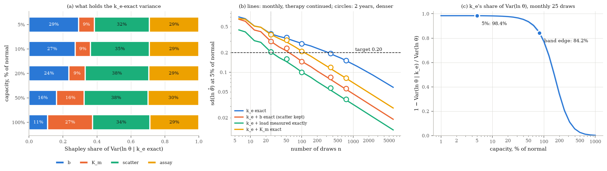
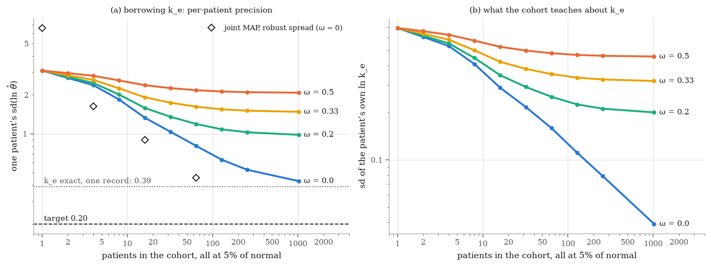
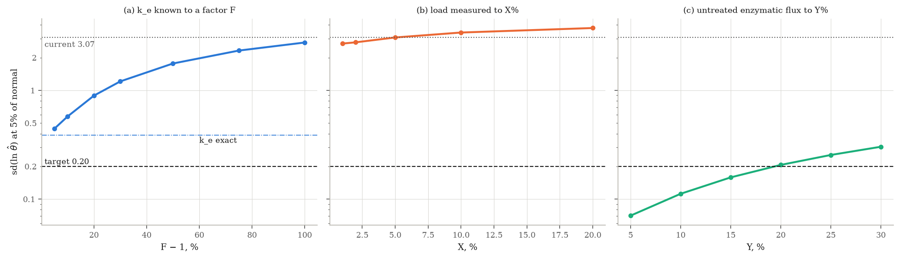

# Practical identifiability of enzyme capacity at 5% of normal

**Brief of 1 October 2026, worked on the repository's own footing, with a follow-up round on six points.** Every number comes from a script in this directory. `out/<script>.txt` holds each script's printed output and `fig/` its figures. Each follow-up script (`t8`–`t11`, `t6c`, `t6d`) was re-derived by an independent verifier, by a route sharing no code with it. The verifier's script is `<name>_recheck.py`, and its output is `out/<name>_recheck.txt`. The footing is imported from `audit/n4_theta_scope.py`, not restated, and `core.fim` reproduces `n4.sd_ln_theta` to 1e-13. Claims that are assumed or not verified are collected in the [last section](#unverified-or-assumed) rather than left inline.

## The answer

**At 5% of normal, k_e is the dominant nuisance, but no knowledge of k_e alone reaches the target on the current record.**
- ln θ and ln k_e are confounded (correlation −0.992), and k_e carries 98% of Var(ln θ̂).
- With k_e exact, 25 monthly draws give 0.39 (FIM). By Monte Carlo the spread is about 0.39–0.45, with a heavy lower tail.
- **That 0.39 is not a floor in the number of draws.** With k_e exact, the record keeps improving as draws are added: 0.195 at 365 draws every 2 days, 0.151 at 730 daily draws (Monte Carlo 0.151).
- The load-recording bias slows the fall at clinical sample sizes but does not stop it.

**Borrowing k_e across a cohort, with no new measurement, does not reach 0.20 at any realistic size.**
- At the trial's 24 patients, all at 5%, with k_e genuinely shared, the FIM gives 1.17. Monte Carlo gives a robust spread of 0.75 and an RMSE of 2.3.
- At a 33% between-patient spread in k_e, the FIM gives 1.82.
- **ω cannot be estimated from the repository.** It holds no patient records: its "24 records" are 24 diet histories of one simulated patient, all with k_e = 5.
- **24 real monthly records could not estimate ω either.** The typical 95% interval would be [0, 0.9–1.0] whatever the truth.

**Routes that clear 0.20 at 5% by Monte Carlo, not just by FIM:**
1. **One calibrated, off-therapy measurement of the enzymatic flux, to about 18% or better.** The Monte Carlo crossing is 18.4% [17.9, 19.0]; the FIM puts it at 19.3%. A 10% reading gives 0.113. If the reading's recovery factor is itself known only to 10%, the crossing falls to 16.0%.
2. **k_e known exactly, plus near-daily sampling for two years.** 730 draws give 0.151.
3. **A drug-forcing burst with no added substrate.** It needs a 0.5% assay CV, 865 samples over 72 h and the delivered increment κ known exactly; it gives 0.113.
4. **Large load excursions.** ×4–×8 pass by FIM; ×3 straddles 0.20 by Monte Carlo (0.203 [0.167, 0.238]). All of them lie beyond the parent model's fold at 1.18× baseline load, so they are not admissible designs.

Everything else in the design space fails once checked by Monte Carlo, including the drug burst at the admissible peak (0.204) and the best washouts (0.20–0.24).

## What the repository contains, and where the brief departs from it

| the brief says | the repository has | consequence |
|---|---|---|
| "~24 patient records" (and, in the follow-up, "the real cohort is 24 patients") | `design.run.SEEDS = range(24)`: **24 draws of one simulated patient's intake sequence**, all with k_e = 5. There is no patient data anywhere in the repository (README: "parameter values are illustrative, not fitted"). | Nothing can be "fit jointly across patients", and ω cannot be estimated from them: their between-record spread of k_e is 0 by construction (`t9`). There are no complete-deficiency records (`t5`). |
| "steady state only" | The 3.07 carries the **booked dose train**: Δ(t), D = 6000 every 14 d, 3.5 d half-life, known, acting on the enzyme channel. Draws are quasi-steady, and the load varies by 10% day to day. | Without the dose train the 5% figure is **8.59**. With constant load too, the FIM is singular. |
| FIM over (θ, k_e, K_m, L) of ln m | Flux-space FIM over (ln θ, ln K_m, b, ln k_e). b is a load-recording bias with a 5%·L prior; K_m has **no prior**; σ combines a 5% assay CV and a 5% load-record scatter. | Equivalent to first order. The finite-difference ln m route agrees to 4e-8; per-draw ln m noise gives 3.045 against 3.067. |
| "m/K_m ~ 10 at normal" | m = 10, K_m = 100: **m/K_m = 0.1**, ε = 0.909. | The enzyme runs at 9% saturation at normal, 35% at 5% untreated, and ≤8% under therapy. |
| "figure caption: median and range across records" | `n4_theta_scope.py` → `tab_S_scope`. Each seed is scored by its own FIM **at the truth**; nothing is fitted. | |
| "upper bound ruling out capacity above ~25%" | `n6_profile_vs_crb.py`: the median upper end of a **profile-likelihood** 95% interval, on 6 records with the k_e prior in force (708, 24%). | Prior-driven, not set identification (Task 4). |
| — | `design.run.delta` **stops after 200 doses** (day 2786), so draws on n4's GRID beyond about the 93rd are untreated. | Affects any "longer monthly record" result. `t8` uses a continued train; Task 3's n·Var figures are corrected below. |

The fixed parameters are normal θ = 3000, K_m = 100 and k_e = 5 /d, with L = 322.73 held as capacity falls (convention A). At 5% (θ = 150), m = 54.0 and s = θg/L = 0.163. Time is in days.

## Scenario table: sd(ln θ̂) at θ = 5% of normal

**The FIM is right about the likelihood in linear θ, and is attained there in every scenario checked (`t11`).** In ln θ it is a lower bound wherever θ̂ can reach 0. That is the case on the current record, with k_e exact, and in any small cohort. There, ln θ Monte Carlo summaries depend on how θ̂ ≤ 0 is bounded. **Use the FIM for ranking. Treat its absolute values at 5% as optimistic unless a Monte Carlo column says otherwise.**

| scenario | FIM | Monte Carlo (MAP) | source |
|---|---|---|---|
| **current design**: 25 monthly draws, therapy on, k_e prior 0.8 | **3.07** [2.66, 3.26] | RMSE 7.1 and robust 6.6, both set by the θ ≥ 1e-3 bound (35% of fits sit on it) | t1, t11 |
| … with no therapy ("steady state only") | 8.59 | — | t1 |
| … plus one untreated baseline draw | 2.31 | — | t5 |
| … with k_e exact | 0.388 | robust 0.39–0.45; RMSE 0.64–1.49 depending on the bound (tail) | t8 recheck, t11 |
| … with k_e exact and the load measured exactly | 0.204 | 0.215–0.218 | t8 recheck, t11 |
| k_e exact, **365 draws every 2 days** for 2 years | 0.195 | 0.219 (robust 0.199) | t8, t8 recheck |
| k_e exact, **730 daily draws** for 2 years | **0.151** | **0.151** | t8, t8 recheck |
| **joint cohort, 24 patients at 5%**, k_e shared exactly (ω = 0) | **1.17** | RMSE 2.34, robust 0.75 | t9 |
| joint cohort, 24 patients, ω = 0.33 | 1.82 | RMSE 3.90, robust 1.39 | t9 |
| joint cohort, 64 patients, ω = 0 | 0.78 | patient 0: RMSE 1.33, robust 0.52 (200 replicates) | t11 |
| **washout**: diet withdrawn, hourly for 48 h, k_e prior 0.8 | **9.4** (383 with no priors) | — | t7 |
| washout + the monthly record + unrecorded load L₀ known to 1% | 0.62 | — | t7 |
| washout at 0.5% CV, every 5 min for 48 h, L₀ to 1% | 0.195 | 0.237 [0.198, 0.273]: **does not pass** | t10 |
| load ×3, every 5 min for 72 h, 5% CV, K_m from the record (inadmissible load) | 0.193 | 0.203 [0.167, 0.238] | t10 |
| **drug burst** at the admissible peak (2850), every 15 min for 72 h, 0.5% CV, κ exact | 0.194 | **0.204 [0.185, 0.222]** (300 replicates): **does not pass** | t10, t10 recheck |
| drug burst, peak 1500, every 5 min for 72 h (N = 865), 0.5% CV, κ exact | **0.124** | **0.113 [0.094, 0.130]** | t10 |
| **direct enzymatic flux**: one untreated reading to 10% | **0.112** | **0.113 [0.110, 0.116]** (2000 replicates) | t5, t12 |
| … to 15% | 0.159 | 0.163 [0.158, 0.168] | t5, t12 |
| … to 20% | 0.206 | 0.218 [0.211, 0.225]: **does not pass** | t5, t12 |
| … crossing of 0.20 | 19.3% | **18.4%** [17.9, 19.0] by RMSE; 19.35% by robust spread | t12 |
| … with the reading's recovery factor known only to 10% | crossing 16.5% | crossing **16.0%** [15.4, 16.6] | t12 |
| … three readings averaged, each to 15% | 0.097 | 0.097 | t12 |
| flux to 20% + k_e to 1.2 + load to 2% | 0.199 | 0.221 [0.197, 0.244]: not confirmed | t5, t11 |
| k_e known to 5% (monthly record) | 0.445 | robust 0.49 | t5, t11 |

## Which hypotheses held

| # | hypothesis | verdict |
|---|---|---|
| 1 | sd ≈ 0.17 at normal, ≈ 3.07 at 5%, band 82–627% | **Held exactly**: 0.1699, 3.0673 and 82.4–627.1%. It is on the dose-train footing, for one simulated patient. |
| 2 | U-shape with its minimum near 200–250% | **Held**: minimum 0.1226 at 212%. |
| 3 | corr(θ, k_e) → −1 as s falls | **Held**: −0.879 at normal, −0.992 at ≤10%. The high-capacity arm of the U is a different confounder: corr(θ, K_m) → +0.98. |
| 4 | amplification (1−s)/s = 5.1 at s = 0.16 | **Held** as the fixed-(m, L, K_m) derivative. The posterior's effective factor is β = −4.44 (−4.50 at the k_e-exact point). |
| 5 | the binding constraint is k_e, not assay noise | **Partly wrong.** k_e is the dominant term, but exact k_e leaves 0.39. In that 0.39 the load record holds 62% and the assay 29% (`t8`). |
| 6 | elasticity −s/(sε + 1 − s) | **Held** to 3e-10. |
| 7 | m/K_m ≈ 10 at normal | **Wrong**: 0.1 (ε = 0.909). |
| 8 | the 24 records are fit one at a time | **They are not patients and are not fitted.** Each is scored by an FIM at the truth. |
| 9 | borrowing k_e across the cohort buys a lot for nothing | **Partly.** At N = 24 it buys 3.07 → 1.17 (FIM) if k_e is genuinely shared. It never reaches 0.20, and it nearly vanishes at ω = 0.33 (1.82). |
| 10 | ~83% of the variance at the band edge is n-independent | **Held**: 84.3% exact, 83.9% from the sd(n) fit. The implied Var(ln k_e) is 0.638, which is the prior itself. |
| 11 | 15× sampling moves the edge only a few percent (82 → 75%) | **Held**: 82.4% → 75.1%. |
| 12 | set identification reproduces the ~25% upper bound | **No.** Non-negativity alone gives 30%, and only because the record pins K_m. The 22–24% is the k_e prior's lower tail. |
| 13 | direct flux > k_e > load, in value | **Held**, and Monte Carlo confirms the ranking (`t11`). |
| 14 | a complete-deficiency record gives k_e for free | **No such record exists.** In the parent model θ = 0 has no steady state. |
| 15 | λ → k_e because the enzyme is saturated | **Premise wrong**: the enzyme is not saturated. λ ≈ k_e at 5% only because θ is small, and θg′ is still 11–16% of λ. |
| 16 | FD regression: EIV attenuation and an MA(1) correlation of −0.5 | **MA(1) held**: −0.47 to −0.49 in the equation error. The bias is **not** classical EIV in m: noisy ψ sits on both sides and flips signs. **IV and bias-compensated LS do not fix it; generalised TLS with the MA(1) covariance does** (`t6c`). |
| 17 | the integral form is much better conditioned | **Only the 2-column saturated form, which cannot return θ.** My earlier "conditioning is not the issue" was wrong: the **noiseless** FD design is nearly collinear (cond 353 on TB-B, 4.8e4 on TB-A), and the noisy cond(X) of 26–93 hid that. |
| 18 | τ tension between derivative noise and aliasing | **Exists only for derivative estimators**: optimum 0.9–1.6/λ. |
| 19 | conditioning depends strongly on the excursion | **Held**: cond[1, m, m²] goes from 76 to 18 as the peak m/K_m goes from 0.7 to 7.4. |
| F1 | 0.39 is an n-independent floor, so measuring L is mandatory | **No floor.** The fall is slow because of the load bias b (slope −0.22 to −0.33 against −0.5). An L measurement is necessary at monthly or weekly sampling, but **not sufficient** at 25 monthly draws (0.204). |
| F1 | the k_e share is 98% at 5% and ~83% at the band edge | **Held, as one curve**: flat at 98.4% to 10%, 93.5% at 50%, 84.3% at the band edge, 77% at 100%, 34% at 200%. |
| F2 | the plateau ≈ (1−s)/s · ω, so ω = 0.33 lands at ~1.55 | **Roughly**: 1.47 computed. The formula overstates by 14–26%, because the posterior amplifies by β = 4.5, not 5.1, and the patient's own record shrinks k_e below ω. |
| F2 | estimate ω from the 24 real records | **Not possible: there are no real records.** 24 real monthly records could not estimate it either. |
| F3 | TB-A to TB-B: which factor? | **The excursion**: 63% of the change in log sd (no priors), then assay CV 19%, capacity 10% and sampling 8%. For NLS, the excursion is the one indispensable factor. |
| F3 | "×4 misses, ×6 passes" | **A sampling and duration edge, not an excursion threshold**: ×4 passes hourly over 72 h, or every 30 min over 48 h. |
| F4 | IV or TLS removes the FD bias | **IV and bias-compensated LS: no.** They need a CV of 0.01% or less. **Generalised TLS with the MA(1) covariance: yes**, matching NLS on TB-B. |
| F5 | the EKF degrading on TB-B is a bug | **No bug.** It is one-pass linearisation error, which grows with the prior width. Started at the truth it still gives 0.50 against a bound of 0.088. **Dropped** from the comparison. |
| F6 | the FIM misleads in both directions | **The FIM is right in linear θ.** "Optimistic at N = 1" compared it with a number set by the θ bound. "Pessimistic at N = 64" was a 60-replicate artefact. Only the core of the constrained MAP is narrower, and that is the positivity of the *other* patients' θ acting through the shared k_e (tested). |

---

## Follow-up results

### F1. The 0.39 is not a floor (`t8_floor.py`, rechecked)

**What holds the k_e-exact variance**, by Shapley share of Var(ln θ̂ | k_e) = 0.150 at 5%:

| factor | share | in your partition |
|---|---|---|
| load-record bias b | 29.2% | load record (b + scatter): **61.7%** |
| per-visit load-record scatter | 32.5% | |
| assay CV (per draw) | 29.1% | assay: **29.1%** |
| K_m | 9.3% | K_m: **9.3%** |

- **b and K_m have zero main effect.** With no per-visit noise the variance is 0. They act only through interaction with the noise, so order-dependent figures range widely: b takes 41% if removed first and 70% if removed after K_m.
- **Measuring the load exactly removes 72% of the variance** (0.388 → 0.204).
- Across 10–100% of normal the two σ terms hold 62–68%. b's share falls from 27% to 11%, and K_m's rises from 9% to 27%.

**The 0.39 against the number of draws, k_e exact, at 5%** (FIM; therapy continued past the repository's 200-dose cap):

| scenario | 25 monthly | 100 monthly | 600 monthly | 365 every 2 d | 730 daily | draws for 0.20 |
|---|---|---|---|---|---|---|
| k_e exact | 0.388 | 0.277 | 0.162 | 0.195 | 0.151 | 324 in 2 y, or 328 monthly (27 y) |
| + load bias b exact | 0.298 | 0.147 | 0.060 | 0.084 | 0.056 | 58 monthly |
| + load measured exactly (b and scatter) | 0.204 | 0.101 | 0.041 | 0.057 | 0.038 | 29 monthly |
| + K_m and b exact | 0.194 | 0.095 | 0.039 | 0.054 | 0.036 | 24 monthly |

- **No n-independent floor.** A fit of √(floor² + c²/n) over n = 6–600 gives a floor of 0.189, but it fails out of sample: it predicts 0.190 at n = 6000, where the FIM gives 0.059.
- **The load bias is what makes the fall slow.** With b at its prior, the local slope of ln sd against ln n is −0.22 (25–50 draws), −0.33 (400–600) and −0.48 (2400–6000): the prior on b is slowly overtaken by the data. The record barely updates b: its posterior/prior sd is 0.96 at 25 draws and 0.64 at 365. With b exact the fall is pure 1/√n.
- **So the answer to "mandatory or optional" is in between.**
  - At monthly or weekly sampling an independent L measurement is **necessary but not sufficient**: at 25 monthly draws, k_e exact plus the load exact gives 0.204 (Monte Carlo 0.215–0.218), and K_m must also be known (0.194).
  - With near-daily sampling it is optional: 730 daily draws with k_e to 2% give 0.176 (FIM).
  - k_e to 5% fails everywhere in the grid.
- **Requirements for 0.20 (FIM)**, with the load as recorded unless stated:

  | draws | k_e needed | other conditions |
  |---|---|---|
  | 730 daily | 2.9% | — |
  | 365 every 2 d | 1.0% | — |
  | 100 every 7.3 d | 2% | load bias and scatter both to 2% |
  | 25 monthly | exact | load exact **and** K_m exact |
- **Caveat from the recheck: the CRB is not attained at the deciding designs.** Monte Carlo with k_e fixed gives:
  - 25 monthly draws: RMSE 0.643 against a CRB of 0.388 (9% of fits off by more than 2×).
  - 365 every 2 d: 0.219 against 0.195.
  - 730 daily: 0.151 against 0.151.

  So 365-every-2-day designs are at best on the edge of 0.20. Per-record CRBs there span 0.185–0.206, and 17% of records miss.
- **The k_e variance share, as a curve** (25 monthly draws, median over 24 records):

  | capacity, % of normal | 1–10 | 20 | 50 | 63 | 82.4 (band edge) | 100 | 158 | 200 | 316 | 627 | 1000 |
  |---|---|---|---|---|---|---|---|---|---|---|---|
  | k_e share of Var(ln θ̂) | 98.4–98.2% | 97.7% | 93.5% | 90.4% | 84.3% | 77.2% | 50.2% | 34.2% | 11.1% | 1.2% | 0.2% |

  Your 1 − (0.39/3.07)² = 0.9839 at 5% and the ~84% at the band edge are two points on this curve (0.9838 and 0.8425).

### F2. N = 24, and ω (`t9_omega.py`, rechecked: [[OMEGA_VERIFY]])

**Task 2 read at N = 24** (FIM; target patient at 5%; the patient's marginal prior on ln k_e stays 0.8):

| ω | 24 patients at 5%: sd ln θ̂ | population sd ln k_e | patient's own sd ln k_e | mixed 5–20% cohort: sd ln θ̂ |
|---|---|---|---|---|
| 0 | **1.17** | 0.25 | 0.25 | 1.44 |
| 0.1 | 1.25 | 0.25 | 0.27 | 1.50 |
| 0.2 | 1.46 | 0.25 | 0.32 | 1.66 |
| 0.33 | **1.82** | 0.26 | 0.40 | 1.97 |
| 0.5 | 2.31 | 0.26 | 0.51 | 2.40 |

- **Monte Carlo joint MAP at N = 24** (60 replicates):

  | ω | RMSE | robust | fits more than 4.5× off |
  |---|---|---|---|
  | 0 | 2.34 | 0.75 | 8% |
  | 0.33 | 3.90 | 1.39 | 25% |

  The FIM is optimistic in ln θ here, as F6 explains.
- **Your plateau approximation**, √(0.39² + ((1−s)/s·ω)²), gives 1.10, 1.74 and 2.60 at ω = 0.2, 0.33 and 0.5. The computed plateau is 0.96, 1.47 and 2.07, so the approximation is 14–26% high. The amplification actually applied is |β| = 4.50 rather than (1−s)/s = 5.13, and the patient's own record shrinks their k_e uncertainty to 0.90–0.98 ω.
- **ω cannot be estimated from the repository.** Its 24 records have one k_e value (5.0) by construction.
- **Would 24 real monthly records identify ω? No.** Simulated cohorts of 24 at 5%, each patient's data-only ln k_e summarised and ω profiled (4000 cohorts per cell):

  | design | true ω | typical 95% interval for ω | share excluding ω = 0 |
  |---|---|---|---|
  | 24 at 5%, monthly | 0 | **[0, 0.89]** | 1% |
  | 24 at 5%, monthly | 0.33 | **[0, 1.00]** | 4% |
  | mixed 5–20%, monthly | 0.33 | [0, 1.22] | 4% |
  | 24 at 5%, every 2 d | 0.33 | [0, 0.54] | 49% |
  | 24 at 5% monthly, + each patient's k_e measured to sd 0.2 | 0.33 | [0.21, 0.47] | 99% |

  The reason is that one monthly record gives each patient's ln k_e only to sd ≈ 1.06 with no k_e prior, three times larger than the ω being sought. Detecting ω = 0.33 with 80% power from monthly records would take about 1200 patients (asymptotic). With every-2-day sampling it would take 33, and with a per-patient k_e measurement to sd 0.2, 6.
- **The repository's only information on ω** is brief R1's "probably a third or more", for "the nearest comparable disposal rate" in healthy adults; there is no 3-HP figure (`q14_hierarchical.py:19-30`, `PHASE8_SIMULATIONS.md:721-723`). `PHASE10_SENSORS.md:486-494` adds that R1's figure is for the marker's clearance, not the model's k_e/α, so the true spread could be larger. No number in the repository measures ω.

### F3. TB-A against TB-B, and whether 5% can reach 0.20 at all (`t10_factorial.py`, rechecked)

**Factorial attribution.** The 2⁴ FIM factorial reproduces both benches exactly (383.3 and 0.089). The change in log₁₀ sd from TB-A to TB-B is −3.63, attributed by Shapley share:

| factor | share |
|---|---|
| excursion (diet out → ×6 load) | **63.4%** |
| assay CV (5% → 1%) | 19.2% |
| capacity (5% → 20%) | 9.5% |
| sampling (1 h → 15 min) | 7.8% |

Main effects carry 99.3% of the variance across the 16 cells; the only material interaction is capacity × excursion. On the "k_e 0.8 + K_m from the record" rung the shares are excursion 48%, capacity 22%, assay CV 22% and sampling 8%.

**For NLS the excursion is the one indispensable factor.** Starting from TB-B and putting back a single TB-A setting:

| TB-B with … at its TB-A value | NLS RMSE | FIM |
|---|---|---|
| nothing (TB-B itself) | 0.100 | 0.089 |
| capacity | 0.38 | 0.32 |
| sampling | 0.21 | 0.17 |
| assay CV | 0.51 | 0.45 |
| excursion | **1.30, and every fit fails** | — |

The other three degrade NLS roughly in line with the FIM. Starting from TB-A, no single TB-B factor rescues it: RMSE stays at 3.3–4.1.

**A 5% patient on TB-B's other settings** (15-min sampling, 1% CV, ×6) has FIM sd 0.32 with no priors and 0.07 on the rung. **So capacity by itself does not block 0.20.** What blocks it is that the excursions able to reach 0.20 add substrate.

**The 5% design frontier.** I scanned 5280 designs:
- sampling every 5–60 min, for 24–72 h;
- assay CV 0.5–5%;
- excursions: diet withdrawal of 25% or 50%, load ×1.5 to ×8, or a drug burst at peak 450, 1500 or 2850;
- the full knowledge ladder, alone or joined to the record.

1422 pass by FIM. The cheapest passes per class, with an explicit cost order (safety class first, then knowledge that must be bought, then assay CV, then samples):

| class | best route to 0.20 (FIM) | Monte Carlo |
|---|---|---|
| **no added substrate** (drug burst, diet withdrawal) | **none at 5%, 2% or 1% CV**: 0 of the grid. At 0.5% CV: drug 2850 at N = 289 gives 0.194; drug 1500 at N = 865 gives 0.124; withdrawal 50% with L₀ to 1% at N = 577 gives 0.195. | drug 2850 **0.204, fails**; drug 1500 **0.113, passes**; withdrawal 0.237, fails |
| load ×1.5 | not at 5% CV; at 2% CV with N = 865 | — |
| load ×2, 5% CV | L₀ to 1%, every 15 min for 72 h, joined: 0.199 | 0.237 [0.181, 0.291], straddles |
| load ×3, 5% CV, no bought knowledge | every 5 min for 72 h (N = 865): 0.193 | 0.203 [0.167, 0.238], straddles |
| load ×4, 5% CV, no bought knowledge, joined | every 5 min for 48 h: 0.199 | — |

- **The earlier "×4 misses (0.205), ×6 passes (0.176)" is a sampling-and-duration edge** at hourly sampling over 48 h, not an excursion threshold. ×4 passes hourly over 72 h (0.182), and every 30 min over 48 h (0.174).
- **The drug designs need the delivered increment κ known exactly.** With κ to 12%, the 2850 burst at N = 289 gives 0.345.
- **Load excursions sit past the repository's own crisis threshold.** The parent model's fold is at 1.18× baseline load (`results/numbers/boundary.tex: fold_load_ratio = 1.177`, a 10%-capacity patient). Every load-up excursion in this table is therefore beyond the point where the parent model has no steady state.
- **Answer: 5% can reach 0.20 in this design space only two ways.** Either through a drug burst at a research-grade 0.5% assay CV, with 865 samples and κ exactly known, or through load excursions that are not admissible. No design at a clinical assay CV with no added substrate does. Two corrections to the earlier Task 7 text follow below.

### F4. One fix for the FD estimator (`t6c_iv.py`, rechecked)

- **The noiseless FD design is nearly collinear**: ψ₀ is almost a quadratic in m along the path. In midpoint form, cond(X₀) is 4.8e4 on TB-A, 353 on TB-B and 1234 on bench C (5%, ×6, 15 min, 1% CV). The noisy cond(X) of about 25 that t6 reported is inflated by the noise in ψ.
- **The psi column carries almost no independent signal.** Its partial signal-to-noise ratio, off [1, m, m²], is 0.0016 on TB-B and 7e-5 on C. So OLS's K_m coefficient goes to its noise-only limit: −266 on TB-B (exact limit −265.5, Monte Carlo −265.1).
- **Instrumental variables do not fix it.** I tried instruments from samples k−1 and k+2 (IV-JI, 2SLS, GMM with an MA-robust weight) and a heteroscedasticity-weighted IV. They still return θ̂ ≤ 0 in 33–61% of records on TB-B and on C. The instruments look strong overall (first-stage R² 0.89) but are weak in the direction that identifies K_m (conditional R² 0.019).
- **Bias-compensated LS does not fix it either**, even with the exact lognormal moment correction, which is verified unbiased. The corrected X′X is positive definite in only about half the records.
- Both linear corrections become consistent only at an assay CV of 0.01% or less.
- **Generalised TLS with the row-wise MA(1) (tridiagonal) noise covariance does fix it** (GTLS-t, midpoint form).

  | | TB-B: bias / RMSE / robust | bench C: RMSE / robust |
  |---|---|---|
  | GTLS-t | −0.016 / 0.090 / 0.084 | 0.43 / 0.34 (recheck: 0.57 / 0.37) |
  | NLS | −0.011 / 0.079 / 0.085 | — |
  | FIM sd | 0.089 | 0.32 |

  The left-point form is discretisation-biased. On TB-A nothing works, because the bench carries no information.
- **So:** OLS-FD and every linear correction of it is a clean negative result, with the mechanism quantified above. The FD equation itself is usable if it is estimated with its correct noise covariance. At that point it is a reparameterised NLS, and offers no advantage over fitting the ODE.

### F5. The one-pass EKF: no bug, dropped (`t6d_ekf.py`, rechecked)

- **No algebraic error.** A copy of t6's filter reproduces t6's numbers exactly. On noiseless data at the truth, its posterior sd equals the FIM+prior bound to five digits (0.08922). The log-state Jacobian matches finite differences to 3e-4. Process noise is irrelevant: q = 0 gives the same result. And an iterated measurement update is a no-op, because the measurement is linear in the log-state.
- **One real inconsistency, which is not the cause.** The diagonal P₀ ignores that the initial marker is a deterministic function of the parameters. Tying it improves RMSE from 3.25 to 1.82 on TB-B.
- **The cause is one-pass linearisation error, which grows with the prior width.**
  - Started *at the truth* with t6's prior width, it still gives RMSE 0.50 while reporting sd 0.05.
  - Narrowing the prior to ×0.1, ×0.3, ×0.5 and ×1 gives RMSE 0.028, 0.093, 0.261 and 0.503.
  - Tied P₀, annealed parameter noise, lag-1 re-linearisation and a cubature filter all fail. The best robust spread is 0.66, against a bound of 0.088.
- **"Wider on TB-B" is mostly one record.** 83% of the EKF's sum of squared errors on TB-B comes from a single record. By robust spread it is *narrower* on TB-B (1.07) than on TB-A (1.63), where it simply returns its prior.
- **Decision: the one-pass EKF is dropped from the comparison.** It stays in t6's printed table, labelled as not a fair comparator, and is removed from t6's figure. The iterated EKF smoother is the Kalman entry.
- **The verifier's corrections.**
  - NLS started only from the drawn prior centre gives RMSE 0.085, identical to the truth-start in 40 of 40 records, so NLS is a like-for-like benchmark.
  - A one-pass Liu–West particle filter reaches a robust spread of 0.15–0.18, so the right statement is "no *Gaussian* one-pass filter is a fair comparator".

### F6. Where the FIM misleads, and the Task 5 spot-checks (`t11_fim_check.py`, rechecked)

- **Given (K_m, k_e), each θᵢ enters linearly.** So the FIM describes a Gaussian likelihood in **linear θ**, and with an sd of 3.0θ at N = 1 and 0.78θ at N = 64, θ̂ ≤ 0 is common. Every ln θ summary then depends on how that is handled.
- **N = 1.** 33.5% of fits sit on the θ ≥ 1e-3 bound. The robust spread is 5.4, 6.6 and 8.9 for bounds of 1e-2, 1e-3 and 1e-5, so t2's "6.6" measured the bound, not the data. Unconstrained, the linear-θ spread is 3.27 against the FIM's 3.04.
- **N = 64.** t2's RMSE of 0.49 was a 60-replicate artefact. With 200 replicates, patient 0's RMSE is 1.33 [0.55, 1.98], above the FIM's 0.78, and pooled over all 64 patients it is 1.47.
- **Why only the core is narrower than the FIM** (robust 0.52, about 0.67× the FIM from N = 8 to 64): positivity of the **other** patients' θ, acting through the shared k_e. The verifier tested this directly. Constraining only the other patients reproduces the full narrowing (0.556); constraining only patient 0 does nothing (0.704, equal to unconstrained). It also makes the MAP biased upward, by +0.04 to +0.12 in median ln error depending on the draws. The unbiased-estimator CRB does not bound a biased estimator, so there is no contradiction.
- **The Monte Carlo machinery was validated** on an exactly linear-Gaussian surrogate.
- **Task 5 spot-checks**, 240 replicates each:

  | scenario | FIM | MC RMSE | MC robust | Monte Carlo verdict |
  |---|---|---|---|---|
  | flux reading to 10% | 0.112 | 0.118 | 0.113 | passes |
  | flux reading to 20% | 0.206 | 0.227 | 0.218 | fails |
  | k_e exact + load exact | 0.204 | 0.215 | 0.197 | fails |
  | flux 20% + k_e 1.2 + load 2% | 0.199 | 0.221 | 0.202 | not confirmed |
  | k_e exact | 0.388 | 1.49 (bound hits) | 0.45 | fails |
  | k_e to 5% | 0.445 | 1.67 | 0.49 | fails |

  The two flux rows were re-run with 2000 replicates on fresh draws (`t12`): RMSE 0.113 at 10% and 0.218 at 20%, robust 0.111 and 0.206. The verdicts are unchanged.

  The ranking survives except for a tie at ranks 2–3. In linear θ the FIM is attained in every scenario (linear RMSE/FIM 0.99–1.06). With k_e exact or to 5%, the ln θ profile reaches θ near 0 in 6 of 24 records, so the FIM's symmetric ln θ interval is optimistic on the low side. Only the flux reading clears 0.20 by Monte Carlo. `t12_flux_mc.py` locates the crossing with 2000 replicates per point on fresh draws, checked to be representative: **18.4% [17.9, 19.0]** by RMSE and 19.35% by robust spread, against 19.33% by FIM. The FIM is attained in linear θ (linear RMSE/FIM 1.003–1.006). If the reading's recovery factor is known only to 10%, the crossing is 16.0% [15.4, 16.6].

---

## The original tasks

### 1. Identifiability (`t1_identifiability.py`)

- **U-curve, 1–1000%.** 14.75 at 1%, 3.07 at 5%, 0.17 at 100%, minimum **0.1226 at 212%**, 0.29 at 1000%. The band is 82.4–627.1%.
- **Mechanism.** corr(ln θ, ln k_e) is −0.992 at 1–10%, −0.967 at 50%, −0.879 at 100%, −0.583 at 200% and −0.047 at 1000%. corr(ln θ, ln K_m) rises from +0.21 at 50% to +0.98 at 1000%, where m ≪ K_m and the record sees only θ/K_m. corr(ln θ, b) stays between −0.13 and +0.02.
- **Variance attribution at 5%, with each nuisance known:** none 3.07; k_e 0.388; K_m 2.885; b 3.046; k_e + b 0.298; all three 0.194. The full curve of k_e's share is in F1.
- **Elasticity.** The analytic form matches numerical differentiation to 3.3e-10 untreated, and to 9e-10 per draw on therapy.

  | | s | m/K_m | ε | d ln m/d ln θ |
  |---|---|---|---|---|
  | normal | 0.845 | 0.100 | 0.909 | −0.9154 |
  | 5% | 0.163 | 0.540 | 0.649 | −0.1729 |
- **Profile likelihood at s = 0.16**, 24 records.
  - **Lower side: no lower bound.** All 24 intervals run to the grid floor (θ = 0.05), and the MLE has median 3.8.
  - **Upper side: a wall.** The 95% upper end is at median **672 (22.4% of normal)**, where k_e has been pushed about 1.6 prior sd below its centre.
  - **The CRB is the wrong shape.** It implies a symmetric factor of 166,704; the likelihood is instead a one-sided plateau with a cliff about 4.5× above the truth.

### 2. Joint fit (`t2_cohort.py`; corrected by F2 and F6)

The 24 records are one diet history each of the same patient. Pooled as one patient with 600 draws they give 1.09 at 5%.

**A real cohort, FIM.** Each patient has their own θᵢ and load-diary bias bᵢ. K_m is shared, and ln k_e,ᵢ = ln k_e,pop + ηᵢ with ηᵢ ~ N(0, ω²). The population prior is σ_pop² = 0.8² − ω², and N = 1 reproduces n4 exactly. On q14's composition this agrees with `q14_hierarchical.py` within 4%.

| patients at 5% | ω = 0 | ω = 0.2 | ω = 0.33 | ω = 0.5 |
|---|---|---|---|---|
| 1 | 3.08 | 3.08 | 3.08 | 3.08 |
| 16 | 1.33 | 1.59 | 1.92 | 2.38 |
| **24** | **1.17** | 1.46 | 1.82 | 2.31 |
| 64 | 0.81 | 1.19 | 1.62 | 2.18 |
| 1024 | 0.43 | 0.98 | 1.48 | 2.08 |

**Correction.** This section first reported Monte Carlo spreads of 0.90 (N = 16) and 0.46 (N = 64), and called the FIM pessimistic. Those came from 60 replicates and a bounded ln θ. With 200 replicates the N = 64 RMSE is 1.33. Only the robust core (0.52) is narrower than the FIM, for the reason tested in F6.

**What does not change:** even exact k_e leaves 0.39 on 25 monthly draws, so borrowing cannot reach 0.20 without more draws per patient (F1). And at ω = 0.33 it buys little.

### 3. Variance decomposition (`t3_variance.py`)

Exact split: Var(ln θ̂) = Var(ln θ̂ | k_e) + β²·Var(ln k_e).

- **At the band edge** (θ = 2472) the k_e term is **84.3%** of the variance. The sd(n) fit puts the floor at 83.9% at n = 25. The implied Var(ln k_e) is 0.638, the prior itself.
- **15× sampling** (every 2 days, 365 draws) moves the edge from 82.4% to 75.1%. That is beyond the k_e-held limit of 79.9%, because dense sampling teaches k_e a little: Var(ln k_e) falls 4.3%.
- **Correction.** I wrote that n·Var(ln θ̂ | k_e) stays between 0.115 and 0.168 for n = 6–400. That was computed on n4's GRID prefixes, which go untreated after the repository's 200-dose cap. With therapy continued, the values at n = 100 and 400 are 0.178 and 0.197 (`t8_floor_recheck.py`). The floor fit (0.183) and the 83.9% are unaffected.
- The edge moves with the k_e prior: 43.7% of normal at a prior sd of 0.4, 24.6% at 0.2 and 15.6% at 0.1.

### 4. Set identification (`t4_set.py`)

**θ_max = (L − k_e,lo·m)(K_m,hi + m)/m**, which increases with K_m.

| k_e floor | K_m ≤ 100 | 107 | 150 | 200 | 500 | unbounded |
|---|---|---|---|---|---|---|
| 0 (non-negativity only) | 30.7% | 32.1% | 40.6% | 50.6% | 110% | ∞ |
| 1.04 (the 0.8 prior's 95% low end) | 25.3% | 26.5% | 33.5% | 41.8% | 91% | ∞ |

- On the noisy dose-train records, a constrained profile with k_e > 0 and no k_e prior gives **907 = 30.2%** in all 24 records. It is finite only because the dose train pins K_m to ~6%.
- **The reported ~25% is the k_e prior's lower tail**: 672 (22.4%) with the prior.

### 5. Value of additional measurements (`t5_value.py`; spot-checked in F6)

The printed output, at θ = 5% of normal on the current monthly record (FIM; see F6 for Monte Carlo):

| measurement | sd(ln θ̂) |
|---|---|
| none (current design) | 3.07 |
| + one untreated baseline marker draw | 2.31 |
| k_e to a factor 1.05 / 1.1 / 1.2 / 1.5 / 2.0 (1 sd) | 0.445 / 0.576 / 0.895 / 1.77 / 2.76 |
| k_e exact | 0.388 |
| load measured to 1% / 2% / 5% / 10% / 20% | 2.70 / 2.77 / 3.07 / 3.41 / 3.75 |
| load measured exactly | 2.67 |
| one untreated flux reading to 5% / 10% / 15% / 20% / 30% | 0.071 / 0.112 / 0.159 / 0.206 / 0.303 |
| three flux readings at 30%, averaged | 0.179 |
| k_e 1.05 + load 1% | 0.305 |
| k_e exact + load exact | 0.204 |
| flux 20% + k_e 1.2 + load 2% | 0.199 |
| flux 30% + k_e exact | 0.226 |
| complete-deficiency anchor (k_e from (L − b)/m), ω = 0 / 0.2 / 0.33 | 0.45–0.50 / 1.0 / 1.5 |

- **Ranking:** flux ≫ k_e ≫ load. The elasticities of sd(ln θ̂) to each measurement's own precision are 0.90, 0.79 and 0.15.
- Only the flux reading reaches 0.20 alone: at Y ≤ 19.3% by FIM and Y ≤ 18.4% by Monte Carlo (`t12`), or ≤ 16.0% if its recovery factor is known only to 10%.
- **Conditions on the flux reading:** it must be taken off therapy, since on therapy any PCC flux measurement sees (θ + Δ)g, and it must be absolutely calibrated.

### 6. Dynamic estimators (`t6_estimators.py`; extended by F4 and F5)

- **λ = 5.6–5.9 /d at 5%** (1/λ = 4.0–4.3 h), with θg′ 11–16% of it.
- **The brief's integral form (b) cannot identify θ**: θ enters only through L₀ − θ.

| estimator | ln θ̂ on TB-A: median bias, RMSE | ln θ̂ on TB-B: median bias, RMSE (robust) | ln k̂_e median bias, A / B |
|---|---|---|---|
| (a) FD, left point | −4.6, 4.9; θ̂ ≤ 0 in 56% | θ̂ ≤ 0 in **100%** | +0.21 / +0.33 |
| (a) FD, midpoint | −4.0, 4.4; θ̂ ≤ 0 in 44% | θ̂ ≤ 0 in **100%** | +0.03 / +0.33 |
| (a) FD estimated by GTLS with the MA(1) covariance (F4) | fails (no information) | −0.016, 0.090 (0.084) | — / +0.004 |
| (b) integral, saturated (brief's) | θ not identified | θ not identified | **+0.11 / +0.23** |
| (b′) integral, general, K_m profiled | +9.8, 9.5 | +0.03, 0.32 (0.24) | +1.7 / −0.01 |
| (b″) integral, cumulative | +9.3, 8.5 | +0.04, 0.21 (0.19) | +0.7 / −0.01 |
| (c) NLS through the ODE | +1.1, 4.3 | **−0.01, 0.079 (0.085)** | 0.00 / 0.00 |
| (c) iterated EKF smoother | +0.11, 1.48 (its prior) | −0.01, 0.33 (**0.082**) | 0.00 / 0.00 |

The one-pass EKF is dropped (F5). TB-B's FIM sd is 0.089.

- **The FD bias is endogeneity of ψ**, not noise in m. The coefficients relative to truth are (−1.59, −2.06, 1.39, −2.64) with noiseless m, and the same with noisy m.
- **Discretisation bias:** on noiseless TB-B samples the left point unlumps to θ = 56 against 600; the midpoint gives 600.3.
- **MA(1):** −0.47 to −0.49 in the equation error at the true coefficients, and −0.30 to −0.33 in fitted residuals (`t6b_ma1.py`).
- **Correction.** I wrote "conditioning is not the issue". It is: the noiseless FD design is nearly collinear (F4).

### 7. Experiment design (`t7_design.py`; extended by F3)

The washout at 5%, hourly for 48 h, down the knowledge ladder (FIM):

| design | nothing | k_e 0.8 | + K_m from the record | + L₀ to 5% of L | + L₀ to 1% | k_e exact |
|---|---|---|---|---|---|---|
| withdraw half the load (the diet) | 383 | 9.4 | 4.1 | 1.5 | 0.63 | 0.10 |
| load ×3 for 24 h, then out | 9.4 | 7.2 | 0.86 | 0.58 | 0.24 | 0.08 |
| load ×6 for 24 h, then out | 3.1 | 3.0 | 0.57 | 0.40 | 0.18 | 0.07 |

- **Corrections from F3.**
  - I wrote that a washout needs *all of* an excursion past K_m, L₀ known to 1%, K_m from the record and the k_e prior. Too strong: with dense enough sampling, ×4 passes joined to the record with no bought knowledge (FIM).
  - I wrote that "a pure withdrawal never reaches 0.20 short of exact k_e". Wrong in the wider grid: a 50% withdrawal reaches 0.195 by FIM at 0.5% CV with L₀ to 1%, although the Monte Carlo gives 0.237.
  - The binding unknowns in a washout are still L₀, then k_e.
- **The τ tension.**
  - For the efficient estimator at fixed duration, denser is never worse.
  - At a fixed N = 24 the optimum is τ ≈ 0.3/λ.
  - Derivative estimators are best at 0.88/λ (forward) or 1.57/λ (central), with the derivative still 43% or 19% wrong.
- **Excursion.** As the peak m goes from 0.68·K_m to 7.4·K_m, cond[1, m, m²] falls from 76 to 18, and sd from 2.94 to 0.48 (k_e prior + K_m from the record).
- **Drug forcing** (13 h rise, 3.5 d decay, no added substrate, k_e untouched). Results are FIM; Monte Carlo is in F3.
  - The burst plus record gives 0.86–1.26 at admissible peaks with L₀ to 1%.
  - It reaches 0.20 if k_e is known to 2.5%, whether κ is known or at 12%.
  - The booked dose (peak 6400) is inadmissible at 5% and worse (1.69).

---

## Unverified or assumed

**Repository footing that this work inherits and cannot check**

- There is no patient data. Every "patient" and "record" is simulated on illustrative parameters (README).
- The marker is treated as the enzyme's substrate. The paper names this its weakest assumption.
- The noise model is the repository's: one flux-space σ per record, evaluated at the untreated level. Under per-draw noise, verdicts within a few per cent of 0.20 can flip. For example, k_e exact plus load exact at 25 monthly draws gives 0.2044 on the repository's noise and 0.1933 per draw.
- Verdicts within a few per cent of 0.20 also depend on the intake seeds and on sample timing against the 14-day dose phase. With k_e and the load exact, 25 draws at 29.2 d give 0.198, at 30.4 d 0.204, and at 28 d (2 × 14 d) 32.6.

**Assumptions I made, with their sensitivity where checked**

| assumption | detail |
|---|---|
| what the 0.8 k_e prior is | Shared-but-unknown, or between-patient spread ω: the repository does not say. Decisive for Task 2 (1.17 at ω = 0 against 1.82 at ω = 0.33, N = 24). R1's "a third or more" is qualitative, for a comparable disposal rate in healthy adults, and for the marker's clearance rather than k_e/α. |
| "k_e known to a factor F" | Read as a 1-sd factor, so sd(ln k_e) = ln F; "k_e to p%" as ln(1 + p). The 95% reading gives 0.40 rather than 0.44 at F = 1.05. |
| unrecorded load in transients | L₀ = 0.5 L and constant through the experiment. ±0.2 L moves the best washout by under 4%. Constancy under a glucose-protected withdrawal is unverified, and the repository withdrew the fast because catabolism raises the load (`u15`, `u17`). |
| load-excursion exposure | Washout and load designs hold the changed load for half the duration, so 72 h designs carry 36 h of load and the safety class counts only the multiple. With the hold capped at 24 h, a few edge passes become misses (`t10_factorial_recheck`). |
| clinical admissibility | Ranking load increases as unsafe, and placing them beyond the parent model's fold (1.18× at 10% capacity, `boundary.tex`), is a judgement drawn from the repository, not a clinical assessment. |
| assay CV below 5% | 0.5–2% assay CVs have no source in the repository. The "5%-assay equivalent" sample counts assume purely analytical, independent noise. |
| drug kernel | A difference of exponentials with a 13 h peak and a 3.5 d decay, my construction around the peak time from `q1`. The admissible ceiling (peak 2850) is n4's R2 reading, one of three that disagree. κ exact unless stated. |
| the direct flux reading | One untreated visit, off therapy, absolutely calibrated, Gaussian with sd F·√(Y² + (ε·5%)²), with m₀ known as in n6. The repository's breath test has an unknown recovery factor, under which one reading is worth nothing. |
| long records | The 27-year (328 monthly) and 500-year (6000) records assume one patient with one constant load bias for decades. They show there is no floor mathematically; they are not designs. |
| the dose train | `design.run.delta` stops after 200 doses. `t8` continues it in closed form; that continuation is mine. |
| the "K_m from the record" rung | Applied on its own with the k_e prior, it counts that prior twice. That is conservative: it created no false passes in the cases checked. |
| cohort composition | Task 2 and F2 put every patient at 5% (and q14's 5–20% mix), with each patient's load bias independent. |

**Explanations that are supported but not proven**

- **The EKF failure** is attributed to one-pass linearisation error growing with the prior width. That is supported by the exact information identity at the truth and by the error's growth with prior width; there is no second-order analysis. The drift of outliers towards the Michaelis–Menten limits is common to all records, so it does not explain the outliers.
- **GTLS-t's success** is read as MA(1) whitening restoring the level information that differencing removes. That is an interpretation, consistent with the whitened partial SNR (3.1 against 0.0016).
- **Why b is so weakly separated from θ** (its constant column against θg(mᵢ), and the limited spread of mᵢ) is plausible, not tested.
- **The linear-Gaussian surrogate at N = 64** has a whitened sd of 0.984 over 8000 replicates, just outside its 95% band. It is provisionally sampling noise.
- **The iterated smoother reaching costs at or below a multi-start least-squares fit** was shown on 6 records only.
- **The ω profile-likelihood hierarchy** in `t9` uses each patient's profile, not integrated, likelihood, and holds it constant below the grid.

**Comparisons with limited support**

- The flux crossing (18.4% by Monte Carlo) is for one simulated patient on the repository's footing. The reading is Gaussian and taken with an untreated marker draw, and either perfectly calibrated or with a recovery factor known to 10% (16.0%). Whether a measurement of this kind and precision exists for PCC flux in vivo is not established here.
- The repository's only breath-test repeatability figure, a between-visit 14% (`PHASE4_SUMMARY.md:208`), is for an uncalibrated relative reading. It does not show that a 10–19% *calibrated* flux measurement exists.
- Monte Carlo sizes: 30–40 replicates per cell in `t10`, overturned where the verifier ran 300 (the drug-2850 burst); 60 per ω in `t9`. Borderline Monte Carlo verdicts carry their bootstrap intervals in the table.
- Assumption-free conclusions are limited to the structure: the confounding mechanisms, the lack of an n-floor, the non-identifiability of ω from monthly records, and the FD mechanism. Every absolute sd depends on the repository's illustrative constants.

## Reproducing

See [`README.md`](README.md) for the script list and the run order.
