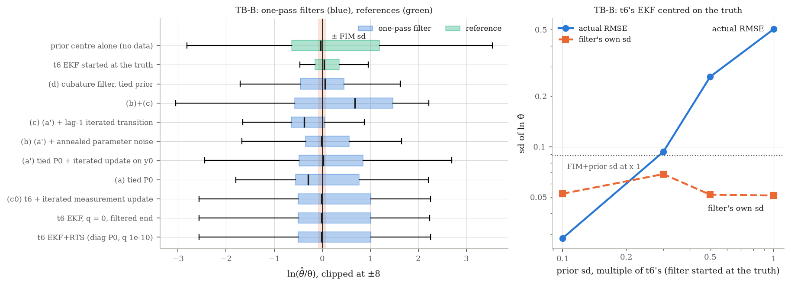
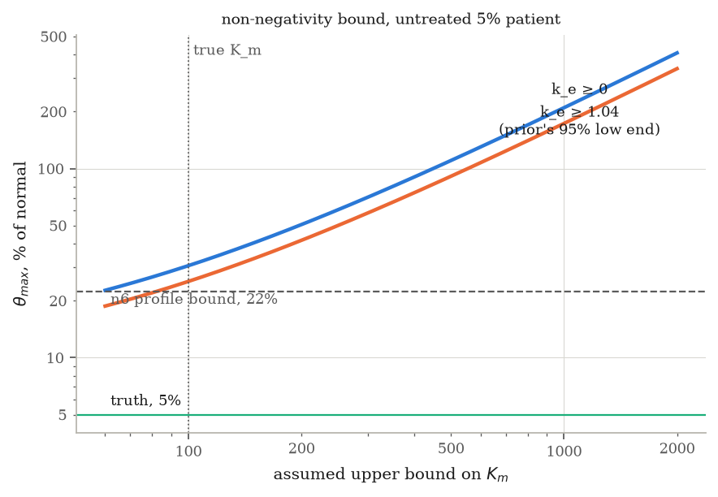
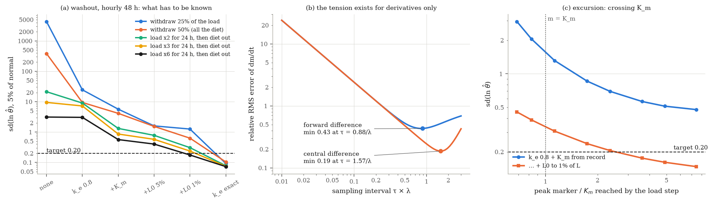

# Practical identifiability of enzyme capacity at 5% of normal

**Brief of 1 October 2026, worked on the repository's own footing, over three rounds (the original eight tasks, a six-point follow-up, and a nine-point round on conditioning, specification, and feasibility).** Every number comes from a script in this directory. `out/<script>.txt` holds each script's printed output and `fig/` its figures. The follow-up scripts (`t8`–`t11`, `t6c`, `t6d`) and the round-3 scripts (`t13`–`t19`) were re-derived by independent verifiers, by routes sharing no code with them; `t12` (the flux crossing) was not. Repository constants and the `n6` output this report quotes are printed in `out/t0_footing.txt` and `out/n6_profile_vs_crb.txt`. The footing is imported from `audit/n4_theta_scope.py`, not restated, and `core.fim` reproduces `n4.sd_ln_theta` to 1e-13. Claims that are assumed or not verified are collected in the [last section](#unverified-or-assumed).

> **Both headlines survive the parameters.** The two load-bearing conclusions — "no feasible design reaches 0.20 on the marker" and the ~19% flux contour — were stress-tested against K_m over a 4× range (50–200), assay CV 3–8%, load scatter 2–10%, the k_e-prior width, and the repo-vs-per-draw noise model: **both hold** (the feasibility sd stays ≥ 0.34; the flux crossing stays 18.8–20.2%) (R-B). The caveat that makes that test necessary: this is a **design study on a specified, simulated model, not an analysis of a cohort** — the repository holds no patient data (item 10; the brief's "24 patient records" was a mislabelling), so every number is conditional on the model and its constants. The saturation regime that governs which approximations hold is in R-A (at 5%, m/K_m ≈ 0.54, g ≈ 0.35 — sub-saturated).

## The decision

> **Scope, stated first (round-7/8 finding).** Everything below is a statement about the **stable inter-crisis steady state**, computed on the parent paper's **Model A** (linear, unbounded non-PCC clearance; `sections/03_model_A.tex`). The round-6 literature shows non-PCC disposal in PA is **low-capacity** — patients accumulate and decompensate — and the repo's own Model C encodes this ("the alternative route alone peaks at 500 against a load of 600, so a patient with θ = 0 cannot be maintained"). Under a bounded, literature-consistent clearance a steady state exists only while the load fits under the disposal ceiling: θ > θ_crit = L − k_e. Because **L is actively managed** (protein restriction, gut suppression), a severe patient *does* have a steady state — **at their managed load**: at 5% capacity, untreated, they are below θ_crit and diverging, and a ~10% load reduction brings them above it (R-H, `t35`). So the correct scope statement is: **the analysis describes the managed, stable inter-crisis state; it does not describe the untreated or decompensating patient, and the margin μ = θ − θ_crit is thin — the record's own antibiotic/protein excursions (paper §3.5) can erase it, which is a decompensation.** Where a steady state exists, switching Model A → B moves the numbers (enzyme share 0.16 → 0.37; cross-sectional sd 3.05 → 0.29–0.92; contrast 0.13 → 0.08) but **not the sign of any verdict**, and B is *better* on both axes (the enzyme carries more of the load). The published figures inherit Model A's affine-clearance assumption — the paper states this explicitly (claim C23) — and B is not uniformly harder to identify: the marginal precision on θ *improves* under B even as the joint conditioning degrades (R-H, a correction to the paper's Remark 15).

**The general result (lead):** **only a direct, calibrated measurement of the enzyme reaches the target cross-sectionally. Inferring absolute capacity through the mass balance fails no matter how well the nuisances are measured** — the repo's full nuisance panel (an IV ¹³C₃ k_e tracer at 5.4% *and* an isotope-dilution load turnover at 10%) gives only **0.44** at 5%, and even k_e-exact + load-exact stays ~0.29 at monthly sampling. The two sensors that *do* reach target both read the enzyme itself, and both carry an **uncalibrated multiplicative factor** a single reading cannot separate from θ (R-G, item 1). The answer then splits by clinical use:

**1. Classifying absolute capacity — cross-sectional.** Reached only by a direct enzyme measurement, *and only if its calibration is supplied*:
- an **enzymatic-flux reading**, O = c·θ·g: reaches 0.20 at √(Y² + Z²) ≤ ~18–19% (reading precision Y, recovery calibration Z); with c uncalibrated it is worthless (R11).
- an **ex vivo PCC activity assay**, A = κ·θ: the repo's 20% is *repeatability only*, and κ (the cell-to-whole-body mapping) is unreported — structurally the breath's recovery factor. So the earlier "0.200" silently assumed κ known; it is knife-edge even then (25% repeatability → 0.25), and with κ **uncalibrated the route reverts to 3.0** (item 1). Same contour, √(Y² + Z²) ≤ 0.20.

So both direct routes need their multiplier (c or κ) calibrated for an *absolute* reading, and the repository supplies neither. No marker-reading or nuisance-sensor design reaches target at all.

> **This cross-sectional conclusion is model-dependent, but the escape it opens is a point, not a route (round-8, `t38`, `t40`).** Everything in the paragraph above is a **Model-A** result (linear, unbounded clearance), and the enzyme carries only a 16% share there, so θ is barely identified (3.05) and even perfect nuisance sensors floor at ~0.29. Under the **literature-consistent Model B** (saturating clearance), at a managed operating point the enzyme carries a larger share and the cross-sectional sd is **0.29 — missing 0.20 by ~1.5×, not ~15×.** Tighten the k_e prior to what the IV ¹³C₃ tracer delivers (5.4%) and one constructed point touches **~0.19**, at the gate. But on scrutiny that 0.19 is a **gate-hugging point, not a route**: swept across the plausible ceiling range under those same tightened conditions (`t40`), it only ever *hugs* the gate — at the tracer's k_e precision the whole ceiling sweep sits at **0.18–0.20, marginal everywhere and never comfortably below**, and at a looser k_e prior it slips off the gate (0.21–0.23) at higher ceilings; sd tracks the *ceiling* (the enzyme share), not the margin; and it holds at all only while **K_e is known to ~30%** (free K_e reopens the exchange degeneracy and sd blows up to ~9). So the honest reading is: Model A's low share makes the cross-sectional problem *look* worse than the mechanism requires, but under B the target is still **not reached by any route the data support** — it is touched only at a low, unmeasured ceiling with an unmeasured half-saturation assumed known.

> **The general negative result (round-8/9 — this is the report's conclusion).** The recurrence of "one unmeasured constant per route" is not a coincidence; it is forced by the structure. *An observable fixes absolute θ only in one of two ways, and each carries its own unmeasured constant:*
>
> - **Through the mass balance.** If the observable is (a function of) an accumulated metabolite state, its steady level is set by `load = θ·g(m) + [competing disposal]`. Attributing that balance to θ rather than to the competing channel requires the **competing channel's shape** — its V_max and half-saturation. These are k_e, K_e (Model B) and k, K_c, R₀, M_i, ρ₀ (Model C). None is measured in humans.
> - **By direct transduction.** If the observable is a scaled reading of the enzyme or its flux, `y = (const)·θ·(known function)`, recovering θ requires the **transduction constant**: κ (ex vivo) or c (breath/flux). Neither is measured in humans.
>
> **There is no third kind**, because θ enters the model only as the V_max of the flux θ·g(m): an observable depends on θ *either* through the metabolite state(s) it helps set (→ needs the competing channel to invert the balance) *or* directly through that flux (→ needs the proportionality to read it). An observable of an *upstream* pool (C3, 2-methylcitrate) needs **both** — a calibration to read the pool and the pool's own balance — so it is the product of the two kinds, not a third. **Checked against the repo's full ten-sensor panel** (`t26`/PHASE10): every one falls on a side (see R-G table). **And the decisive test — Model C, the only model where the competing channel has its own observable (free carnitine) — does not break it (`t41`, `t43`):** reading θ through it *still* needs the channel's shape constants (K_c/R₀/M_i/ρ₀ free → sd ~16; known → 0.34), and those are exactly the arbitrary (K_c, M_i), reverse-engineered (R₀) and one-sided-bounded (ρ₀) ones. Round-10 sharpened this: the carnitine observable **never earns its keep** — m-alone with the channel known already gives 0.34 (c is *redundant* for θ there), and in the channel-free regime c helps only marginally (20→16) and that help *erodes* once the realistic plasma→pool compartment gap is admitted (free carnitine is <1% of body carnitine, a different compartment from the modelled pool; its unknown, load-drifting partition is a **fifth** unmeasured constant, `t43`). So even a directly observed competing channel does not escape the pattern. **The conclusion: the accumulation marker cannot pin absolute capacity cross-sectionally without importing a constant unmeasured in humans — a calibration or a competing-channel shape — and across all three structural hypotheses (A/B/C) and the whole sensor panel, the repository and the human literature supply none.**

> **This is also why monitoring works (round-9, item 3; R-D).** κ, c, k_e, K_e and the load-bias b are *all patient-level constants*, and a within-patient contrast differences every one of them out. So the longitudinal result is **not a lucky exception** to the cross-sectional failures — it is immune to them *by the same mechanism that causes them*: the unmeasured constant each route must import is a patient constant, present identically in both windows, so it cancels in the change even though it blocks the absolute level.

> **The same theorem, derived independently from the biology (round-10 validation).** The round-10 literature reaches this conclusion from the other side, without the model: *at metabolic steady state the net carboxylation flux simply equals the rate of propiogenic-substrate disposal, so any concentration you measure reports a pool size set by inflow/outflow balance, not the throughput of the enzyme — and no concentration measurement can isolate the carboxylation step without a tracer.* That is the identity this brief proves from the sensor/FIM side (θ enters only as the flux's V_max, so a state read inverts the balance and a flux read needs a calibration). Two independent derivations, model and biology, land on the same negative result. And they close the one apparent escape — a direct flux read — the same way: **the 19% flux specification (R11) has no instrument.** The only observable truly proportional to carboxylation flux is a tracer-modelled V_PCC, which is rodent-validated only with no published human per-subject CV; and the ¹³C-propionate breath test is disqualified by its own criterion — an uncalibrated bicarbonate recovery (50–100% across states, not calibrated per subject) and a within-subject CV of 14.0 ± 12.9% (range 0.4–50.8%) in the one repeated-test series. So the flux route is not a pending measurement either: no human instrument for it exists.

*The **ratio route** removes the κ multiplier but not the deeper problem, and which it is turns on the estimand.* If θ is defined as A_patient / (healthy-control mean), the population mapping κ **cancels by construction**: a direct ratio read reaches **≈ 0.11–0.19** with the patient read to ~10% and 30–100 controls, no known-θ anchor (`t28`). **But that answers for *in vitro residual activity*, and the repository's θ is *whole-body capacity* — V_max in the mass balance (`models.py`).** The literature (user's round-6 research) is explicit that in vitro activity predicts in vivo capacity only weakly — the one same-subject study (Manoli 2021, in MMA) gives R² = 0.327, and the field calls the mapping "difficult or impossible to reduce to a single scaling factor." That introduces a **per-patient** scatter η that, unlike the population constant κ, **does not cancel in a ratio**. At the measured R² and a between-patient spread of ~0.8 log-units, η ≈ 0.66 — about **5× the ratio route's 0.135, far above the 0.20 gate** (R-G, item 1; `t29`). So the ex vivo ratio route reaches target **only if the clinical question is in vitro residual activity**; for the whole-body capacity the model carries, it does not, and the cross-sectional verdict reverts to **no inference-through-the-proxy route reaches 0.20** — the lone exception being a measurement that reads in-vivo capacity *directly* (the ¹³C-propionate breath oxidation test), bypassing the in-vitro mapping. The scatter figure is borrowed from MMA and is **unmeasured in PA**; the honest statement is that the ratio route silently assumes a tight mapping the only relevant data contradict.

**2. Monitoring within-patient change — longitudinal.** Here the marker reaches target *on its own*, and the calibration problem **disappears**: c, κ, k_e, b and K_m are patient constants, so they cancel in the contrast. sd(ln θ₂ − ln θ₁) is **≈ 0.13 for two weekly windows and ≈ 0.10 for two 6-month daily windows** — enough to detect a **+45% rise or −30% fall at 80% power** (weekly), needing no new assay and no calibration (R-D). It depends on draws-*per-window*, not calendar span, so short dense windows suffice. **Two large caveats from the round-6 literature**, which revise R-D: (i) the 0.13 is a model floor under *perfect* nuisance sharing and is **empirically untested** — the one cohort that collected these markers longitudinally (Moderna, n=50) found them too variable to use past baseline, and named real month-scale confounders (eGFR→k_e, carnitine dose→calibration) that the contrast's own stress tests show it tolerates only in small amounts; so the claim holds only for short intervals on a stable regimen with standardised sampling (`t30`). *Quantified against the only empirical serial-CV anchor (round-10): at a 5% per-draw CV the weekly contrast is 0.13, but at the one measured serial CV for C3 (26.4%, healthy adults) it is ~0.47 and would need ~590 draws per window for 0.20 — so monitoring is deliverable only if the true (unmeasured) PA serial CV is near the low end, <~10% (`t42`, R-D).* (ii) The **¹³C-propionate breath test is probably the better monitoring instrument**: it reads in-vivo capacity directly, its recovery c cancels in the contrast, and at a plausible ~8% repeatability a *single* reading per window matches 104 weekly blood draws (~0.13), a few readings beat it — and its reproducibility is the one such property the literature actually documents (`t31`, R-D).

**3. The one recommendation that costs nothing: record antibiotic status.** It is a precondition for *both* routes and is currently absent from the load record. Gut-flora propionate is antibiotic-suppressible (~40% load swing under metronidazole), so an unrecorded antibiotic course between two monitoring windows fakes a capacity change of **+1 to +3 ln units (a 3–20× apparent rise)**, destroying the contrast, and it collapses the cross-sectional estimate as well (R-E). **This is a safety point, not only a precision one: the fake is in the direction of apparent improvement, and antibiotics are started around clinical concern — so the failure mode is false reassurance exactly during deterioration.** Recording antibiotic status (and holding it fixed across a monitoring pair) is free and mandatory.

The cross-sectional routes, for completeness — everything but a *calibrated direct enzyme measurement* rests on an unobtainable premise, research-grade hardware, is clinically inadmissible, or is uncalibrated:

| route | verdict at 5% |
|---|---|
| **calibrated enzymatic-flux reading (O = c·θ·g) to Y ≤ ~18%** | **reaches 0.20** — only if absolutely calibrated. Contour **√(Y² + Z²) ≤ ~18–19%** (reading Y, recovery Z); flat at ~19% across capacities ~1–20% (`t16`/`t21`, R11/R-B). The repository's breath test reads a *fraction oxidised* with unknown recovery — off the contour until calibrated. |
| **ex vivo PCC activity (A = κ·θ)** | **reaches 0.20 only if κ is calibrated.** The repo's 20% is repeatability; with it, 0.200 (knife-edge — 25% → 0.25). κ (cell-to-whole-body mapping) is unreported, and **uncalibrated the route reverts to 3.0** — the same calibration problem as the breath test (`t27`, item 1). Contour √(Y² + Z²) ≤ 0.20. |
| nuisance sensors: IV ¹³C₃ k_e tracer (5.4%) + load turnover (10%) | **0.44 — does not reach 0.20**, even combined; even k_e-exact + load-exact ~0.29 (R-G). Inference through the balance fails however well the nuisances are known. |
| k_e known **exactly** + hundreds of draws | reaches 0.20 in principle (309 draws/2 yr) but **not feasibly**: k_e is achievable only to ~0.2 log units, and at that precision no sampling intensity reaches 0.20 (R12). |
| drug-forcing burst, peak 1500 | reaches 0.20 (0.131) only with a **research-grade 0.5% assay CV and κ known exactly** (`t10`). |
| load excursions large enough to reach 0.20 | **inadmissible** — every one sits past the parent model's crisis threshold of 1.177× baseline load (R15). |
| a cohort, a washout, a second-reading average, measuring the load | **none reach 0.20.** |

**k_e is the binding nuisance; the load matters only as a route to it.** *(This corrects the v2 "everything bottoms out at the load" framing, which the multi-observable panel showed is partly wrong — see the changed-claims table.)* k_e, not L, is what blocks cross-sectional θ: a **direct k_e sensor** (the IV ¹³C₃ tracer) at 5.4% takes the record to 0.45 **without touching L at all**, whereas measuring the load (turnover, 10%) does almost nothing (3.05 → 3.04). The load enters only indirectly, as the *route* to k_e through the safe transient (k_e's precision there is set by how well L₀ is known), and that route is worse than the direct sensor (turnover's 10% L supports only k_e ≈ 0.29). L is still the biggest term in the finite-n variance partition (62% at 25 draws) and the washout intercept, but neither of those is what decides the cross-sectional verdict. The reason no sensor suffices is deeper than the load: inference through the mass balance cannot separate θ from its clearance however well either nuisance is measured; only a direct enzyme read does, and only when calibrated.

**And measuring L to 1% is still not enough on its own.** If L₀ were known to 1%, the safe transient pins k_e to ~0.06; combined with daily sampling for two years that reaches only **0.33** — short of 0.20. Reaching the target by this route needs k_e within ~0.04 of exact (L₀ essentially exact) *and* ~300 draws, which is not feasible. So tightening the load helps, but does not open a marker-only path to 0.20.

**If no calibrated flux assay exists, the deliverable is set identification, not a point estimate** (R16): the record pins a one-sided ceiling **θ ≤ 30.7% of normal** (balance + non-negativity + K_m), tightening to **22–25%** with the k_e prior, and it pins K_m (~6%), the clearance slope b = θg′+k_e (~28%), and a k_e-dominated combination (~8%) — but not θ itself, nor the untreated flux or fraction oxidised, which all inherit θ's ~3.0. A defensible ceiling beats an unreachable target.

*(Monitoring, claim 2 above, is detailed with its stress tests — minimum programme, detectable change, drift and antibiotic breaking points — in R-D.)*

### Supporting findings
- **The confounding.** ln θ and ln k_e are confounded (correlation −0.99 at 5%); k_e carries 98% of Var(ln θ̂). The likelihood already conditions on the per-draw recorded load L(t_k) and drug dose Δ(t_k), so the L–m covariation is inside the 3.07 (R9); the only load lever left is the systematic bias, worth little (R13).
- **No floor only when k_e is exact; otherwise there is a floor.** In one sentence: *with k_e exact the fall is 1/√n and crosses 0.20 near n ≈ 300 draws, but at the achievable sd(ln k_e) = 0.2 no sampling rate reaches even 0.30* (R12, R13). The 0.39 is not an n-floor in the first clause; the feasibility wall is the second. "k_e achievable to ~0.2" is itself not an external measurement — it is what a safe transient delivers when the unrecorded load L₀ is known to 5% (the repo's load prior); reaching the k_e ≈ 0.05 the target needs would require L₀ to ~1% (R-B).
- **Task 2 is closed as a negative result** (R14): at 24 patients with k_e shared the per-patient sd is 1.17 (still a factor 3.2 either way), and ω is unidentifiable from the available records under every likelihood tried.
- **The two-stage design is safe but short.** A mild, safe transient pins k_e to ~0.2 log units where it is nowhere near pinning θ, but k_e to 0.2 is not tight enough: the two-stage lands near 0.9, not 0.20 (R15).
- **The specification is untested, and largely untestable here.** All data is simulated from the one-compartment model; the monthly record is nearly blind to a second compartment and to saturable non-enzymatic clearance, though it can catch a time-varying load drift (R10). And the round-6 literature flags a concrete model-validity problem: the linear clearance k_e·m has the alternative route clearing ~84% of the load at 5% capacity, which conflicts with the PA literature (non-PCC disposal is low-capacity — patients accumulate); the repo's own Model B (saturating clearance) is the literature-consistent form (R-H).

## What changed across the rounds

Several round-1 claims were overturned by later rounds. The causes:

| claim (round) | corrected to | what caused the change |
|---|---|---|
| "the 0.39 is an n-independent floor" (R1 framing) | **not a floor**: ~1/√n with k_e exact, no positive asymptote (R13) | decomposing bias vs scatter and pushing n → 10⁵; both load terms are learned from the dose-modulated operating point |
| "the washout is the safe route to 0.20" (R1) | **the washouts that reach 0.20 add substrate past the 1.177× crisis threshold; inadmissible** (R15, F3) | making the safety threshold a hard constraint and sourcing it to `boundary.tex` / Model C |
| "the one-pass EKF is a bug" (R2 suspicion) | **linearisation error, not a bug**; dropped as unfair (F5) | the exact information identity at the truth + error growth with prior width |
| "the FIM misleads in both directions" (R2 suspicion) | **exact in linear θ; a lower bound only in ln θ where θ̂→0** (F6) | 150–300-replicate Monte Carlo against the FIM |
| best washout "0.237, fails" (R2, 40 replicates) | **0.199, straddles** (F3) | the verifier's 150-replicate re-run |
| "flux ≫ k_e ≫ load; flux reaches 0.20 alone" (R1/R2) | holds, **but only if absolutely calibrated**: √(Y²+Z²) ≤ ~19% (R11) | the generic-observable + (s, L) analysis, and the breath-test reparameterisation |
| "at n=25 the load scatter costs more than the bias" (R3 draft) | **reversed**: the bias is modestly more binding (R13) | the item-13 verifier caught a `core.fim` coupling that silently pinned the bias in the scatter-off run |
| "a dense excursion detects saturable clearance at ~100% power" (R3 draft) | **overstated**: that test is size-invalid at large N; only strong saturation is detected at a size-valid N (R10) | the item-10 verifier found the true MM model is rejected at ~100% too (errors-in-variables) |
| "no feasible design reaches 0.20 on the marker" (R3) | **split in two**: true for cross-sectional classification; **monitoring within-patient change reaches ~0.13** (R-D) | asking for the longitudinal contrast, where the shared nuisances cancel |
| "the calibrated flux reading is the only cross-sectional route" (R-B) | **also** a direct ex vivo PCC enzyme assay; the nuisance sensors (k_e tracer + load turnover) do **not** reach 0.20 even combined (R-G) | building the joint multi-observable FIM from the repo's own sensor panel — a gap in all prior rounds |
| "ex vivo PCC reaches 0.20 at its repo 20%" (R-G, v6) | **only if κ is calibrated**: the 20% is repeatability; κ (the mapping) is unreported, and uncalibrated the route reverts to 3.0 — the same problem as the breath test (item 1) | the κ question: κ is structurally the breath recovery factor, and the 20% covers reading repeatability only |
| "κ must be calibrated from known-θ patients" (v8, `t27`) | **κ need not be estimated at all** (**the user's ratio-route question**): if θ is defined as A_patient/mean(A_healthy), κ cancels by construction; the route reaches ~0.11–0.19 from a healthy control panel alone, no known-θ anchor (R-G step 1, `t28`). The anchor study I had costed is both unnecessary *and* practically unavailable (nothing measures θ to 20%) | the estimand is % of normal (scale-free), so the ratio cancels the population mapping — I had answered "how to calibrate κ" when the question was "need it be calibrated" |
| "the ex vivo ratio route reaches target, κ dissolved" (v9) | **only for an *in vitro activity* estimand; it fails for *whole-body capacity*, which is what the repo's θ is** (**the user's round-6 catch**): the ex vivo assay reads in-vitro activity, which predicts in-vivo θ only weakly (Manoli R²=0.327), leaving a per-patient scatter ~0.66 that does **not** cancel in a ratio — ~5× the 0.135 and above the gate (R-G step 2, `t29`). The cross-sectional verdict reverts: only a *direct in-vivo* read (the breath test) reaches target | v9 conflated in-vitro activity with whole-body capacity; the round-6 literature (Lehnert, Manoli 2021) shows the mapping is weak and unmeasured in PA, and per-patient scatter (unlike the population κ) does not cancel |
| "monitoring reaches ~0.13 on the marker (main result)" (R-D) | **a model floor under perfect nuisance sharing, empirically untested and probably optimistic** (**round-6 literature**): no within-patient CV is published; the Moderna n=50 cohort found the markers too variable to use past baseline; eGFR and carnitine confounders plausibly exceed the drift breakpoints (`t30`). And the **breath test is likely the better instrument** — it reads capacity directly, c cancels, one reading ≈ 104 draws (`t31`) | the 0.13 assumes the only non-shared variance is per-draw noise; the literature names real month-scale drift the contrast tolerates only in small amounts, and documents reproducibility for the breath test, not plasma C3 |
| "the analysis describes capacity across the disease range" (implicit, all rounds) | **it describes the *managed*, stable inter-crisis steady state only** (**the user's round-7/8 catch**): on a bounded clearance a 5% patient has a steady state only once the load is managed below θ+k_e (θ_crit = L − k_e moves with the managed load); untreated they diverge, a ~10% load cut restores stability, margin μ is thin (R-H, `t35`). Not "no steady state at 5%" — that overstated it | every brief number was on Model A; the ceiling is below the *untreated* load, but L is actively managed (protein restriction, gut suppression cut it 20–40%), so real patients are stable at their managed load |
| "Model B is uniformly harder to identify; A is the most favourable case" (parent paper, Remark 15 / Fig 13) | **holds for the joint conditioning, NOT for the marginal CRB on θ** (**a finding about the parent paper**): under B the enzyme share rises (0.16→0.37), so the *marginal, prior-regularised* precision on θ *improves* (3.05→0.29–0.92) even as the condition number degrades (the paper's direction) and the exact (θ,K_m)↔(k_e,K_e) exchange degeneracy appears (no-prior sd blows to 55). The two objects move oppositely — the relation Remark 3 left "not established" (R-H, `t36`) | the share gives θ more leverage while the ill-conditioning stays in the (prior-pinned) nuisance subspace; "fails a fortiori under B" is true for identifiability, not for the one parameter of interest |
| "the longitudinal contrast worsens under B, 0.133→0.167" (my v11) | **wrong — a bug; B's contrast is 0.088 (better)** (self-caught via the managed-load work): the Model-B contrast had failed to share the load-bias b between windows (b is a patient constant and cancels, as in R-D). Sharing it, B is better on *both* axes; there is no cross-sectional/longitudinal asymmetry | b not coupled between windows in the v11 Model-B contrast; the share mechanism moves both axes the same way |
| "no feasible design reaches target cross-sectionally" (all rounds, stated flatly) | **a Model-A statement; under Model B the gap is ~1.5× not ~15×, but the target is still not reached by any route the data support** (**the user's round-8 catch, then re-scrutinised**): A misses by ~15× (floor ~0.29 even with perfect nuisances); B at a managed point is 0.29. A tightened-k_e point touches ~0.19, but the sweep (`t40`) shows that holds only at a *low, unmeasured ceiling* (sd tracks the share, not the margin) and only with *K_e known to ~30%*, which no data fixes. So Model A's 16% share overstates the difficulty, yet the cross-sectional target remains unreached on the evidence | A's low enzyme share, not a deep obstruction, drives the *magnitude*; but reaching 0.20 under B needs a low ceiling and a known K_e — the third unmeasured constant (after κ, c) — so the sign of the conclusion survives the model change |
| "everything bottoms out at the unrecorded load L" (**the user's v2 framing**) | **k_e is the binding nuisance**; L matters only as the (inferior) route to k_e via the transient; a direct k_e sensor (5.4% → 0.45) beats it without touching L (item 3) | the IV ¹³C₃ tracer gives k_e directly; turnover (the load) adds ~nothing cross-sectionally |
| "Model C's free carnitine identifies θ (0.34) when the channel is known" (round-9, `t41`) | **slightly over-credited c; the 0.34 is from the channel-known *assumption*, not the carnitine reading** (self-caught via the plasma-compartment work): m-alone with the channel known already gives 0.34 (c redundant for θ), and in the channel-free regime c helps only marginally (20→16), eroded by the plasma-vs-pool partition to ~17.7 (R-I, `t43`). c never earns its keep | last round attributed to c what the channel-known prior supplied; the plasma defect (a fifth unmeasured constant) removes even the marginal channel-ID help |

**A note on the pipeline this table records.** The reversals run in *both* directions. Early rounds overstated **positives** — the ex vivo "0.200" (κ assumed known), the v9 ratio route (estimand conflated), "a k_e sensor reaches the gate" (a low-ceiling point), and "free carnitine identifies θ" (the channel-known prior, not c, round-9→10); and one round overstated a **negative** — the v11 "contrast worsens under B" (a sharing bug). An adversarial-verification pass has caught each, in both directions, and the corrections (not just the conclusions) are logged here. That the errors go both ways is the reassuring part: the process is not biased toward a preferred answer, positive or negative — it is biased toward whatever survives an independent recomputation. The standing discipline (repo values only, verify every claim, keep this record) is what converts a sequence of confident-but-wrong intermediate claims into a conclusion that has been attacked from both sides and held.

## What the repository contains, and where the brief departs from it

| the brief says | the repository has | consequence |
|---|---|---|
| "~24 patient records" (and, in the follow-up, "the real cohort is 24 patients") | `design.run.SEEDS = range(24)`: **24 draws of one simulated patient's intake sequence**, all with k_e = 5. There is no patient data anywhere in the repository (README: "parameter values are illustrative, not fitted"). | Nothing can be "fit jointly across patients", and ω cannot be estimated from them: their between-record spread of k_e is 0 by construction (`t9`). There are no complete-deficiency records (`t5`). |
| "steady state only" | The 3.07 carries the **booked dose train**: Δ(t), D = 6000 every 14 d, 3.5 d half-life, known, acting on the enzyme channel. Draws are quasi-steady, and the recorded load varies by 10% day to day (`t0`). | Without the dose train the 5% figure is **8.59**. With constant load too, the FIM is singular. |
| FIM over (θ, k_e, K_m, L) of ln m | Flux-space FIM over (ln θ, ln K_m, b, ln k_e). b is a load-recording bias with a 5%·L prior; K_m has **no prior**; σ combines a 5% assay CV and a 5% load-record scatter. | Equivalent to first order. The finite-difference ln m route agrees to 3.9e-8 (`t0`); per-draw ln m noise gives 3.045 against 3.067. |
| "m/K_m ~ 10 at normal" | m = 10, K_m = 100: **m/K_m = 0.1**, ε = 0.909. | Untreated, the enzyme runs at 9% saturation at normal and 35% at 5%. Under therapy it runs at 3–10% at normal and 4–30% at 5% (`t0`). |
| "figure caption: median and range across records" | `n4_theta_scope.py` → `tab_S_scope`. Each seed is scored by its own FIM **at the truth**; nothing is fitted. | |
| "upper bound ruling out capacity above ~25%" | `n6_profile_vs_crb.py`: the median upper end of a **profile-likelihood** 95% interval, on 6 records with the k_e prior in force: 708, 24% (`out/n6_profile_vs_crb.txt`). | Prior-driven, not set identification (Task 4). |
| — | `design.run.delta` **stops after 200 doses** (day 2786), so draws on n4's GRID beyond about the 93rd are untreated. | Affects any "longer monthly record" result. `t8` uses a continued train; Task 3's n·Var figures are corrected below. |

The fixed parameters are normal θ = 3000, K_m = 100 and k_e = 5 /d, with L = 322.73 held as capacity falls (convention A). At 5% (θ = 150), m = 54.0 and s = θg/L = 0.163. Time is in days.

## Scenario table: sd(ln θ̂) at θ = 5% of normal

**For one patient, the FIM is right about the likelihood in linear θ, and is attained there in every single-patient scenario checked (`t11`, `t12`).** In ln θ it is optimistic wherever θ̂ can reach 0: on the current record, and with k_e exact or to 5%. There, ln θ Monte Carlo summaries depend on how θ̂ ≤ 0 is bounded. **In cohorts it errs both ways:** it understates the ln θ RMSE but overstates the robust spread, because the other patients' positivity constrains the shared k_e (F6). **Use the FIM for ranking. Treat its absolute values at 5% as optimistic for RMSE unless a Monte Carlo column says otherwise.**

Monte Carlo verdicts follow one rule: **pass** if the interval lies wholly below 0.20, **fail** if wholly above, **straddles** otherwise. Intervals are 90% bootstrap unless marked 95%.

| scenario | FIM | Monte Carlo (MAP) | source |
|---|---|---|---|
| **current design**: 25 monthly draws, therapy on, k_e prior 0.8 | **3.07** [2.66, 3.26] | RMSE 7.1 and robust 6.6, both set by the θ ≥ 1e-3 bound (35% of fits sit on it) | t1, t2, t11 |
| … with no therapy ("steady state only") | 8.59 | — | t1 |
| … plus one untreated baseline draw | 2.31 | — | t5 |
| … with k_e exact | 0.388 | robust 0.39–0.45; RMSE 0.64–1.49 across three independent Monte Carlos (heavy lower tail): fails | t8 recheck, t11, t11 recheck |
| … with k_e exact and the load measured exactly | 0.204 | 0.215–0.218 (t11: 95% [0.192, 0.240]): straddles | t8 recheck, t11 |
| k_e exact, **365 draws every 2 days** for 2 years | 0.195 | 0.219 (robust 0.199) | t8, t8 recheck |
| k_e exact, **730 daily draws** for 2 years | **0.151** | **0.151** | t8, t8 recheck |
| **joint cohort, 24 patients at 5%**, k_e shared exactly (ω = 0) | **1.17** | RMSE 2.34, robust 0.75 | t9 |
| joint cohort, 24 patients, ω = 0.33 | 1.82 | RMSE 3.90, robust 1.39 | t9 |
| joint cohort, 64 patients, ω = 0 | 0.81 (0.78 on the Monte Carlo's own records) | patient 0: RMSE 1.33, robust 0.52 (200 replicates) | t2, t11 |
| **washout**: diet withdrawn, hourly for 48 h, k_e prior 0.8 | **9.4** (383 with no priors) | — | t7 |
| washout + the monthly record + unrecorded load L₀ known to 1% | 0.62 | — | t7 |
| washout at 0.5% CV, every 5 min for 48 h, L₀ to 1% | 0.195 | 0.199 [0.179, 0.219] (150 replicates; t10's 40 gave 0.237): straddles | t10, t10 recheck |
| load ×3, every 5 min for 72 h, 5% CV, K_m from the record (inadmissible load) | 0.193 | 0.211 [0.191, 0.230] (150 replicates): straddles | t10, t10 recheck |
| load ×2, every 15 min for 72 h, 5% CV, L₀ to 1%, joined (inadmissible load) | 0.199 | 0.217 [0.201, 0.232] (300 replicates): **fails** | t10, t10 recheck |
| **drug burst** at the admissible peak (2850), every 15 min for 72 h, 0.5% CV, κ exact | 0.194 | **0.204 [0.185, 0.222]** (300 replicates): straddles | t10, t10 recheck |
| drug burst, peak 1500, every 5 min for 72 h (N = 865), 0.5% CV, κ exact | **0.124** | **0.131 [0.114, 0.149]** (150 replicates): passes | t10, t10 recheck |
| **direct enzymatic flux**: one untreated reading to 10% | **0.112** | **0.113 [0.110, 0.116]** (2000 replicates): passes | t5, t12 |
| … to 15% | 0.159 | 0.163 [0.158, 0.168]: passes | t5, t12 |
| … to 20% | 0.206 | 0.218 [0.211, 0.225]: **fails** | t5, t12 |
| … crossing of 0.20 | 19.3% | **18.4%** [17.9, 19.0] by RMSE; 19.35% by robust spread | t12 |
| … with the reading's recovery factor known only to 10% | crossing 16.5% | crossing **16.0%** [15.4, 16.6] | t12 |
| … three readings averaged, each to 15% | 0.097 | 0.097 | t12 |
| flux to 20% + k_e to 1.2 + load to 2% | 0.199 | 0.221, 95% [0.197, 0.244]: straddles | t5, t11 |
| k_e known to 5% (monthly record) | 0.445 | robust 0.49, RMSE 1.67: fails | t5, t11 |

## Which hypotheses held

| # | hypothesis | verdict |
|---|---|---|
| 1 | sd ≈ 0.17 at normal, ≈ 3.07 at 5%, band 82–627% | **Held exactly**: 0.1699, 3.0673 and 82.4–627.1%. It is on the dose-train footing, for one simulated patient. |
| 2 | U-shape with its minimum near 200–250% | **Held**: minimum 0.1226 at 212%. |
| 3 | corr(θ, k_e) → −1 as s falls | **Held**: −0.879 at normal, −0.991 to −0.992 at ≤10%. The high-capacity arm of the U is a different confounder: corr(θ, K_m) → +0.98. |
| 4 | amplification (1−s)/s = 5.1 at s = 0.16 | **Held** as the fixed-(m, L, K_m) derivative. The posterior's effective factor is β = −4.44 (−4.50 in the cohort limit with K_m known). |
| 5 | the binding constraint is k_e, not assay noise | **Partly wrong.** k_e is the dominant term, but exact k_e leaves 0.39. In that 0.39 the load record holds 62% and the assay 29% (`t8`). |
| 6 | elasticity −s/(sε + 1 − s) | **Held** to 3e-10. |
| 7 | m/K_m ≈ 10 at normal | **Wrong**: 0.1 (ε = 0.909). |
| 8 | the 24 records are fit one at a time | **They are not patients and are not fitted.** Each is scored by an FIM at the truth. |
| 9 | borrowing k_e across the cohort buys a lot for nothing | **Partly.** At N = 24 it buys 3.08 → 1.17 (FIM, for the same target patient) if k_e is genuinely shared, and 3.08 → 1.82 at ω = 0.33. It never reaches 0.20. |
| 10 | ~83% of the variance at the band edge is n-independent | **Held**: 84.3% exact, 83.9% from the sd(n) fit. The implied Var(ln k_e) is 0.638, which is the prior itself. |
| 11 | 15× sampling moves the edge only a few percent (82 → 75%) | **Held**: 82.4% → 75.1%. |
| 12 | set identification reproduces the ~25% upper bound | **No.** Non-negativity alone gives 30%, and only because the record pins K_m. The 22.4% (`t4`; n6's 24% on 6 records) is the k_e prior's lower tail. |
| 13 | direct flux > k_e > load, in value | **Held by FIM.** Monte Carlo confirms flux > k_e (`t11`, `t12`); no load-only scenario was run by Monte Carlo. |
| 14 | a complete-deficiency record gives k_e for free | **No such record exists.** In the parent model θ = 0 has no steady state. |
| 15 | λ → k_e because the enzyme is saturated | **Premise wrong**: the enzyme is not saturated. λ ≈ k_e at 5% only because θ is small, and θg′ is still 11–16% of λ. |
| 16 | FD regression: EIV attenuation and an MA(1) correlation of −0.5 | **MA(1) held**: −0.47 to −0.49 in the equation error. The bias is **not** classical EIV in m: noisy ψ sits on both sides and flips signs. **IV and bias-compensated LS do not fix it; generalised TLS with the MA(1) covariance does** (`t6c`). |
| 17 | the integral form is much better conditioned | **Only the 2-column saturated form, which cannot return θ.** My earlier "conditioning is not the issue" was wrong: the **noiseless** FD design is nearly collinear (cond 353 on TB-B, 4.8e4 on TB-A), and the noisy cond(X) of 26–104 hid that. |
| 18 | τ tension between derivative noise and aliasing | **At fixed duration, only for derivative estimators**: optimum 0.9–1.6/λ. For the efficient estimator at a fixed number of samples (N = 24) there is an interior optimum at about 0.3/λ. |
| 19 | conditioning depends strongly on the excursion | **Held**: cond[1, m, m²] goes from 76 to 18 as the peak m/K_m goes from 0.7 to 7.4. |
| F1 | 0.39 is an n-independent floor, so measuring L is mandatory | **No floor.** The fall is slow because of the load bias b (slope −0.22 to −0.33 against −0.5). An L measurement is necessary at monthly or weekly sampling, but **not sufficient** at 25 monthly draws (0.204; K_m must also be known). |
| F1 | the k_e share is 98% at 5% and ~83% at the band edge | **Held, as one curve**: 98.2–98.4% up to 10%, 93.5% at 50%, 84.3% at the band edge, 77% at 100%, 34% at 200%. |
| F2 | the plateau ≈ (1−s)/s · ω, so ω = 0.33 lands at ~1.55 | **Roughly.** Evaluated with (1−s)/s = 5.13, the formula gives 1.74 at ω = 0.33, against a computed 1.47: 14–26% high across ω = 0.2–0.5. Your ~1.55 lies closer. The posterior amplifies by β = 4.5, not 5.1, and the patient's own record shrinks k_e below ω. At ω = 0 the computed plateau is 0.38 (N → ∞, K_m known), or 0.43 at N = 1024, against your ~0.42. |
| F2 | estimate ω from the 24 real records | **Not possible: there are no real records.** 24 real monthly records could not estimate it either (confirmed under every likelihood). What would: each patient's own k_e measured to about sd 0.2, or every-2-day sampling in roughly 50–100 patients. |
| F3 | TB-A to TB-B: which factor? | **The excursion**: 63% of the change in log sd (no priors), then assay CV 19%, capacity 10% and sampling 8%. For NLS, the excursion is the one indispensable factor. |
| F3 | "×4 misses, ×6 passes" | **A sampling and duration edge, not an excursion threshold**: ×4 passes hourly over 72 h, or every 30 min over 48 h. |
| F4 | IV or TLS removes the FD bias | **IV and bias-compensated LS: no.** They need a CV of 0.01% or less. **Generalised TLS with the MA(1) covariance: yes**, matching NLS on TB-B. |
| F5 | the EKF degrading on TB-B is a bug | **One initialisation flaw, but not the cause.** P₀ ignored that m₀ is tied to the parameters, and tying it halves the TB-B RMSE (3.25 → 1.82). The dominant cause is one-pass linearisation error, which grows with the prior width: started at the truth it still gives 0.50 against a bound of 0.088. **Dropped** from the comparison. |
| F6 | the FIM misleads in both directions | **The FIM is right in linear θ.** "Optimistic at N = 1" compared it with a number set by the θ bound. "Pessimistic at N = 64" was a 60-replicate artefact. Only the core of the constrained MAP is narrower, and that is the positivity of the *other* patients' θ acting through the shared k_e (tested). |

---

## Follow-up results

### F1. The 0.39 is not a floor (`t8_floor.py`, rechecked)

**What holds the k_e-exact variance**, by Shapley share of Var(ln θ̂ | k_e) = 0.150 at 5%:

| factor | share | in your partition |
|---|---|---|
| load-record bias b | 29.2% | load record (b + scatter): **61.7%** |
| per-visit load-record scatter | 32.5% | |
| assay CV (per draw) | 29.1% | assay: **29.1%** |
| K_m | 9.3% | K_m: **9.3%** |

- **b and K_m have zero main effect.** With no per-visit noise the variance is 0. They act only through interaction with the noise, so order-dependent figures range widely: b takes 41% if removed first and 70% if removed after K_m.
- **Measuring the load exactly removes 72% of the variance** (0.388 → 0.204).
- Across 10–100% of normal the two σ terms hold 62–68%. b's share falls from 27% to 11%, and K_m's rises from 9% to 27%.

**The 0.39 against the number of draws, k_e exact, at 5%** (FIM; therapy continued past the repository's 200-dose cap):

| scenario | 25 monthly | 100 monthly | 600 monthly | 365 every 2 d | 730 daily | draws for 0.20 |
|---|---|---|---|---|---|---|
| k_e exact | 0.388 | 0.277 | 0.162 | 0.195 | 0.151 | 324 in 2 y, or 328 monthly (27 y) |
| + load bias b exact | 0.298 | 0.147 | 0.060 | 0.084 | 0.056 | 58 monthly |
| + load measured exactly (b and scatter) | 0.204 | 0.101 | 0.041 | 0.057 | 0.038 | 29 monthly |
| + K_m and b exact | 0.194 | 0.095 | 0.039 | 0.054 | 0.036 | 24 monthly |

- **No n-independent floor.** A fit of √(floor² + c²/n) over n = 6–600 gives a floor of 0.189, but it fails out of sample: it predicts 0.190 at n = 6000, where the FIM gives 0.059.
- **The load bias is what makes the fall slow.** With b at its prior, the local slope of ln sd against ln n is −0.22 (25–50 draws), −0.33 (400–600) and −0.48 (2400–6000): the prior on b is slowly overtaken by the data. The record barely updates b: its posterior/prior sd is 0.96 at 25 draws and 0.64 at 365. With b exact the fall is pure 1/√n.
- **So the answer to "mandatory or optional" is in between.**
  - At monthly or weekly sampling an independent L measurement is **necessary but not sufficient**. At 25 monthly draws, k_e exact plus the load exact gives 0.204 (Monte Carlo 0.215–0.218), and K_m must also be known: 0.194 with K_m and the load bias exact, or 0.133 with the load fully exact.
  - With near-daily sampling it is optional: 730 daily draws with k_e to 2% give 0.176 (FIM).
  - k_e to 5% fails everywhere in the grid.
- **Requirements for 0.20 (FIM)**, with the load as recorded unless stated:

  | draws | k_e needed | other conditions |
  |---|---|---|
  | 730 daily | 2.9% | — |
  | 365 every 2 d | 1.0% | — |
  | 100 every 7.3 d | 2% | load bias and scatter both to 2% |
  | 25 monthly | exact, 1% or 2% | K_m exact **and** the load bias b exact (scatter kept: 0.194 with k_e exact, 0.199 with k_e to 1%); or k_e 2% with b and scatter both to 1% (0.196) |
- **Caveat from the recheck: the CRB is not attained at the deciding designs.** Monte Carlo with k_e fixed gives:
  - 25 monthly draws: RMSE 0.643 against a CRB of 0.388 (9% of fits off by more than 2×).
  - 365 every 2 d: 0.219 against 0.195.
  - 730 daily: 0.151 against 0.151.

  So 365-every-2-day designs are at best on the edge of 0.20. Per-record CRBs there span 0.185–0.206, and 17% of records miss.
- **The k_e variance share, as a curve** (25 monthly draws, median over 24 records):

  | capacity, % of normal | 1–10 | 20 | 50 | 63 | 82.4 (band edge) | 100 | 158 | 200 | 316 | 627 | 1000 |
  |---|---|---|---|---|---|---|---|---|---|---|---|
  | k_e share of Var(ln θ̂) | 98.4–98.2% | 97.7% | 93.5% | 90.4% | 84.3% | 77.2% | 50.2% | 34.2% | 11.1% | 1.2% | 0.2% |

  Your 1 − (0.39/3.07)² = 0.9839 at 5% and the ~84% at the band edge are two points on this curve (0.9838 and 0.8425).

### F2. N = 24, and ω (`t9_omega.py`, rechecked by `t9_omega_recheck.py`: headline confirmed; the every-2-day and sample-size claims corrected)

**Task 2 read at N = 24** (FIM; target patient at 5%; the patient's marginal prior on ln k_e stays 0.8):

| ω | 24 patients at 5%: sd ln θ̂ | population sd ln k_e | patient's own sd ln k_e | mixed 5–20% cohort: sd ln θ̂ |
|---|---|---|---|---|
| 0 | **1.17** | 0.25 | 0.25 | 1.44 |
| 0.1 | 1.25 | 0.25 | 0.27 | 1.50 |
| 0.2 | 1.46 | 0.25 | 0.32 | 1.66 |
| 0.33 | **1.82** | 0.26 | 0.40 | 1.97 |
| 0.5 | 2.31 | 0.26 | 0.51 | 2.40 |

- **Monte Carlo joint MAP at N = 24** (60 replicates):

  | ω | RMSE | robust | fits more than 4.5× off |
  |---|---|---|---|
  | 0 | 2.34 | 0.75 | 8% |
  | 0.33 | 3.90 | 1.39 | 25% |

  The FIM understates the ln θ RMSE here and overstates the robust spread, as F6 explains.
- **Your plateau approximation**, √(0.39² + ((1−s)/s·ω)²), gives 1.10, 1.74 and 2.60 at ω = 0.2, 0.33 and 0.5. The computed plateau is 0.96, 1.47 and 2.07, so the approximation is 14–26% high. At ω = 0 the computed plateau is 0.38 (N → ∞ with K_m known) and 0.43 at N = 1024, against your ~0.42. The amplification actually applied is |β| = 4.50 rather than (1−s)/s = 5.13, and the patient's own record shrinks their k_e uncertainty to 0.90–0.98 ω.
- **ω cannot be estimated from the repository.** Its 24 records have one k_e value (5.0) by construction.
- **Would 24 real monthly records identify ω? No.** Simulated cohorts of 24 at 5%, each patient's data-only ln k_e summarised and ω profiled (4000 cohorts per cell):

  | design | true ω | typical 95% interval for ω | share excluding ω = 0 |
  |---|---|---|---|
  | 24 at 5%, monthly | 0 | **[0, 0.89]** | 1% |
  | 24 at 5%, monthly | 0.33 | **[0, 1.00]** | 4% |
  | mixed 5–20%, monthly | 0.33 | [0, 1.22] | 4% |
  | 24 at 5%, every 2 d | 0.33 | [0, 0.54] | 49% |
  | 24 at 5% monthly, + each patient's k_e measured to sd 0.2 | 0.33 | [0.21, 0.47] | 99% |

  The reason is that one monthly record gives each patient's ln k_e only to sd ≈ 1.06 with no k_e prior, three times larger than the ω being sought. The independent recheck simulated **raw** records rather than per-patient summaries. It used three likelihoods: θ ≥ 0 profiled, θ integrated over [0, ∞), and the exact restricted likelihood with θ unconstrained. It also ran a Bayesian posterior with a half-normal(1) prior. Its findings:

  - **Monthly: confirmed under every likelihood.** At a true ω = 0.33 the test rejects ω = 0 in 0–5% of cohorts. The posterior P(ω > 0.2) is 0.43 at a true 0 and 0.59 at 0.33, against a prior of 0.84, and never exceeds 0.95. Letting capacities vary between patients does not change this.
  - **The interval width depends on the likelihood; the conclusion does not.** The exact restricted likelihood gives upper ends of 1.05 and 1.17, so the Gaussian summary is about 15% too narrow. The θ ≥ 0 likelihoods give narrower upper ends (about 0.46 and 0.61), but those come from bias towards ω = 0, not information: every 2 days they cover the true 0.33 in only 63–70% of cohorts.
  - **Every-2-day sampling: refuted at 24 patients.** From raw records the test rejects ω = 0 in 32–53% of cohorts at a true 0.33, not ~50–60% as the Gaussian summary suggests. 80% power needs roughly 50–100 patients: 50–60% at 48, 90–100% at 96. t9's asymptotic "33 patients" is optimistic even inside its own model (72% at 33).
  - **Monthly power.** t9's "about 1200 patients" gives 77% power inside the Gaussian model; with θ ≥ 0 imposed, power is lower.
  - **A per-patient k_e measurement to sd 0.2: confirmed.** At a true 0.33 the interval excludes 0 in 100% of 40 cohorts, with coverage of 0.33 at 90%.
- **The repository's only information on ω** is brief R1's "probably a third or more", for "the nearest comparable disposal rate" in healthy adults; there is no 3-HP figure (`q14_hierarchical.py:19-30`, `PHASE8_SIMULATIONS.md:721-723`). `PHASE10_SENSORS.md:486-494` adds that R1's figure is for the marker's clearance, not the model's k_e/α, so the true spread could be larger. The only other figure is `params.py:363-367`, a 51% between-subject spread in the 3-HP *baseline* between mice of one inbred strain. The repository reads that as a lower bound on between-patient variability, and it is not a k_e figure. No number in the repository measures ω.

### F3. TB-A against TB-B, and whether 5% can reach 0.20 at all (`t10_factorial.py`, rechecked)

**Factorial attribution.** The 2⁴ FIM factorial reproduces both benches exactly (383.3 and 0.089). The change in log₁₀ sd from TB-A to TB-B is −3.63, attributed by Shapley share:

| factor | share |
|---|---|
| excursion (diet out → ×6 load) | **63.4%** |
| assay CV (5% → 1%) | 19.2% |
| capacity (5% → 20%) | 9.5% |
| sampling (1 h → 15 min) | 7.8% |

Main effects carry 99.3% of the variance across the 16 cells; the only material interaction is capacity × excursion. On the "k_e 0.8 + K_m from the record" rung the shares are excursion 48%, capacity 22%, assay CV 22% and sampling 8%.

**For NLS the excursion is the one indispensable factor.** Starting from TB-B and putting back a single TB-A setting:

| TB-B with … at its TB-A value | NLS RMSE | FIM |
|---|---|---|
| nothing (TB-B itself) | 0.100 (recheck, 200 replicates: 0.088) | 0.089 |
| capacity | 0.38 | 0.32 |
| sampling | 0.21 (recheck, 200 replicates: 0.171) | 0.17 |
| assay CV | 0.51 | 0.45 |
| excursion | **1.30, and every fit fails** | 29.7 |

The other three degrade NLS roughly in line with the FIM. Starting from TB-A, no single TB-B factor rescues it: RMSE stays at 3.3–4.1.

**A 5% patient on TB-B's other settings** (15-min sampling, 1% CV, ×6) has FIM sd 0.32 with no priors and 0.07 on the rung. **So capacity by itself does not block 0.20.** What blocks it is that the excursions able to reach 0.20 add substrate.

**The 5% design frontier.** I scanned 5280 designs:
- sampling every 5–60 min, for 24–72 h;
- assay CV 0.5–5%;
- excursions: diet withdrawal of 25% or 50%, load ×1.5 to ×8, or a drug burst at peak 450, 1500 or 2850;
- the full knowledge ladder, alone or joined to the record.

1422 pass by FIM. The cheapest passes per class, with an explicit cost order (safety class first, then knowledge that must be bought, then assay CV, then samples):

| class | best route to 0.20 (FIM) | Monte Carlo |
|---|---|---|
| **no added substrate** (drug burst, diet withdrawal) | **none at 5%, 2% or 1% CV**: 0 of the grid. At 0.5% CV: drug 2850 at N = 289 gives 0.194; drug 1500 at N = 865 gives 0.124; withdrawal 50% with L₀ to 1% at N = 577 gives 0.195. | drug 2850 0.204 [0.185, 0.222], straddles; drug 1500 **0.131 [0.114, 0.149], passes**; withdrawal 0.199 [0.179, 0.219], straddles (t10's 40 replicates gave 0.237) |
| load ×1.5 | not at 5% CV; at 2% CV with N = 865, joined, on intake seed 0 (passes in only 7 of 24 seeds) | — |
| load ×2, 5% CV | L₀ to 1%, every 15 min for 72 h, joined: 0.199 | 0.217 [0.201, 0.232] (300 replicates), **fails** |
| load ×3, 5% CV, no bought knowledge | every 5 min for 72 h (N = 865): 0.193, with 36 h of load; 0.205 if the load is held only 24 h | 0.211 [0.191, 0.230] (150 replicates), straddles |
| load ×4, 5% CV, no bought knowledge, joined | every 5 min for 48 h: 0.199 | — |

- **The earlier "×4 misses (0.205), ×6 passes (0.176)" is a sampling-and-duration edge** at hourly sampling over 48 h, not an excursion threshold. ×4 passes hourly over 72 h (0.182), and every 30 min over 48 h (0.174).
- **κ matters at small N.** At N = 289 the drug burst needs κ known exactly: with κ to 12% the 2850 burst gives 0.345. At N = 865 it passes by FIM with κ to 12% (0.182; no Monte Carlo).
- **Load excursions sit past the repository's own crisis threshold.** The parent model's fold is at 1.18× baseline load (`results/numbers/boundary.tex: fold_load_ratio = 1.177`, printed by `t0`, for a 10%-capacity patient). Every load-up excursion in this table is therefore beyond the point where the parent model has no steady state.
- **Answer.** At the clinical 5% assay CV, no design that adds no substrate reaches 0.20, even by FIM. At a research-grade 0.5% CV, the drug-1500 burst (865 samples, κ exact) passes by Monte Carlo. The drug-2850 burst and a 50% withdrawal with L₀ to 1% straddle 0.20. Load excursions are not admissible. Only five designs were checked by Monte Carlo, so the other FIM passes are unconfirmed. Two corrections to the earlier Task 7 text follow below.

### F4. One fix for the FD estimator (`t6c_iv.py`, rechecked)

- **The noiseless FD design is nearly collinear**: ψ₀ is almost a quadratic in m along the path. In midpoint form, cond(X₀) is 4.8e4 on TB-A, 353 on TB-B and 1234 on bench C (5%, ×6, 15 min, 1% CV). The noisy cond(X) that t6 reported (about 25 on TB-B, 93–104 on TB-A) is inflated by the noise in ψ.
- **The psi column carries almost no independent signal.** Its partial signal-to-noise ratio, off [1, m, m²], is 0.0016 on TB-B and 7e-5 on C. So OLS's K_m coefficient goes to its noise-only limit: −266 on TB-B (exact limit −265.5, Monte Carlo −265.1).
- **Instrumental variables do not fix it.** I tried instruments from samples k−1 and k+2 (IV-JI, 2SLS, GMM with an MA-robust weight) and a heteroscedasticity-weighted IV. In the midpoint form they still return θ̂ ≤ 0 in 33–61% of records on TB-B and on C (up to 85% in the left-point form). The instruments look strong overall (first-stage R² 0.89) but are weak in the direction that identifies K_m (conditional R² 0.019).
- **Bias-compensated LS does not fix it either**, even with the exact lognormal moment correction, which is verified unbiased. The corrected X′X is positive definite in only about half the records.
- The unweighted linear corrections become consistent only at an assay CV of 0.01% or less. The weighted IV and weighted BCLS approach consistency at 0.1% on TB-B; on bench C everything needs 0.01% or less.
- **Generalised TLS with the row-wise MA(1) (tridiagonal) noise covariance does fix it** (GTLS-t, midpoint form).

  | | TB-B: bias / RMSE / robust | bench C: RMSE / robust |
  |---|---|---|
  | GTLS-t | −0.016 / 0.090 / 0.084 | 0.43 / 0.34 (recheck: 0.57 / 0.37) |
  | NLS | −0.011 / 0.079 / 0.085 | 0.37 / 0.31 (100 records) |
  | FIM sd | 0.089 | 0.32 |

  The left-point form is discretisation-biased. On TB-A nothing works, because the bench carries no information.
- **So:** OLS-FD and every linear correction of it is a clean negative result, with the mechanism quantified above. The FD equation itself is usable if it is estimated with its correct noise covariance. At that point it is a reparameterised NLS, and offers no advantage over fitting the ODE.

### F5. The one-pass EKF: one initialisation flaw, but linearisation is the cause; dropped (`t6d_ekf.py`, rechecked)

- **No algebraic error.** A copy of t6's filter reproduces t6's numbers exactly. On noiseless data at the truth, its posterior sd equals the FIM+prior bound to five digits (0.08922). The log-state Jacobian matches finite differences to 3e-4. Process noise is irrelevant: q = 0 gives the same result. And an iterated measurement update is a no-op, because the measurement is linear in the log-state.
- **One real inconsistency, which is not the cause.** The diagonal P₀ ignores that the initial marker is a deterministic function of the parameters. Tying it improves RMSE from 3.25 to 1.82 on TB-B.
- **The cause is one-pass linearisation error, which grows with the prior width.**
  - Started *at the truth* with t6's prior width, it still gives RMSE 0.50 while reporting sd 0.05.
  - Narrowing the prior to ×0.1, ×0.3, ×0.5 and ×1 gives RMSE 0.028, 0.093, 0.261 and 0.503.
  - Tied P₀, annealed parameter noise, lag-1 re-linearisation and a cubature filter all fail. The best robust spread is 0.66, against a bound of 0.088.
- **"Wider on TB-B" is mostly one record.** 83% of the EKF's sum of squared errors on TB-B comes from a single record. By robust spread it is *narrower* on TB-B (1.07) than on TB-A (1.63), where it simply returns its prior.
- **Decision: the one-pass EKF is dropped from the comparison.** It stays in t6's printed table, labelled as not a fair comparator, and is removed from t6's figure. The iterated EKF smoother is the Kalman entry, with a caveat: only its robust core matches NLS (0.082 against 0.085). Its TB-B RMSE of 0.328 is 4.2× NLS's because a few fits fail, so it too fails t6d's fairness criterion on RMSE.
- **The verifier's corrections.**
  - NLS started only from the drawn prior centre gives RMSE 0.085, identical to the truth-start in 40 of 40 records, so NLS is a like-for-like benchmark.
  - A one-pass Liu–West particle filter reaches a robust spread of 0.15–0.18, so the right statement is "no *Gaussian* one-pass filter is a fair comparator".

### F6. Where the FIM misleads, and the Task 5 spot-checks (`t11_fim_check.py`, rechecked)

- **Given (K_m, k_e), each θᵢ enters linearly.** So the FIM describes a Gaussian likelihood in **linear θ**, and with an sd of 3.0θ at N = 1 and 0.78θ at N = 64, θ̂ ≤ 0 is common. Every ln θ summary then depends on how that is handled.
- **N = 1.** 33.5% of fits sit on the θ ≥ 1e-3 bound. The robust spread is 5.4, 6.6 and 8.9 for bounds of 1e-2, 1e-3 and 1e-5, so t2's "6.6" measured the bound, not the data. Unconstrained, the linear-θ spread is 3.27 against the FIM's 3.04.
- **N = 64.** t2's RMSE of 0.49 was a 60-replicate artefact. With 200 replicates, patient 0's RMSE is 1.33 [0.55, 1.98], above the FIM's 0.78, and pooled over all 64 patients it is 1.47.
- **Why only the core is narrower than the FIM** (robust 0.52, about 0.67× the FIM from N = 8 to 64): positivity of the **other** patients' θ, acting through the shared k_e. The verifier tested this directly. Constraining only the other patients reproduces the full narrowing (0.556); constraining only patient 0 does nothing (0.704, equal to unconstrained). It also makes the MAP biased upward, by +0.04 to +0.12 in median ln error depending on the draws. The unbiased-estimator CRB does not bound a biased estimator, so there is no contradiction.
- **The Monte Carlo machinery was checked** on an exactly linear-Gaussian surrogate. It passes at N = 1 and 16. At N = 64 it falls just outside the 95% band on t11's draws and inside it on the verifier's independent draws.
- **Task 5 spot-checks**, 240 replicates each:

  | scenario | FIM | MC RMSE | MC robust | Monte Carlo verdict |
  |---|---|---|---|---|
  | flux reading to 10% | 0.112 | 0.118 | 0.113 | passes |
  | flux reading to 20% | 0.206 | 0.227 | 0.218 | fails |
  | k_e exact + load exact | 0.204 | 0.215 | 0.197 | straddles (95% [0.192, 0.240]) |
  | flux 20% + k_e 1.2 + load 2% | 0.199 | 0.221 | 0.202 | straddles (95% [0.197, 0.244]) |
  | k_e exact | 0.388 | 1.49 (bound hits) | 0.45 | fails |
  | k_e to 5% | 0.445 | 1.67 | 0.49 | fails |

  The two flux rows were re-run with 2000 replicates on fresh draws (`t12`): RMSE 0.113 at 10% and 0.218 at 20%, robust 0.111 and 0.206. The verdicts are unchanged.

  The ranking survives except for a tie at ranks 2–3. In linear θ the FIM is attained in every scenario (linear RMSE/FIM 0.99–1.06). With k_e exact or to 5%, the ln θ profile reaches θ near 0 in 28–38% of records on the verifier's independent draws (t11's own 24-draw profile set is skewed, P = 0.0014). So the FIM's symmetric ln θ interval is optimistic on the low side. Only the flux reading clears 0.20 by Monte Carlo. `t12_flux_mc.py` locates the crossing with 2000 replicates per point on fresh draws, checked to be representative: **18.4% [17.9, 19.0]** by RMSE and 19.35% by robust spread, against 19.33% by FIM. The FIM is attained in linear θ (linear RMSE/FIM 1.003–1.006). If the reading's recovery factor is known only to 10%, the crossing is 16.0% [15.4, 16.6].

---

## Round 3: conditioning, specification, and feasibility

### R9. What the likelihood conditions on (`t13_conditioning.py`)

The likelihood **conditions on the per-draw recorded load L(t_k) and the per-draw drug increment Δ(t_k)**, not on one constant load per patient. Each marker m(t_k) solves the balance at its own recorded load and dose (`m` recomputed from (load_k, inc_k) matches the record exactly); doubling the booked dose doubles Δ exactly. The only load quantity treated as unknown is a single systematic bias b (prior 5% of L, the one constant column of `flux_rows`).

Consequence: the L–m covariation is **already inside the 3.07**. Holding the load flat makes the record slightly *worse* (3.06 → 3.14), so the day-to-day variation is mild signal, not discarded noise; pinning the bias (measuring L exactly) moves 3.06 → 3.03, almost nothing at 5% because k_e dominates. Ideas that relied on unused L–m covariation are already counted; the only load lever is the bias (R13).

### R10. Is the model right? Residual diagnostics (`t19_residuals.py`)

**Caveat first:** all data is simulated from the one-compartment Michaelis–Menten model, so MM residuals are white by construction. This is a **power analysis of the diagnostic**, not a test of the model — a real test needs real data, which the repository does not have.

Residuals from the MM fit, regressed on marker / time / load, with power at the repository's noise (25 monthly draws, 5% CV) against three misspecified data-generating processes:

| misspecification | monthly record | load excursion |
|---|---|---|
| second compartment (slow exchange pool) | **blind** (identical steady-state balance; shows only in the transient decay, 5–15% of the rate) | — |
| saturable non-enzymatic clearance (k_e·m → Vₙₑ·m/(Kₙₑ+m)) | **nearly blind** (power ~5% at n=25; narrow on-therapy m-range looks linear) | carries the signal, but see below |
| time-varying load drift (10–20%, zero-mean) | **detected** (residual-vs-time power 88–100%) | — |

Two cautions the verifier earned. (i) The residual-vs-marker test is degenerate (the MM fit is itself a marker model). (ii) **A dense excursion's residual-slope test is size-invalid**: a noisy nonlinear regressor (errors-in-variables) inflates the false-positive rate, so at 5-min sampling (N≈577) the test rejects even the *true* MM model at ~100%. At a size-valid sampling (hourly, N≈49, true-MM rejection ~0%) only **strong** saturable clearance is genuinely detected (Kₙₑ=60: 64%); **mild** saturation (Kₙₑ=150) is not. So the load-record assumption is checkable from the monthly record, but a second compartment and mild saturable clearance are not — and even a rich excursion detects only strong misspecification, with a size-corrected test. **Model criticism and θ-identification need the same richer data, and neither is free.**

### R11. The flux observable as a specification (`t16_flux_observable.py`)

Treating the observable as a specification, not a biological claim:

- **Generic observable O = c·θ·g(m), calibration c unknown to Z.** The 5×5 FIM collapses *exactly* (gap 3e-16) to a single calibrated reading at Y_eff = √(Y² + Z²). So the 0.20 contour is **√(Y² + Z²) ≤ 19.3% (FIM) / 18.4% (Monte Carlo)**. **Requirement sentence:** *an observable proportional to the enzymatic flux, read to Y% with calibration known to Z%, reaches sd(ln θ̂) = 0.20 at 5% of normal iff √(Y² + Z²) ≤ ~18–19%.* Averaging n readings divides Y by √n but **not** Z: a single shared calibration is the floor, so three readings still need Z ≤ 19% alone.
- **Reparameterisation (s, L).** If the reading is the fraction oxidised s = θg/L, then (s to Y%, L to X%) reaches target on the **same locus** (crossing Y ≈ 19.7%, weakly dependent on X): s and L enter as ln(flux) = ln s + ln L, so measuring L plays essentially the role of calibrating c. (Not *exactly*: X tightens the bias prior, which the 26 marker draws already partly constrain, so hypot(Y*, X) drifts 19.7 → 20.2% as X goes 0 → 5% rather than staying flat — the verifier's nuance.) Switching to the fraction oxidised buys nothing; it only moves the calibration burden onto an independent L.
- **The breath test.** It reads a fraction oxidised y = c·F(m) with recovery c unknown (round 2, `u2_breath_functional.py`). It can deliver the relative reading (a Y) but **not** the absolute calibration (its Z). With c entirely unknown, one reading is off the contour. It reaches target only if **both** its recovery is calibrated to Z ≤ ~18% **and** the load is known, with √(Y²+Z²+X²) ≤ ~18–19%. Whether such a calibration exists is a domain question, not answered here.

### R12. The k_e-precision / sampling trade-off surface (`t14_ke_sampling.py`)

sd(ln θ̂) at 5% over (external precision sd(ln k_e), draws per year over a two-year programme), replacing the unobtainable "k_e exact" premise:

- The **0.20 contour** is reached only at k_e essentially exact: 309 draws/2 yr (≈155/yr) with k_e exact; **sd(ln k_e) = 0.05 does not reach 0.20 by 730/yr**, and ≥ 0.10 does not reach 0.30.
- At the **achievable** precision sd(ln k_e) = 0.20, sd(ln θ̂) stays **0.81–0.96** from 24 draws up to daily for two years.
- **There is no feasible point on the 0.20 contour.** Reaching it needs k_e tighter than ~0.05 log units, which the project's own estimate (~0.2) rules out. The "0.195 at 365 draws" of round 2 was conditional on k_e *exactly* known.

### R13. Does the fall asymptote? Load bias vs scatter (`t15_load_asymptote.py`)

- **n → ∞ with k_e exact: the limit is 0, not a floor.** sd(ln θ̂) falls as ~1/√n (sd·√n drifts slowly up toward ~4.6 as the priors wash out, log-log slope −0.497); 0.38 at n=25, 0.15 at 730, 0.03 at 2×10⁴. Neither the load bias nor the scatter creates a positive floor — both are learned from the dose-train modulation of the operating point. So 0.151 at 730 draws is **not** flattening toward a floor; **Task 2 is not answered by an asymptote, it is answered by feasibility** (R12).
- **The bias is modestly the more binding of the two load terms** (your premise holds). At n=25, pinning the *bias* (measuring L exactly) buys +0.094, against +0.073 for removing the per-draw *scatter* — the bias wins in 8/8 seeds and by Shapley (0.105 vs 0.084). _[An earlier draft reported the opposite; that was a bug — `core.fim` ties the default bias prior to `load_frac`, so a "scatter-off" run silently pinned the bias too. Caught by the item-13 verifier and corrected.]_ Neither is a floor.
- **Costing an L measurement.** Measuring L to 1–2% takes the n=25, k_e-exact value from 0.38 to ~0.30, but does nothing to the n → ∞ limit and almost nothing when k_e is the binding nuisance. L binds in three places — the 0.39 partition (small), the washout intercept L₀ (the biggest washout-ladder rung, but the washout is inadmissible on safety), and the flux route's calibration (R11) — and is only decisive in the third.

### R14. Task 2 is closed as a negative result

At 24 patients, all at 5%, with k_e genuinely shared, the per-patient sd is **1.17** (a factor of 3.2 either way) — still uninformative. ω is **unidentifiable** from the available records under every likelihood tried, and the repository holds no real records to estimate it from. The mechanism (the shared-k_e core is narrowed only through the other patients' positivity, which borrows little at ω ≥ 0; the between-record k_e spread is 0 by construction) is in F2 and Task 2. No further work is warranted; the recheck already committed stands.

### R15. The safety threshold as a hard constraint, and the two-stage design (`t17_two_stage.py`)

- **The threshold, sourced and flagged.** `results/numbers/boundary.tex`: the parent model (Model C / ParamsC) loses its steady state when the load exceeds **1.177× baseline** (= 380). This is a **modelling construct** — a saddle-node of ParamsC's R0 setting — not a measured clinical crisis level; `src/model_A/run.py:35–40` states only the *ratio* (~1.5×) as "the physiological claim". The load ratio is model-independent (the fold *marker* 276 is Model C's, not Model A's — at the fold load Model A's marker is ~64). The repository's one clinical-labelled figure, M_TOL = 40, is a target, not a ceiling (the untreated 5% marker is already 54). The hard bound used here: an added-substrate excursion must keep the load below **1.177×**; withdrawals and the drug channel add no substrate and are admissible by construction.
- **The gap, as a figure.** Every sustained load excursion that drives sd(ln θ̂) below 0.20 crosses at **f ≈ 2.3× baseline** — about twice the admissible edge. The admissible band (shaded) never reaches 0.20.
- **The smallest excursion that pins k_e.** The relaxation rate λ = θg′(m) + k_e is k_e-*dominated* (≈1.13 k_e at 5%, the θ-term ~11%; R-A), not equal to k_e — so a *mild, safe* transient (even withdrawing 25% of the diet, marker dropping 54 → 47) still pins **k_e to ~0.2 log units** while leaving sd(ln θ̂) ≈ 1.2, because pinning k_e tolerates the small θ-contamination that pinning θ cannot. k_e's precision is capped by the unrecorded load L₀: ~0.2 at L₀ to 5%, ~0.06 at L₀ to 1%. Tightening k_e past 0.06 needs L₀ measured (R13).
- **The two-stage cost.** Safe k_e transient, then n steady-state draws for θ:

  | draws (2 yr) | k_e ≈ 0.20 (L₀ 5%) | k_e ≈ 0.06 (L₀ 1%) | k_e exact (ref) |
  |---|---|---|---|
  | 24 | 0.96 | 0.49 | 0.41 |
  | 52 | 0.93 | 0.42 | 0.32 |
  | 104 | 0.89 | 0.38 | 0.27 |
  | 365 | 0.81 | 0.33 | 0.19 |

  **The two-stage is safe and feasible but does not reach 0.20.** With a realistic L₀ it lands near 0.9; with L₀ measured to 1% it reaches ~0.25–0.30 only with hundreds of draws. k_e to ~0.2 is simply not tight enough (R12), and the safe transient cannot do better without also solving the load-measurement problem. The user's intuition — that pinning k_e needs a far smaller excursion than pinning θ — is **correct**, but it does not rescue θ.

### R16. Set identification elevated: what is recoverable (`t18_set_id.py`)

If no feasible design reaches 0.20, the deliverable is what the record *does* fix.

- **The one-sided bound on θ** (balance θg(m) + k_e m = L at the untreated state, L/m = 5.97/d): with K_m from the record, θ ≤ **30.7%** of normal under non-negativity alone, **25.3%** at the k_e prior's 95% low end. The lower bound is 0 — no record rules out a near-complete deficiency. The deliverable is a **ceiling on capacity**, not a point.
- **What the record pins, and what it does not** (median over 24 seeds):

  | quantity | sd(ln ·) | recoverable? |
  |---|---|---|
  | θ (capacity) | 3.05 | no |
  | a = θ·g(m)² | 3.13 | no |
  | untreated flux θ·g(m₀) | 3.09 | no |
  | fraction oxidised s | 3.08 | no |
  | K_m | 0.062 | **yes (~6%)** |
  | clearance slope b = θg′(m) + k_e (≈ λ) | 0.28 | **yes (~28%)** |
  | best (ln θ, ln k_e) combination (k_e-dominated) | 0.084 | **yes (~8%)** |

  The record identifies the **local clearance curve** (its slope and K_m), hence k_e, but not the capacity: the enzyme's own curvature a = θg² is swamped at this operating point. Neither the flux nor the fraction oxidised is a reparameterisation that escapes θ — they *are* θ, up to the pinned g and L.
- **Complete-deficiency check** (asked in Task 5, answered here): all 24 records have θ = 150; none is a θ ≈ 0 patient. If one existed at an untreated steady state, θg ≈ 0 would give k_e = L/m directly with no confounding — a tight prior at no cost. But in the parent model a θ = 0 patient has **no steady state**, so the counterfactual cannot be realised within the model.
- **Validation against the parent model.** The θ ≤ 22–25% ceiling here reproduces the parent model's published statement that the data "rule out capacity above about a quarter of normal" (`n6_profile_vs_crb.py`'s 708 = 24%, `out/n6_profile_vs_crb.txt`). An independent arrival at the same bound is a check that this pipeline matches its source, not just an internal result.

---

## Round-3 close-out

### R-A. The saturation regime, the integral collapse, and why the dynamic route fails (`t20_saturation.py`)

**A correction the brief's author flagged, and the explanation it unlocks.** The enzyme is **not** saturated in the disease range: at 5%, m/K_m ≈ 0.54 and g ≈ 0.35, so λ = θg′(m) + k_e = **1.13 k_e**, with the θ-term carrying **11%** of λ — of the same order as the precision we want, not negligible. The regime across capacity (K_m = 100):

| capacity | untreated m | m/K_m | g | on-therapy g (median) |
|---|---|---|---|---|
| 1% | 62.2 | 0.62 | 0.384 | 0.127 |
| 5% | 54.0 | 0.54 | 0.351 | 0.121 |
| 20% | 34.1 | 0.34 | 0.254 | 0.104 |
| 100% | 10.0 | 0.10 | 0.091 | 0.059 |

**This explains the TB-A integral collapse — and it is not quite the g = 1 story.** Only the *saturated* form (b) assumes g = 1 (a ~1/0.35 ≈ 3× misspecification at 5%), and it cannot identify θ structurally regardless. The general forms (b′)/(b″) use the proper g and in fact **recover θ noiselessly even on TB-A** (153.5 vs 150). Their TB-A collapse is **ill-conditioning**: θ's regressor is ∫g, and when g barely moves (0.21–0.35) the ∫g column is near-collinear with the constant and ∫m columns (design cond ≈ 2×10⁴), so the 5% assay noise is amplified ~10⁴-fold. On TB-B the ×6 excursion sweeps g to 0.75, the condition number falls ~7×, and θ survives the noise. So *sub-saturation via ill-conditioning*, not a misspecified flux, is what sinks the integral estimators.

**"Needs an excursion" and "needs to drive the enzyme toward saturation" are one constraint — and it is the one safety forbids.** As the load excursion f grows, the peak g rises from its baseline ~0.35 and θ becomes identifiable (sd and the ∫g-column condition both fall):

| f × load | peak marker | peak g | sd(ln θ̂) | admissible (≤1.177×) |
|---|---|---|---|---|
| 1.18 | 64 | 0.39 | 0.68 | yes |
| 1.5 | 83 | 0.45 | 0.32 | no |
| 2.3 | 131 | 0.57 | 0.20 | no |
| 6.0 | 364 | 0.78 | 0.14 | no |

θ first clears 0.20 at **f ≈ 2.3** (peak g ≈ 0.57, marker ≈ 131, well above K_m) — the excursion that drives the enzyme substantially toward saturation is the same one that reaches target, and it sits ~2× past the admissible edge. **The dynamic route fails for the same reason it would be unsafe: θ's information lives in the curvature of g, which only appears when substrate is pushed past the crisis fold.** This is the cleanest statement of the negative result.

**The transient route is closed in both directions, for one structural reason.** θ needs the enzyme driven *up* toward saturation (a large g-span), and g can only be raised by adding substrate — upward excursions large enough are inadmissible. The only safe excursion is *downward* (remove load), but the removable load is bounded by the gut-bacterial share (~20–50% of L), so a downward step caps g's span at ~0.13 and never approaches the ~0.22 θ needs (R-E). So no safe load change — up or down — reaches the g-range that identifies θ. That closes the transient route cleanly: it is not a sampling or estimator shortfall, it is that the identifying excitation and the safety constraint point in opposite directions.

### R-B. Sensitivity of the conclusions, and the flux contour across capacity (`t21_sensitivity.py`)

Because the data is simulated, the two load-bearing conclusions were stress-tested.

- **"No feasible point reaches 0.20" survives.** The anchor (sd(ln θ̂) at 5%, k_e to 0.2, daily draws for two years) is 0.72 at baseline and stays **far above 0.20** under every variation: K_m = 50 → 0.34, K_m = 200 → 1.46, assay CV 3–8% → 0.66–0.79, repo vs per-draw noise → 0.72, load scatter 2–10% → 0.59–0.86. Even shrinking the *achievable* k_e precision to 0.05 gives 0.27 — still above. The conclusion is governed by k_e precision, not by K_m, L, the noise model or the assay.
- **The ~19% flux contour survives.** The single-reading crossing Y* is 18.8–20.2% across K_m ∈ {50, 100, 200} and assay CV ∈ {3, 5, 8}% — a robust "~1 part in 5".
- **The flux contour across capacity** (the deliverable, extended): a single calibrated reading to **~19% recovers θ to 0.20 across the clinically relevant low-capacity range (~1–20%)**, where the requirement is essentially flat. It loosens only above ~50% (Y* 24% at 50%, >60% at 100%), where the monthly record alone already approaches 0.20 — so the reading matters most exactly where capacity is lowest. Three averaged readings relax the requirement to ~34% over the same range.
- **Provenance of "k_e achievable to ~0.2".** It is not an external measurement capability; it is what the safe transient (R15) delivers, and it is set by the unrecorded load L₀: L₀ to 5% (the repo's load prior) → sd(ln k_e) 0.21; L₀ to 2% → 0.10; L₀ to 1% → 0.06; L₀ exact → 0.04. The θ-target needs k_e ≈ 0.05, i.e. **L₀ to ~1%** — so the whole gap between the feasible (~0.2) and the required (~0.05) is the gap between knowing the unrecorded load to 5% versus 1%.

### R-C. The safety threshold cuts both ways

The 1.177× fold is a modelling construct (R15), so it must not carry a clinical conclusion in either direction. Stated cleanly:

- **Design requirement (a fact of this model):** the transient/excursion route needs a *sustained load excursion of ≈ 2.3× baseline* to reach 0.20 (R-A).
- **Admissibility (an open question for a clinician):** whether 2.3× is tolerable is not settled here; the repository's own crisis fold is at 1.177×, but that is a saddle-node of the parent model, not a measured safe limit.
- The gap between the requirement (2.3×) and the modelled threshold (1.177×) is about a factor of two. That is wide enough that the conclusion *probably* survives a corrected threshold — but it is stated as "probably", not assumed. A clinician's admissible limit anywhere below ~2.3× leaves the dynamic route infeasible.

### R-D. Realistic sampling, and longitudinal (monitoring) precision (`t22_longitudinal.py`)

**Sampling at an achievable k_e.** Holding sd(ln k_e) = 0.06 (what the safe transient delivers with L₀ to 1%, R-B), sd(ln θ̂) at 5% over a two-year programme is **0.47 monthly / 0.38 weekly / 0.31 daily**. The k_e-floor (|β|·0.06 ≈ 0.30) is approached only at daily sampling; a feasible monthly protocol sits at ~0.47. None reaches 0.20 — sampling buys about a third, not the factor of two needed.

**Longitudinal precision is the one regime that reaches target.** Every cross-sectional bar is an error on *absolute* θ. For monitoring, the quantity is the within-patient contrast sd(ln θ₂ − ln θ₁), where the shared k_e, load-bias b and K_m cancel, leaving only the independent per-visit noise:

> **One mechanism, not three escapes.** Every nuisance that defeats *classification* is a patient-level constant — the clearance k_e, the Michaelis constant K_m, the additive load-record bias b, and the two multiplicative calibration factors (ex vivo κ, breath recovery c). A within-patient contrast differences out *every* patient-level constant at once, additive and multiplicative alike. That single fact — not a separate piece of luck for each — is why monitoring survives the κ/c calibration failure that kills the ex vivo and flux routes, the k_e confounding that kills the record, and the load-bias that dominates the finite-n budget: the contrast never has to *know* any of them, only that they are stable between the two windows.

| draws per visit | sd(ln θ₂ − ln θ₁) | cross-sectional sd(ln θ) |
|---|---|---|
| 25 (monthly) | **0.26** | 2.1 |
| 104 (weekly) | **0.13** | 1.5 |
| 365 (~daily) | 0.07 | 1.0 |

The weekly contrast (0.13) is below 0.20 — **the only design in this whole study that reaches target on the marker alone.** Nobody had looked at this quantity before; it reframes the marker as a monitoring tool rather than a classifier. The stress tests (`t24_contrast_stress.py`) pin down when it actually delivers:

**Minimum programme — draws per window, not calendar span.** The contrast is set by the number of draws in each estimation window, nearly independent of how long the window spans. So two *short dense* windows work: two 6-month daily windows give **0.10**, and ~45 draws per window (≈ a 6-week daily burst) already reaches 0.20. Years of weekly draws are not needed; a longer gap between windows only allows more drift.

**Detectable change at 80% power** (two-sided 5%; minimum detectable |Δ ln θ| = 2.80·sd):

| programme | contrast sd | detectable rise / fall |
|---|---|---|
| monthly, 2-yr windows | 0.26 | +109% / −52% |
| weekly, 1-yr windows | 0.19 | +69% / −41% |
| weekly, 2-yr windows | 0.13 | **+45% / −30%** |
| daily, 6-month windows | 0.10 | +31% / −24% |

A 50% capacity rise (ln 1.5 = 0.405) needs a contrast ≤ 0.145 — weekly windows or denser.

**Breaking conditions.** The cancellation is exact only while the shared nuisances are stable between windows. The weekly contrast stays below 0.20 up to ~0.06 log-units of k_e drift and ~0.015 L of load-calibration drift; beyond that it degrades toward the cross-sectional bar (k_e drift 0.05 → 0.25, 0.10 → 0.43; b drift 0.02 L → 0.23). Physiology: k_e is the marker's clearance (renal + non-enzymatic) — over a week it is effectively fixed (< 0.01), but over a year in a growing child, where renal clearance scales with size, 0.05–0.1 is plausible; the load calibration b drifts with any diet, formula or adherence change. **So the contrast is reliable for short intervals (weeks to a few months) on a stable regimen, and degrades over a year or across a regimen change.** And it is destroyed by an antibiotic change between windows (R-E).

**The repository's own drift analysis (`PHASE11_DRIFT.md`, `PHASE11_PROPOSED_CONSTANCY.md`) supports the monitoring claim and undermines the long cross-sectional record.** These are the one inventory item that bears directly on a published conclusion, so they were read. They price the *constant-θ* assumption: a steady θ-drift of rate r over a record of span T injects a bias of order **−r·T/2 into ln θ̂**, which scales with the record's **calendar span, not its draw count**. The two implications cut in opposite directions, and both favour this report:

> - **It supports monitoring.** The monitoring result already insists on *short, dense windows* (draws-per-window, not span — the minimum-programme result above). Short windows have small T, so the drift bias is negligible precisely where the contrast is used; a decade of true θ-change is exactly what monitoring is *for*, measured as a sequence of short-window contrasts rather than assumed away.
> - **It undermines a long cross-sectional record.** The same bias makes a *single* θ estimate from a long record (e.g. a decade-spanning Tier-1 cross-sectional record) systematically wrong if θ is drifting at even ~0.5–1%/yr — the record's own length becomes a liability. The drift files price a **drift column** (letting θ vary linearly in the fit) as near-free insurance (≈ 0.3–1.6% precision premium). This is consistent with, and sharpens, R10 (the monthly record *can* detect a time-varying drift) and R-D: estimate θ over short windows, do not assume it constant over years.

This does not change the headline contrast numbers (short windows carry negligible drift bias); it confirms the design choice behind them.

**The empirical literature is hostile, and the 0.13 must be stated as an untested floor (round-6 research, `t30_monitoring_confounders.py`).** The 0.13 assumes the *only* non-shared variance between windows is the per-draw assay+load noise, and that k_e, b and the calibrations are shared exactly. The literature challenges both halves. **No published within-patient CV exists** for 3-HP, C3 or C3/C2 in stable PA. The one cohort that collected these markers serially — Moderna's n = 50 natural history study, every 6 months for 36 months — **restricted its analysis to baseline "due to high variability during follow-up,"** the closest empirical analogue to the monitoring claim, and it did not yield a usable longitudinal signal. And the named confounders map straight onto the drift axes already stress-tested: **declining eGFR drifts the marker's renal clearance k_e** (Shchelochkov 2021: C3 and 2-MC rise as eGFR falls), and **levocarnitine dose changes drift the C3 calibration** (C3 ∝ carnitine dose, r = 0.41). Re-running the contrast with these as between-window drift (`t30`): a k_e drift of 0.03 still passes (0.18) but 0.06 fails (0.28); a calibration drift of just 0.015 L already fails (0.20). Over a year, in a growing child on an adjustable carnitine regimen with unstandardised sampling, both are plausible. **So R-D's 0.13 is a best-case model floor, empirically untested; the monitoring claim holds only for short intervals on a stable regimen with standardised sampling** (time of day, fed state, timing vs dose and carnitine — none of which any PA cohort has reported). The most valuable outstanding item in the whole project is to **extract the raw within-patient CV** from Haijes 2020 (11 PA, longitudinal) and Cappuccio (serial C3): serial marker values from stable periods only, with sampling conditions, carnitine dose and renal function recorded, partitioned into within-window (the per-draw noise the 0.13 rests on) vs across-window (the non-shared drift that inflates the contrast). That calculation has never been done and the data exist.

**R-D against the only empirical serial-CV anchor — give it as a range, not 0.13 (round-10, `t42`).** The 0.13 assumes a ~5% per-draw marker scatter. The one measured serial within-patient CV for C3 is **26.4% (range 8.2–61.1%), in healthy adults** (Thompson 2012, same-day, unstandardised; 7.9% analytical, 39.2% between-subject) — there is still no PA figure. Recomputing the weekly (104-draw) contrast with the per-draw marker scatter set to the serial CV (the load bias stays shared and cancels):

| per-draw marker CV | weekly contrast | draws/window for 0.20 |
|---|---|---|
| 5% (repo assay) | 0.13 | ~46 |
| 8.2% (serial low) | 0.18 | ~81 |
| **26.4% (serial mean)** | **0.47** | **~590** |
| 61.1% (serial high) | 1.08 | ~3000 |

At the measured mean serial CV the contrast is ~0.47 and reaching 0.20 needs **~590 draws per window — not deliverable** (matching a variance ∝ CV²/n estimate). **Stated two-sided, honestly:** the anchor is healthy-adult, same-day, unstandardised data on a small labile plasma C3 pool, so it likely *overstates* the standardised stable-state PA CV; but PA's grossly elevated, larger C3 pool could also vary *less* in relative terms — the true PA serial CV is simply unknown. So the monitoring result is deliverable (≤0.20 at ~100–200 draws) **only if the true PA serial CV is near the low end (<~10%)**; at the one measured value it is not. A standardised within-patient CV in stable PA is the single number the monitoring claim turns on, and it has never been measured.

**The breath test is probably the right monitoring instrument, not plasma 3-HP (round-6 research, `t31_breath_contrast.py`).** Two facts converge. First, the one reproducibility claim anywhere in this literature attaches to the **¹³C-propionate breath test** (Shchelochkov 2021 "good intrasubject reproducibility"; Thompson 1990 "reproducible and prognostically useful") — *not* to plasma C3, whose within-patient CV is unmeasured and, by the cohort evidence, large. Second, the breath recovery factor c is subject-specific — fatal for cross-sectional classification, but it **cancels in a within-patient contrast**, like every other patient constant. The breath test reads the fraction oxidised S = θ·g(m)/L, whose elasticity d ln S/d ln θ at 5% capacity is **0.89** (repo model). So the contrast is √2·CV_S/(0.89·√n):

| CV_S per reading | n = 1 | n = 3 | n = 6 |
|---|---|---|---|
| 5% | 0.080 | 0.046 | 0.033 |
| 8% | **0.127** | 0.074 | 0.052 |
| 10% | 0.159 | 0.092 | 0.065 |

At a plausible ~8% within-subject repeatability a **single** breath reading per window (~0.13) matches 104 weekly blood draws, and 3–6 readings beat it (~0.05–0.07, detecting a ±15–20% change). Unlike the ex vivo assay (which fails cross-sectionally on the in-vitro mapping, R-G/`t29`) the breath test reads in-vivo capacity *directly*, so it is clean on both fronts. **This is a material revision: if a within-subject CV_S is measured, the monitoring instrument should probably be the breath test.**

**Stress-testing the breath result the way R-D stress-tested the marker (`t34_breath_stress.py`).** Because this is now the project's strongest result, it gets the same scrutiny:

- **Provenance of the 8%.** It is *not* a measured within-subject figure — the literature gives only between-subject spreads (Manoli controls CV 8.9%, heterozygotes 12.1%; Thompson n=5) and documents within-subject reproducibility only *qualitatively* ("good intrasubject reproducibility," Shchelochkov; "reproducible," Thompson). So CV_S is a between-subject stand-in, swept 5–10%; the headline needs a measured within-subject CV_S to stand — the same evidence gap as the marker's missing CV, but here the qualitative claim is at least on record for the right quantity.
- **c-drift is the breath analogue of the k_e/b drift.** c cancels only if *temporally* stable, and subject-specific ≠ stable: c is the ¹³C recovery (gut absorption + oxidation), so it can drift with diet, gut flora, or an **antibiotic course** — the same events that corrupt the load record (R-E). The contrast tolerates a between-window c-drift of **d(ln c) ≈ 0.14–0.19 (~15–19%)** before the bias reaches 0.20 — wider than the marker's k_e/b tolerances, but not unlimited; c must be held as fixed as k_e and the diet.
- **Control spread (Thompson n=5) matters only cross-sectionally.** For monitoring it cancels; for an absolute reading the control-mean SE is spread/√n ≈ 0.04 at n=5, 0.02 at n=30 — a 5-control reference is thin but ~15–30 controls make it negligible.
- **It dodges the C3 confounders.** The oxidised fraction, normalised to measured CO₂ production, does **not** inherit eGFR or carnitine-dose drift (those move the accumulated marker pool, not the oxidation fraction). It *is* sensitive to fed/fasted state and activity — but those are controllable within a standardised test visit, unlike the uncontrolled month-scale drift of eGFR/carnitine.
- **Cross-sectionally it has the same calibration problem as every direct route.** S = c·fraction, so with c known sd(ln θ) ≈ 0.06–0.11, and with c uncalibrated it is worthless — the R11 contour hypot(CV_S, Z)/0.89. Its advantage is *entirely longitudinal*, where c cancels; the cross-sectional verdict (only a *calibrated* direct in-vivo read reaches target) is unchanged — but unlike the ex vivo route it carries **no in-vitro/in-vivo mapping gap** (`t29`): it reads capacity in vivo by construction.

(Overall caveat: CV_S is a literature-informed sweep and the elasticity 0.89 is from the repo model; the headline holds unless the true within-subject CV_S is well above ~10%.)

### R-E. Antibiotics as a load term, and as a safe excursion (`t23_antibiotic.py`)

Gut-bacterial propionate is a substantial, antibiotic-suppressible part of the load, so **L is not a patient constant**. The **core identifiability model does not represent antibiotic status** (the load is dietary-recorded with a constant bias; a diet prescription does not record antibiotic weeks) — stated as explicitly as R9. The repository's *audit* layer does characterise it: gut flora ≥ 22.2 ± 8.5% of production, metabolites falling ~41% (12–76%) under metronidazole on a 21–35 day cycle (`params.py`, `m2_antibiotic_cycle.py`, Thompson 1990), and `u15` even treats suppression as a k_e instrument. This is a **model extension**, built on those repo numbers. **The round-6 literature confirms these are literature-grounded, not assumed:** the 22.2 ± 8.5% and the 41% (range 12–76%) metronidazole fall are both Thompson 1990's own primary figures — the 22.2% being explicitly a *minimum* (gut-bacterial production by metronidazole suppression, n = 6), not a point estimate. The commonly cited "one-third to 50%" gut-share headlines are extrapolations; the repo correctly uses the primary minimum. (A caveat worth recording: propionyl**carnitine** (C3) excretion is largely *unchanged* by metronidazole — Burns 1996 — so the ~41% suppression applies to production/turnover and the organic-acid markers, 3-HP among them, not to C3; the antibiotic effect on the load record depends on which marker the record is.)

- **An unmodelled antibiotic swing corrupts the cross-sectional estimate.** Because θ is weakly identified, the near-singular direction amplifies the unmodelled load variation without bound. A within-record cycle biases θ **downward** (suppressed troughs read as lower capacity): even a mild 30% cycle pushes ln θ down by 1–2 and collapses a fifth-to-a-half of fits to θ ≈ 0; at the realistic ~41% depth most fits collapse. A *uniform* whole-record suppression is absorbed by the per-record bias b — so the harm comes from *variation*, as with the load drift in R10. The longitudinal contrast is corrupted too if antibiotic status differs between windows — and here it is catastrophic. A load drop the record misses makes the low markers read, at the nominal recorded load, as *higher* capacity; the linear-response fake shift (`t24`) is **+1.1 ln θ at 10% depth, +2.0 at 20%, +2.9 at the realistic 41%** — a 3× to 20× apparent capacity *rise*, 8–20× the 0.13 weekly precision. **The sign matters for safety:** the fake is always toward apparent *improvement*, and antibiotics are started around clinical concern, so the failure mode is **false reassurance exactly during deterioration** — a declining patient put on metronidazole would read as improving. It would mask a real decline and mimic a large improvement. **Antibiotic status must be recorded for either route**, and held fixed across any monitoring pair.
- **A known antibiotic step is a safe (downward) excursion — good for k_e, not for θ.** It adds no substrate, so it escapes the 2.3× safety wall. For **k_e** it is a moderate instrument if sampled fast enough to catch the ~4 h relaxation: hourly gives sd(ln k_e) ≈ 0.26–0.42 (deeper = better); daily sampling misses the relaxation entirely. For **θ** it fails in *either* direction (sd ≈ 1.5–2.9): the limit is amplitude, not direction — a downward step can remove at most the gut share (~20–50% of L), moving g only 0.35 → 0.22–0.28, far short of the g ≈ 0.57 that θ-information needs (that needs a large *upward* substrate load, g-span 0.22 at +100%). The low-m collinearity of θ·g with k_e·m is a secondary effect under that amplitude cap. So a documented antibiotic step is a **safe way to pin k_e** — the stage 1 of the two-stage design (R15), without the inadmissible substrate loading — but it cannot recover θ.

### R-F. Drug response, assay precision, and a falsifiable prediction (`t25_drug_cv_marker.py`)

**Drug response.** The drug is a *known* increment Δ on the enzyme channel (at the booked dose θ+Δ ≈ 14× θ — the therapy dominates clearance, which is part of why θ is so hard to see). A **recorded** dose change therefore does *not* fake a capacity change — it is the good dual of the antibiotic: the contrast stays unbiased, at a precision cost (0.13 at a fixed dose → 0.18 if the dose doubles between windows). So the contrast is specific to the patient's *own* θ, and its drug-response use is detecting a disease-modifying change in θ itself — resolvable at ≥ +45% / −30% (weekly) over a weeks-scale window that matches the contrast's validity. (If the delivered dose/κ were *uncertain* rather than documented, it would leak into θ like the antibiotic, so dosing must be recorded too.) **Protocol:** two windows of ~45–100 draws (a ~6-week daily burst, or weekly for longer), same recorded dose and diet, antibiotic status fixed, gap set to the expected response interval.

**Assay CV × draws — a noisier marker does not substitute.** The contrast variance goes as CV²/n, so the draws per window needed to reach 0.20 scale with the square of the assay CV: **~45 at 5%, ~100 at 10%, ~190 at 15%, ~340 at 20%, ~760 at 30%.** A less-invasive but noisier collection (dried spot, saliva) at 15–30% CV is not deliverable — the protocol needs a ~5% assay. The monitoring route trades on precision per draw, not on more draws.

**A falsifiable prediction (the most valuable thing left).** The 0.13 contrast rests on the shared nuisances cancelling, which is a property of the simulation. Its checkable consequence is how much the marker *itself* fluctuates within a patient on serial sampling. The model predicts serial within-patient **sd(ln marker) ≈ 0.12 (CV ~12%) when sampling is synchronised to the dose cycle** (load 10% and assay 5% combined), rising to ~0.64 (CV ~64%) if sampling is dose-phase-random (then dominated by the 14-day dose cycle). **The test:** on real serial-monitoring data sampled at a consistent time relative to dosing, within-patient marker CV should be ≈ 12%. If real patients fluctuate materially more than that (after removing dose-phase), the extra variance is either real θ movement — the "stable θ between visits" assumption fails — or uncancelled nuisance; either way the cancellation is optimistic and the main result with it. This converts the study from simulated to testable.

### R-G. The joint multi-observable FIM (`t26_multiobservable.py`; repo sensors `q15_sensors.py`, `u3_joint_fisher.py`, `PHASE10_SENSORS.md`)

The whole report had treated this as a one-observable problem. The repository defines a sensor panel (Phase 10), and the joint FIM over it had not been placed in this report — a real gap. Built here, **repo observables and repo precisions only**.

**Enumeration (ten candidates; five dropped).** The model carries only the marker state — it has no propionyl-CoA pool — so every observable that reads that upstream pool is *inexpressible* and dropped at step 1:

| # | observable | what it reads | repo precision (source) | type | status |
|---|---|---|---|---|---|
| 1 | 1-¹³C-propionate breath test | fraction oxidised S = θ/(θ+k_e(K_m+m)), ×unknown recovery c | CV swept 5–10% (not a repo-measured figure) | repeated single-timepoint | **dropped** (no propionyl-CoA state; S not a physical flux) — modelled anyway in `u3` |
| 2 | **ex vivo PCC activity** | A = κ·θ·exp(ε) → **θ directly** | **20%** (assay repeatability; κ, τ_map unreported in any human study) | tissue/cell procedure | **kept** |
| 3 | plasma 3-HP | the balance itself (= the marker m) | 5% assay + 5% load-record | steady-state record | kept (= the record) |
| 4 | 2-methylcitrate | propionyl-CoA × oxaloacetate | — | — | dropped (needs oxaloacetate) |
| 5 | **C3 / propionylcarnitine** | near-equilibrium on propionyl-CoA, scaled by free carnitine | — | — | **dropped** (needs propionyl-CoA) |
| 6 | C3/C2 ratio | propionyl-CoA vs acetyl-CoA | — | — | dropped (needs acetyl-CoA) |
| 7 | propionylglycine | GLYAT, glycine-dependent | — | — | dropped (needs propionyl-CoA) |
| 8 | **IV ¹³C₃-3-HP micro-dose** (the "IV microbolus") | CL_total = k_e + θ/(K_m+m₀) → **k_e** | **5.4%** (P.8's four micro-dose studies; α closure assumed free) | tracer procedure | **kept** |
| 9 | **whole-body propionate turnover** (isotope dilution) | R_a = L + b → **the load** | **10%** (a turnover study at the load record's CV) | tracer procedure | **kept** |
| 10 | timed urine + paired plasma | CL_renal = f_renal·k_e → k_e, **bound only** | f_renal "not found in any population" | timed collection | kept, as a lower bound |

**Classification (the three buckets you asked for).** (a) *Known inputs already conditioned on*: dose Δ and recorded diet. (b) *Re-reads of m*: **none** — the repo has no clean re-read. Your C3 example is **not** a re-read: C3 reads the upstream propionyl-CoA pool, which would be *independent* information, but the model cannot express it without a propionyl-CoA state. (c) *Independent, parameter-specific*: ex vivo PCC → θ, IV tracer → k_e, turnover → L+b, timed urine → k_e (bound). Each buys precision on **one** existing parameter; none is a novel combination, because the only observables that would read a different mechanism (the propionyl-CoA markers) are inexpressible here.

**The joint FIM at 5% of normal, monthly record** (`t26`, reproducing `q15`):

| observable set (repo precisions) | sd(ln θ̂) |
|---|---|
| record alone (plasma 3-HP) | 3.05 |
| + ex vivo PCC (θ, 20%, **κ assumed known**) | **0.20** |
| + IV tracer (k_e, 5.4%) | 0.45 |
| + turnover (L+b, 10%) | 3.04 |
| + IV tracer + turnover (**nuisance sensors only**) | **0.44** |
| + ex vivo PCC + IV tracer + turnover (all three) | **0.18** |

- **Only the direct enzyme assay reaches target — and only if calibrated.** Ex vivo PCC at 20% gives 0.20 *when κ is assumed known*. The **nuisance sensors do not**, even together: an IV k_e tracer (5.4%) + a turnover load measurement (10%) give 0.44, and even k_e-exact + L-exact stays ~0.29 at monthly sampling. **Turnover (the load) adds almost nothing** to cross-sectional θ (3.05 → 3.04): at 10% it is looser than the record's own 5% load-bias prior, and k_e, not the load, is the binding nuisance.

- **The κ problem (item 1), which the v6 table glossed.** Ex vivo reads A = κ·θ·exp(ε): the repo's 20% is the *repeatability* (ε scatter, `q15`), while κ (cell-to-whole-body mapping) is "neither … reported in any human study" (`PHASE10 1.2`, R4) — i.e. uncalibrated, structurally the breath's recovery factor. So the 0.200 assumed κ known, and it is knife-edge even then. Carrying κ free with a calibration prior Z = sd(ln κ), the contour is the same hypot as R11, **√(Y² + Z²) ≤ 0.20** (Y the repeatability; `t27`):

  | Z = sd(ln κ) | Y = 10% | 20% | 30% |
  |---|---|---|---|
  | κ known | 0.100 | 0.200 | 0.299 |
  | 0.10 | 0.141 | 0.223 | 0.315 |
  | 0.20 | 0.223 | 0.282 | 0.358 |
  | κ free (uncalibrated) | 3.05 | 3.05 | 3.05 |

  At the repo's 20% repeatability the maximum κ uncertainty compatible with target is **≈ 0** (repeatability alone already = 0.20); tolerating any κ uncertainty needs the repeatability pushed below ~15% first (Y = 10% → sd(ln κ) ≤ 0.173). **Uncalibrated, the ex vivo route reverts to 3.0** — the same unresolved calibration problem as the breath test. The κ problem is a *classification* problem only: κ is a patient constant and cancels in the longitudinal contrast, so monitoring is immune.

- **Calibrating κ is a short, costable study — because κ is a *population* constant.** It is pinned once, not per subject. From N patients whose θ is independently known to sd(ln θ) = σ_θ, each read to repeatability Y_cal, sd(ln κ) = √(Y_cal² + σ_θ²)/√N. To reach the sd(ln κ) ≤ 0.173 the 10%-repeatability deployment needs: **N ≈ 2 patients at σ_θ = 20%, ≈ 4 at 30%, ≈ 9 at 50%** (10% calibration reads). **Deliverable:** *κ calibrated to ≤ 0.173 from ~2 patients with θ independently known to 20% makes the ex vivo route reach 0.20 at ≤ 10% repeatability.* Two caveats sharpen it: (i) **complete-deficiency patients (θ ≈ 0) do not serve** — A = κ·θ → 0 for every κ, so a zero anchor carries no κ information; the subgroup needs *known, nonzero* θ, and the repository identifies no source for it (ex vivo itself is circular), making that source the real open requirement, not N. (ii) **The same study does not fix the breath test**, whose recovery c is *subject-specific* (`u3`), not a population constant — so κ is calibratable once and c is not, the one structural advantage ex vivo holds over the breath test.
- **The ratio route, step 1 — κ need not be estimated *if* the estimand is in vitro activity (`t28_ratio_route.py`).** The previous two bullets answered *how to calibrate κ* — but the prior question is whether κ needs calibrating. For an in-vitro-activity estimand it does not. Capacity is reported **as a fraction of normal**: the figure's x-axis and the gate sd(ln θ) ≤ 0.20 are both scale-free (θ = 3000 is V_max in absolute units, but every result is reported as % of normal and sd(ln θ) is scale-invariant). If θ is *defined* as the ratio A_patient / mean(A_healthy), then A = κ·θ gives A_patient/mean(A_healthy) = θ_patient/θ_normal and **κ cancels by construction**. No known-θ anchor is needed anywhere — only a panel of healthy controls, whose mean carries an error σ_healthy/√N that falls with N. The reading's precision is then **hypot(Y/√reads, σ_healthy/√N)** with *no* κ term (the contrast is formed in log space — ln A_patient − mean_j ln A_j, i.e. the ratio to the *geometric* control mean; first-order identical to the arithmetic mean):

  | | N=10 | N=30 | N=100 |
  |---|---|---|---|
  | patient read 20%, healthy spread 30% | 0.221 | 0.207 | 0.202 |
  | patient read 20%, healthy spread 50% | 0.254 | 0.219 | 0.206 |
  | patient read 10% (or 20%×4 reads), spread 30% | **0.138** | **0.114** | **0.104** |
  | patient read 10%, healthy spread 50% | **0.187** | **0.135** | **0.112** |
  | patient read 10%, healthy spread 70% | 0.242 | **0.162** | **0.122** |

  With the patient read to ~10% (a few averaged assays) and ~30–100 obtainable healthy controls, the ratio reaches **≈ 0.11–0.19** at 5% capacity **with no known-θ anchor**. The "calibrate κ from known-θ patients" study (previous bullets, `t27`) answered a question that **need not be asked**: κ cancels. (σ_healthy — the between-healthy-subject spread of ln A — has **no repo figure**; the 51% the repo carries is the 3-HP marker baseline between mice, not PCC activity, so σ_healthy is swept and flagged.) **But this is the answer for a reading of *in vitro activity*, and the next bullet shows that is not the quantity the model's θ denotes.**

- **The ratio route, step 2 — it fails for *whole-body capacity*, which is what the repo's θ is (`t29_mapping_scatter.py`).** The round-6 literature catches a conflation step 1 glossed. The ex vivo assay reads *in vitro residual PCC activity*; the parent model's θ is *whole-body* V_max in the mass balance `dm/dt = s − θ·g(m) − k_e·m`. These are **not the same quantity**, and the literature says in vitro activity predicts in vivo capacity only weakly: Lehnert/Suormala/Baumgartner call residual activity "neither a predictive marker for severity nor for outcome," and the **only same-subject in-vitro/in-vivo study (Manoli 2021, in MMA, ¹⁴C-incorporation not a direct PCC assay) gives R² = 0.327** (n = 11) — the field's view is that the relationship is "difficult or impossible to reduce to a single scaling factor" (tissue-specific expression, hepatic vs fibroblast flux, alternative disposal). Write ln(in-vitro) = a + b·ln θ + η; the per-patient departure η is what makes the in-vitro reading an imperfect proxy, and **η does not cancel in a ratio** (unlike the population constant κ). The residual floor is σ_η = √(1−R²)·sd(ln θ_between):

  | | between-patient sd 0.6 | 0.8 | 1.0 |
  |---|---|---|---|
  | R² = 0.327 (Manoli, measured) | 0.503 | **0.654** | 0.802 |
  | R² = 0.50 (optimistic) | 0.441 | 0.571 | 0.701 |
  | R² = 0.80 (very optimistic) | 0.299 | 0.380 | 0.462 |

  (sd computed at patient read 10%, N = 30 controls, healthy spread 50%; the record contributes negligibly.) At the measured R² = 0.327 and a between-patient spread of ~0.8 log-units (Thompson in-vivo oxidation mean 36.3%, range 3.0–91.1%), σ_η ≈ **0.66 — about 5× the 0.135 of step 1, and far above the 0.20 gate.** Even R² = 0.80 with a tight 0.6 spread gives ~0.27, still over. A **tighter healthy-control spread does not rescue it** — once σ_η dominates, more or better controls barely move the answer (0.16 spread → 0.649 vs 0.50 spread → 0.654). **So the ex vivo ratio route reaches target only if the clinical question is in-vitro residual activity; for the whole-body capacity the model carries, it does not.** The one measurement that escapes this is a *direct in-vivo* read — the ¹³C-propionate breath oxidation test — which reads capacity itself, not an in-vitro proxy.

  **The floor is borrowed, not measured — and a small study would settle it.** The honest conclusion is *not* "the floor is 0.66"; it is that **there is no evidence an in-vitro assay reaches target for whole-body capacity, and the study that would decide it has never been done in PA.** The 0.66 is indicative, from the one same-subject datum (MMA). For the ratio route to reach the gate, the mapping would have to explain **R² ≥ ~0.89–0.96** (σ_η = √(1−R²)·sd_between ≤ 0.20 at sd_between 0.6–1.0) — near-perfect prediction, versus the ~⅓ of variance actually measured. The decisive experiment is **paired direct ex vivo PCC activity and ¹³C-propionate oxidation in the same PA patients** (Manoli's MMA design, with a direct PCC assay added); **~20–30 patients would reject the route** if PA's mapping is as loose as MMA's (at N=20 the 95% upper bound on R² is ~0.65, below the ~0.9 needed), and it is the single small study that decides whether the ex vivo route is viable (`t29`).

- **Say the circularity out loud (item 2).** The κ-calibration study of the previous bullet is **practically unavailable, and the ratio route is what makes it unnecessary.** Its anchor — ~2 patients with θ *independently known* to 20% — requires a source of independently-known nonzero θ, which is exactly what does not exist: **this entire project exists because θ cannot be measured to 20% by any standing method.** Complete-deficiency patients give zero κ information (A = κ·θ → 0 for every κ). Genotype (PHASE12) is the obvious candidate anchor, and it does **not** serve: PHASE12_GENOTYPE_REVIEW places genotype as giving a *class / predicted range* (a plausibility band), **not a θ identity** to 20% — and the repo has no carrier data to calibrate even that. So the absolute (κ-anchor) route is blocked on a non-existent input; the ratio route sidesteps it by never needing an absolute θ at all.

- **The assumption, and why the scatter is the worse half (item 3).** Even granting the in-vitro-activity estimand, the ratio is unbiased only if the mapping κ is the same in chronically-overloaded patients as in controls. A *systematic* difference b = ln(κ_patient/κ_control) adds in quadrature, rmse = hypot(sd, b); at an achievable sd ≈ 0.11–0.14 a difference of only **ln-ratio ≈ 0.15–0.17 (κ_patient ≈ +16–18%)** reaches 0.20 (`t28`). But this was the *lesser* problem: a systematic offset is in principle correctable, and bounded. The **per-patient scatter** of the previous bullet is the binding one — it is irreducible (it does not cancel, and no amount of averaging or control-matching removes it) and, at ~0.66, an order of magnitude larger than the 0.15–0.17 systematic tolerance. The round-6 literature is what sharpened this: the real obstruction to the ratio route is not a constant offset between groups but the fact that an in-vitro number does not pin an in-vivo one within-subject.

- **Carriers: the line closes on biology, not just missing repo data.** A 50%-of-normal carrier anchor would, in principle, give a second calibration point and test the linearity of the ex vivo reading in θ. The repository has **no carrier data**, but the round-6 literature shows the idea fails for a deeper reason even with data: carrier PCC activity is **not uniformly ~50%** — it is **subunit-specific**. Wolf & Rosenberg 1978: *PCCA* (α-subunit) carriers sit near half-normal (mean 52%, individual range ~43–64%), but *PCCB* (β-subunit) carriers are **indistinguishable from controls** (β is made in functional excess, so halving its gene dose changes nothing; Ohura 1989). About half of all PA carriers are therefore enzymatically invisible, and even the α-group overlaps the control range. So carriers would serve as a calibration anchor **only if genotype-stratified to α-subunit families** — and carrier status itself is now established by molecular, not enzyme, testing precisely because of this. The line closes on the biology, independent of the repo gap.

- **The flux pair (breath + turnover).** Turnover cleanly supplies the L+b the flux route needs (θ = S·(L+b)/g); at 10% it is ample. The unresolved half is the breath recovery: with c carried free, one breath reading is worth nothing and `u3` needs ~70 readings at 10% capacity. So the pair reaches 0.20 only if the fraction-oxidised reading is itself calibrated (S to ~19%) — exactly R11's requirement, now with the load half supplied by a named assay.
- **Item 3 with turnover's real precision.** Turnover at 10% leaves cross-sectional θ at 3.04 (negligible), and the safe-transient k_e it supports is only **sd(ln k_e) ≈ 0.29** (not the 0.06 of R-B, which needed the load to 1% — turnover does not deliver that). So a real load assay does not rescue the two-stage design.
- **Monitoring.** No sensor improves the longitudinal contrast: it already cancels the shared k_e, b and K_m, so the tracer and turnover tighten what already cancels, and a per-visit ex vivo PCC at 20% gives √2·0.20 ≈ 0.28, worse than the record's 0.13. Sensors help classification, not monitoring.

**Does it overturn the conclusion? (item 6)** After the round-6 literature, the cross-sectional picture is **more negative, not less**. The ex vivo PCC assay does *not* give a clean second route after all: granting κ cancels (the ratio route), it still reads *in vitro* activity, and that predicts the model's *whole-body* θ only to a per-patient floor of ~0.66 (R-G step 2, `t29`) — far above 0.20. So for the whole-body capacity the model carries, the only measurement that reaches target cross-sectionally is one that reads **in-vivo capacity directly**: the enzymatic-flux / ¹³C-propionate breath reading, O = c·θ·g, *if* its recovery c is calibrated (R11). The marker-only and nuisance-sensor conclusions are unchanged (k_e tracer + load turnover = 0.44). The net: **no inference-through-a-proxy route reaches 0.20 — neither the mass-balance marker, nor the nuisance sensors, nor an in-vitro enzyme assay through the weak in-vitro/in-vivo mapping; only a calibrated direct in-vivo flux read does.**

**The model extension (item 2), now the main open item.** Five of the ten candidates are dropped for want of a propionyl-CoA state, and `PHASE10 1.1(b)` flags adding one as the structural change its sensor half is waiting on. Scoping it, repo-grounded where possible:

- **The repo does not price C3** (correcting the brief's premise): C3 is dropped as inexpressible, so "compute sd(ln θ) with C3" cannot be done on repo values — it requires building route (b).
- **New parameters** beyond (θ, K_m, k_e, L, b): a non-enzymatic disposal rate k_P for the pool P, the overflow kinetics P → m (form and rate), and a C3 mapping constant κ_c — a *third* uncalibrated multiplier. None is in any repo file.
- **Are they identifiable from existing data? No.** The record observes only m, downstream of P; P and its disposal split are unobserved. Adding k_P and the overflow kinetics with only m observed adds *unidentified* parameters to an already ill-posed model — it can only make θ worse. So the extension is worth running **only together with a P-observable (C3)**.
- **Does C3 then break the degeneracy, or move it?** Structurally it **moves** it: measuring P pins the pool (the genuine promise — C3 reads the enzyme's actual substrate), but the θ-vs-k_P confound on the P balance is the *same structure* as θ-vs-k_e on m, and κ_c is a new calibration unknown. It **breaks** the degeneracy only if (a) non-enzymatic propionyl-CoA disposal k_P is negligible or measured and (b) κ_c is calibrated — neither of which the repository supplies. A definitive number needs the structural model built with those priors; that is out of the current model and is the repo's own stated main open item. Not fabricated here.

---

### R-H. Model A vs Model B — the validity question under the whole brief (`t32_massbalance.py`, `t33_model_b.py`)

**This is not a side finding. Every number in this brief — 3.07, the 0.39 partition, s = 0.16, every contour, the monitoring floor — was computed on Model A** (`dm/dt = s − θ·g(m) − k_e·m`), whose alternative clearance k_e·m is **linear and unbounded**. The round-6 literature says that is the wrong structure for the disease range, and the repository itself carries the alternative (Model B, saturating: `k_e·h(m)`, `h = m/(K_e+m)`). So Model B is a **threat to the whole analysis**, not an appendix item, and this round recomputes the headlines under it, A and B side by side.

**Which model the parent paper used.** The paper's own identifiability configuration (`sections/03_model_A.tex`, `eq:local`; `symbolic/.../observational_equivalence.py`) **is Model A**: `m′ = L + L₀ − (θ+Δ)g(m) − k_e·m`. So every published degeneracy and precision figure — and every number here — is a Model-A result. The paper does **not** hide this: claim C23 states the degeneracy is "conditioned on clearance being affine over the observed range," and Model C (`sections/05`) is where it treats a bounded alternative route and the decompensation a null genotype cannot escape. The assumption is explicit, not silent — but the round-6 literature is what shows it bites inside the disease range.

**The first question is existence, not precision.** Under a bounded alternative route, total disposal θ·g(m) + k_e·h(m) rises to a **ceiling θ + k_e** as m → ∞. A steady state exists only if the load fits under it: L < θ + k_e, i.e. θ > **θ_crit = L − k_e**. Below θ_crit the marker **diverges — there is no steady state, which is what decompensation is.** Where θ_crit lands decides whether the steady-state FIM analysis even applies:

| alt-route ceiling k_e | anchored load L | θ_crit (% of normal) | steady state at 5%? |
|---|---|---|---|
| 400 (**ParamsB**) | 285.6 | −3.8% | yes (even at θ=0) |
| 200 | 279.2 | 2.6% | yes |
| 100 | 276.0 | 5.9% | **no** |
| 50 | 274.3 | 7.5% | **no** |
| 25 | 273.5 | 8.3% | **no** |

**ParamsB sets the ceiling at 400 — above the load (~286) — so a steady state exists even at θ = 0; ParamsB does not reproduce decompensation at all**, which already fails the severe-PA phenotype (flagged: ParamsB is **miscalibrated** for severe PA, contradicting the repo's own Model C, whose comment states "the alternative route alone peaks at 500 against a baseline load of 600, so a patient with θ = 0 cannot be maintained — that is the severity of null genotypes"). With a literature-consistent ceiling *below* the load (k_e < L − θ₅%), θ_crit lands above 5%.

**But θ_crit moves with the managed load, and that is the clinically right statement (round-8 correction, `t35`).** θ_crit = L − k_e depends on L, and **L is actively managed** — protein restriction and gut suppression cut the propionate load 20–40% (Thompson: gut share ~22%, ~41% metronidazole-suppressible; protein restriction cuts the ~52% amino-acid share). So a real 5% patient is alive and stable *because their managed load sits below the ceiling*. Concretely, at a low ceiling k_e = 100 (untreated anchor L₀ ≈ 276):

| managed load L | reduction vs L₀ | θ_crit (% normal) | margin μ (% normal) | 5% patient |
|---|---|---|---|---|
| 276 (untreated) | 0% | 5.9% | −0.9% | **diverges** |
| 250 | 9% | 5.0% | 0.0% | at the edge |
| 240 | 13% | 4.7% | +0.3% | stable |
| 220 | 20% | 4.0% | +1.0% | stable |
| 200 | 28% | 3.3% | +1.7% | stable |

So the fundamental finding, correctly stated: **the steady state the brief analyses is the *managed* inter-crisis state. Untreated, a 5% patient is below θ_crit and diverging; a ~10% load reduction (well within what management delivers) brings them above it.** The analysis does not describe the untreated or decompensating patient, and the margin μ = θ − θ_crit is **thin** — the record's own antibiotic and protein-intake excursions (paper §3.5, R-E) move L and can erase it, which is exactly a θ_crit excursion, i.e. a decompensation. The benign steady state is real for managed patients; it is not a Model-A artifact. (The genuine saddle-node is the paper's own, from its non-monotone carnitine α (`prop:intrinsic`); the ceiling hypothesis loses the equilibrium to infinity rather than by annihilation, but the θ_crit = L − k_e boundary is the same idea.)

> **Provenance health warning on every Model-B number (round-9, item 4).** The verifier found that `params.py` — the paper's parameter-provenance registry, which has a row for every constant with its source — imports only `ParamsA` and `ParamsC`. **The entire Model-B parameter set is unregistered:** neither its alt-route V_max (k_e = 400) nor its half-saturation (K_e = 300) has a provenance row, and both are bare defaults with no citation. So Model B is the *least*-grounded of the three structures — weaker than A (whose k_e has a row stating "no independent human measurement," at least acknowledged) and than C (whose constants are registered, if marked arbitrary/assumed/reverse-engineered). Every B column below, and the "B is better cross-sectionally" result, inherits this: it is a statement about a parameter set the paper never sourced. Read the B numbers as *what would hold if ParamsB were right*, not as grounded values.

**Where a steady state does exist, the headlines move in magnitude but not in sign, and B is *better* on both axes.** A and B side by side at 5% of normal — at ParamsB's (miscalibrated, unregistered) anchor and at the valid managed point (k_e = 100, managed L = 220):

| quantity | Model A | Model B (ParamsB) | Model B (valid: low ceiling + managed load) |
|---|---|---|---|
| enzyme share s at 5% | 0.16 | 0.37 | 0.63 (untreated balance) |
| cross-sectional sd(ln θ), monthly | 3.05 | 0.92 | **0.29** |
| longitudinal contrast, weekly | 0.133 | 0.088 | **0.078** |

Under B the saturating alt route cannot soak up the rising marker, so the enzyme carries a **larger** share and θ is better identified — **both cross-sectionally (0.29–0.92 vs 3.05, still > 0.20) and in the contrast (0.078–0.088 vs 0.133).** *(v11 reported the contrast **worsening** to 0.167; that was a bug — the Model-B contrast failed to share the load-bias b between windows. b is a patient constant and cancels, exactly as in R-D; sharing it, B is better, not worse. There is no cross-sectional/longitudinal asymmetry — the single share mechanism moves both the same way, R-H reconciliation and `t36`.)* *Why B's sd is finite at all: over the **dosed** record m stays low (≈[3, 52]), where both channels are still rising — the paper's C23 "affine over the observed range" condition holds for the data; saturation bites only at the untreated balance (m ≈ 1273 near the managed ceiling) and below θ_crit, not in the dosed record.* (`t33`, `t35`, independently verified.)

**Reconciling "B is better for θ" with the paper's Remark 15 ("if identification fails in A it fails *a fortiori* in B") and Figure 13 (`t36_reconcile_remark15.py`).** The paper's "ceiling hypothesis" (Remark `rem:ceiling`) *is* Model B, and it prices B's cost two ways: the condition number of the column-normalised sensitivity matrix rises ~450× at a 10% excursion, and (Prop `exchange`) B carries an **exact two-point degeneracy** in which (θ,K_m) and (k_e,K_e) swap. My "B is 3.3× better" is not a contradiction — it is a *different object*, and the reconciliation refines what Remark 3 called an unestablished relation:

- **The mechanism of the marginal gain is the share.** sd(ln θ) tracks (1−s)/s (the clearance the nuisances carry relative to the enzyme's); 0.16 → 0.37 gives (1−s)/s falling 5.14 → 1.69, a factor **3.04 — 92% of the observed 3.30 sd ratio** (the ~8% residual is the extra nuisance K_e and the shifted operating point).
- **The condition number does degrade — the paper's direction.** In my monthly-record FIM, cond(B) / cond(A) = **18×** (same sign as the paper's 450×; the magnitude differs because the paper's figure is the *dynamic* sensitivity matrix at a 10% excursion). With K_e pinned, B's conditioning is actually ≤ A's — **the degradation lives entirely in the K_e column**, i.e. the k_e↔K_e exchange direction.
- **The marginal θ improves anyway because it is prior-regularised.** The ill-conditioning sits in the *nuisance* subspace, which the k_e/K_e priors absorb, protecting θ's marginal variance. **Strip the priors and B is catastrophic, exactly as the paper says:** with no nuisance priors and K_e free, B's sd(ln θ) = **55** vs A's 5.9 — the exchange degeneracy in full.

So the two objects move in **opposite directions**: the *joint* conditioning degrades under B (confirming the paper's a-fortiori for identifiability and the exchange degeneracy), while the *marginal, prior-regularised* precision on the one parameter of interest *improves*. The paper's "A is the most favourable case" holds for conditioning; it does **not** hold for the marginal CRB on θ once the nuisances carry reasonable priors — a narrow but real correction to Remark 15, bearing on the paper's stated reason for working in A (changed-claims).

**The provenance of the valid Model-B point, and its range (`t38`).** The valid column is a *construction*, not a fit: the ceiling k_e = 100 is chosen *below* the untreated load (so θ = 0 is not maintainable — the severe phenotype), literature-consistent but not a measured value (the repo gives no k_e in absolute units); the managed load L = 220 is chosen to admit a steady state with a ~1%-of-normal margin (a ~20% reduction). Because both are choices, the honest output is a **range**, not the point 0.29. Swept over the plausible grid (ceiling k_e ∈ 50–200, managed L ∈ 180–240, wherever a steady state exists), the cross-sectional sd runs **0.21 → 0.49** (median 0.38) — every valid cell above 0.20 and far below Model A's 3.05. The magnitude is model- and operating-point-dependent; the **sign** (misses 0.20 cross-sectionally, before any k_e sensor) is robust across the whole grid. The ~10–20% load reduction the margin needs is the same order as the relevant amplitudes — management supplies 20–40% (literature: Thompson 1990 et al., *not* the parent paper's own text), and the smallest illness excursion the parent paper says strands a patient is +18% (`§3.5`) — so the patient lives in a ~10–40% band where routine management keeps them just inside and a single ~18% illness pushes them out; margin and trigger are comparable, which is why decompensation recurs.

**Does the "reaches ~0.19" result survive the sweep and the K_e assumption? It only hugs the gate, and how robustly depends on the unmeasured k_e prior (`t40`).** The 0.21–0.49 range above was at the *base* priors; the ~0.19 was one constructed point with the k_e prior tightened and K_e known. Re-running the ceiling × load sweep *under those tightened conditions*: at the tracer's k_e precision (0.054) with K_e known, the **whole ceiling sweep (k_e 50–200) sits at the gate — 0.18–0.20, marginal everywhere, never comfortably below**; at the looser 0.2 prior it slips off the gate at higher ceilings (low ceilings pass, k_e 150–200 reach 0.21–0.23, not beyond). Within a ceiling the sd is nearly flat in the managed load, so **it tracks the ceiling — the enzyme share — not the margin μ** (the sorted sd-vs-μ list shows no monotone trend), and the cells nearest the gate are the *low-ceiling, smallest-margin* (most fragile) ones. So it does not survive at a less fragile operating point *by making it less fragile* — it survives only by lowering an unmeasured ceiling and tightening an unmeasured prior; a gate-hugging point held up by assumptions, not a comfortable pass.

**K_e provenance and tolerance (`t40`).** The 0.19 also requires **K_e known**, and K_e is the half-saturation of the alternative route — a **bare default** in the repo (`ParamsB.Ke = 300`, `models.py`) with **no entry in the provenance registry** (`params.py`) and **no human measurement** (the same gap as k_e). Worse, the exchange degeneracy the paper prices is *exactly* (θ, K_m) ↔ (k_e, K_e): assuming K_e known **collapses that degeneracy by fiat**, pinning the very constant whose unknownness *is* the degeneracy. Reporting sd(ln θ) as a function of sd(ln K_e) (at k_e = 100, L = 220, k_e prior 0.054): it stays ≤ 0.20 only while **K_e is known to ~30%** (sd(ln K_e) ≲ 0.30 → 0.19–0.20; 0.50 → 0.22; free → ~9), and no data fixes K_e to any precision.

*Stated as a specification* — the same shape as the flux reading's ≤19% and κ's tolerance: **an independent determination of K_e to ~30% brings the Model-B inference route to the gate.** What would that determination be? K_e is the half-saturation of the *lumped* non-PCC clearance (renal conjugate excretion, odd-chain lipid incorporation, protein propionylation, the methylcitrate shunt, carnitine buffering — a composite, not one enzyme). To fix it one would have to titrate that aggregate clearance against metabolite level across the operating range in vivo, in humans — a measurement the round-6 literature shows **has never been attempted** (there is no human k_e, let alone a K_e) and arguably *cannot* be made as a single constant, since the composite's half-saturation is not a property of any one transporter or pathway. So this is not a gap a feasible study closes, as κ's calibration or the flux reading's recovery might be; it is a request for a shape parameter of a lumped channel that may not have one. It is the weakest-grounded of the three constants, and the route that needs it is correspondingly the least promising.

**K_e is ill-posed, not merely unmeasured — which closes the route rather than leaving it pending (round-10, research doc 3).** The round-10 kinetics review is explicit that "no single half-saturation constant exists for a lumped non-PCC clearance route, and the concept is not well defined as one constant." The composite aggregates processes with *qualitatively different* kinetics: CrAT carnitine conjugation (propionyl-CoA Km ~2–50 µM, in vitro), GLYAT glycine conjugation (**sigmoidal, not hyperbolic** — so no single Km, K₀.₅ ~10–200 µM acyl-CoA / ~6 mM glycine), OCTN2-governed renal handling (a **threshold** at 40–60 µmol/L, not a Km), and **first-order, non-saturable** glomerular filtration of the free acids; and the likely rate-limiter is ACSS3 activation of free propionate, for which **no human Km is published at all**. A first-order term lumped with saturable ones has no fixed half-saturation — its apparent "K_e" drifts with concentration. So the Model-B inference route does not merely await a measurement of K_e; **it rests on a constant that is not a single constant.** That closes the route on structural grounds, independent of whether anyone measures it.

**The mass-balance conflict in physical units (round-10 bounds).** R-H's "Model A's k_e·m clears 84% of the load at 5%" can now be put against human numbers: healthy propionate turnover is ~17.6 µmol/kg/h, and *measured* non-PCC urinary disposal in PA is 1.5–3 µmol/kg/h (vs 38–55 in MMA) — i.e. the real non-PCC routes clear only **~10–20% of normal turnover**, "low-capacity overflow pathways, not a substitute for PCC" (research doc 3). Model A's linear k_e·m, carrying 84% at 5% capacity, overstates non-PCC disposal by ~4–8×; the literature puts the true figure near the enzyme-share end, confirming (in physical units now, not just as a fraction) that the bounded, low-capacity clearance of Model B/C is the physiological one and Model A's is not.

### R-I. Model C, and the pattern as a structural law (`t41_model_c.py`)

The pattern — each cross-sectional route reaches target only by importing a constant unmeasured in humans — reads as a coincidence while it is a list (κ ex vivo, c breath, K_e Model-B inference). Model C decides whether it is a law, because **C is the only structural hypothesis in which the competing channel has its own routine observable: free carnitine.** At steady state the carnitine balance `R₀ = c·k·(u(m) + ρ₀(1+m/M_i))` carries **no θ** (`rhs_C`), so free carnitine reads the alternative channel *directly*, independent of the enzyme — exactly the thing that, if measured, could break the mass-balance route's dependence on the competing channel.

Built the two-observable (m, c) FIM under C at 5% of normal, managed load 500 (a ~17% reduction below the paper's baseline 600, since at θ = 150 the load must sit below C's fold at 599.5 for a steady state — the same managed-load footing as B):

| observables / knowledge | sd(ln θ) at 5% |
|---|---|
| A — marker only, linear clearance | 3.05 |
| B — marker + K_e, managed, K_e free | 0.29 |
| C — marker only, alt channel free | ~20 |
| **C — marker + free carnitine, alt channel FREE** (K_c, R₀, M_i, ρ₀, k) | **~16** |
| **C — marker + free carnitine, alt channel KNOWN** | **0.34** |

So the carnitine reading **does** carry real information — with the channel's constants known it pins θ to 0.34, comparable to B — **but only then.** With the channel free, θ reverts to ~16: observing the competing channel is not enough; you must also know its *shape*. And the constants that must be known are exactly the ones the repo flags as unmeasured — **K_c "arbitrary," R₀ reverse-engineered** (so that the alt route peaks at 500 < the 600 baseline, making θ = 0 unmaintainable), **M_i arbitrary, ρ₀ a one-sided bound** — with K_c (free → 0.44) and M_i (free → 0.49) the most binding. (R₀ and k are additionally degenerate in c, which depends only on R₀/k, so one of the two must be known even to use the carnitine reading.) Swept over the admissible ranges with the channel known, sd stays 0.25–0.70 — robust *when known*, which is the point: the dependence is on knowing the channel, not on the operating point.

**So the pattern is a law, not a coincidence (the four instances, and the argument).** Every route that reaches the cross-sectional target imports a constant unmeasured in humans — **κ** (ex vivo transduction, R-G), **c** (breath/flux transduction, R11), **K_e** (Model-B competing-channel shape, R-H/`t40`), and now **K_c/R₀/M_i/ρ₀** (Model-C competing-channel shape, even with the channel *observed*). The decision states the structural reason: an observable reads θ either through the mass balance (needing the competing channel's shape) or by direct transduction (needing a calibration), there is no third way, and Model C shows that even *observing* the competing channel does not remove the need for its shape. The accumulation marker cannot pin absolute capacity cross-sectionally without an externally supplied constant, and across A/B/C and the full sensor panel the repository and the human literature supply none.

**Round-10 correction and a fifth instance (`t43`).** Round 9's framing slightly over-credited the carnitine observable — it said "c identifies θ (0.34) when the channel is known." On inspection, **m alone with the channel known already gives 0.34**: the carnitine reading is *redundant* for θ there, and the 0.34 came from the channel-known *assumption*, not from c. In the channel-*unknown* regime (the one the disease is in), c helps only marginally — m-only ~20, m+c ~16 — and that marginal help **erodes under the realistic plasma compartment**: Model C's c is a single well-mixed pool, but the observable is *plasma* free carnitine, which is <1% of body carnitine (>95% is in muscle, on a ~230 h vs <1 h two-timescale split) and whose partition to the pool is unknown and *drifts with the acyl load* (Stanley 1993: rising acylcarnitine displaces free carnitine). Carrying that plasma→pool partition as a free, load-dependent constant pushes m+c back toward m-only (~16 → ~17.7, `t43`). So the one model in which the competing channel looked *observable* turns out not to deliver it — plasma carnitine reports the modelled pool only up to a **fifth** unmeasured constant (the partition), the same measured-≠-modelled-compartment problem the parent paper flags for the marker m. The pattern does not merely survive the best-case counterexample; the counterexample dissolves into a fifth instance of it.

**The classification, checked against the repo's full ten-sensor panel (`t26`/PHASE10).** Every observable falls on one side of the dichotomy (or, for upstream-pool reads, needs *both* kinds); the nuisance sensors read an input, not θ, so they feed the through-balance route rather than being a route themselves:

| # | observable | reads θ via | unmeasured constant it needs |
|---|---|---|---|
| 2 | ex vivo PCC activity (A = κ·θ) | **direct transduction** | κ (cell→whole-body mapping) |
| 1 | ¹³C breath / enzymatic-flux (O = c·θ·g) | **direct transduction** | c (recovery) |
| 3 | plasma 3-HP (the marker m) | **through the balance** | competing-channel shape (k_e,K_e / K_c,R₀,M_i,ρ₀) |
| 4 | 2-methylcitrate | **both** — upstream (propionyl-CoA) pool | pool calibration + the pool's own balance |
| 5 | C3 / propionylcarnitine | **both** — pool × carnitine | carnitine transduction + the pool's balance |
| 6 | C3/C2 ratio | **both** — pool read | as #5 |
| 7 | propionylglycine | **both** — pool × glycine (GLYAT) | glycine transduction + the pool's balance |
| 8 | IV ¹³C₃ micro-dose (CL = k_e + θ/(K_m+m₀)) | nuisance sensor → **feeds the balance** | reads k_e; θ still needs the balance |
| 9 | whole-body turnover (R_a = L + b) | nuisance sensor (reads the **load**, an input) | not a θ-route; supplies s |
| 10 | timed urine (CL_renal = f_renal·k_e) | nuisance sensor → feeds the balance | reads k_e (bound) |

No observable reads θ free of a constant: the direct reads (1,2) need a calibration, the state read (3) and the upstream-pool reads (4–7) need the competing channel's shape (and the pool reads a transduction on top), and the "nuisance" sensors (8–10) do not read θ at all — they supply k_e or the load into the through-balance route, which still needs the competing channel's shape to finish. The dichotomy is exhaustive, as the argument requires.

**The affine premise is checkable, and it has now been checked on the repo's data (`t39`).** The whole degeneracy rests on the paper's condition `eq:affine`: over the observed range, sup|C(m) − (a+bm)| ≤ ε (ε the measurement error). Nobody had evaluated it on the repo's records. Taking ε as the per-draw flux noise the FIM already uses: over the **dosed record** (m ≈ [3, 52]) the gap is **0.3 ε — it PASSES**, so the affine degeneracy genuinely holds on the data the model is fit to. Over the full span up to the **resting balance** (m ≈ [3, 1273], crossing the saturation knee) the gap is **~7 ε — it FAILS**, so a record that wandered up there would carry curvature information. The dose train holds the operating point low, which is exactly why the factor-75 gap between the record (m ≈ 17) and the resting balance (m ≈ 1273) does not break the analysis: the affine premise is safe where the data live and fails only where they don't go. (The far saturated tail is itself flat, hence affine; the non-affinity is the knee the operating point never reaches.)

**The sharing contract is now in one place, with a test (`contrast.py`, `t37`).** The round-7/8 contrast bug (a patient constant left unshared between windows) occurred three times — k_e once, b twice. All FIM contrasts now route through a single `window_contrast` helper that shares *every* patient constant (k_e, K_m, b, K_e) unless given an explicit drift, and `check_contract` fails if any is left independent (verified against a negative control). Re-auditing **every** FIM contrast number in the report through the helper: **R-D is clean** — the marker contrasts (0.26/0.13/0.07 and the drift breakpoints) reproduce exactly, because `t24` shared b and k_e from the start. The only number the bug ever touched is the Model-B contrast, 0.167 → 0.088.

**So does Model B change the framing?** The precision numbers shift (s = 0.16 → 0.37; sd 3.05 → 0.29–0.92; contrast 0.13 → 0.08) but **every verdict keeps its sign** — cross-sectional still fails, monitoring still passes — and B is the *easier* model for the marginal θ, not the harder one. What changes is **scope**: the framework describes the *managed, stable inter-crisis* state. Under a bounded clearance a 5% patient has a steady state only once the load is managed below θ + k_e, with a thin margin μ that antibiotic/protein excursions can erase (a θ_crit excursion is a decompensation). The report now says this at the top (see the decision's scope note). The obvious next model-side step — redoing the identifiability under Model B/C *with a bounded, literature-calibrated ceiling* and the crisis boundary treated explicitly — is outside this identifiability brief; it is the parent paper's own `PHASE5`/Model-C question, and the literature says it is the one that matters.

---

The mass-balance conflict that motivates all this, in detail. In Model A the alternative clearance k_e·m is **linear and unbounded**, so as capacity falls and the marker m rises, k_e·m rises without limit. The disposal split inverts with capacity:

| capacity | enzymatic θ·g(m) | non-PCC k_e·m | non-PCC share |
|---|---|---|---|
| 100% (normal) | 272.7 | 50.0 | 15.5% |
| 10% | 94.1 | 228.6 | 70.8% |
| 5% (disease) | 52.6 | 270.1 | **83.7%** |
| 1% | 11.5 | 311.2 | 96.4% |

So at 5% capacity the model has the alternative route silently clearing **84%** of the load — which is how a 5% patient reaches a benign steady state in the model at all.

**This conflicts with the PA literature.** Measured urinary propionate-metabolite output in PA is **1.5–3 µmol/kg/h** (Thompson & Chalmers 1990), one-to-two orders of magnitude below estimated production (~1–2 mmol/kg/day) — i.e. real non-PCC disposal clears only a *few percent* of the load, which is precisely **why PA patients accumulate and decompensate**. A route that absorbs 84% is not the PA phenotype. *(The user's own caveat is correct and I keep it: urinary output is not all non-PCC disposal — odd-chain lipid incorporation, protein propionylation, the methylcitrate shunt and acyl-CoA/carnitine buffering are not excreted — so 1.5–3 is a floor. But research doc 4 is explicit that the remainder is **buffered or accumulated, not cleared at high capacity**, so the conflict is real at the level of disposal *capacity*, not just excretion.)*

- **No absolute-unit comparison is possible from the repo.** θ = 3000 and L ≈ 323 are in abstract units (calibrated to a mouse 3-HP baseline, not an absolute propionate flux); the repository supplies **no bridge to µmol/kg/h**, so only the *fraction* (84% non-PCC) is comparable to the literature — and that is what conflicts. An absolute check needs a unit anchor the repo does not contain (flagged, not fabricated).
- **k_e provenance confirmed.** The research confirms **no human measurement of k_e (non-PCC disposal / propionate half-life) exists** in the literature — supporting the parent paper's claim that no published source supplies k_e, and the brief's choice to carry it with a wide prior.

---

## The original tasks

### 1. Identifiability (`t1_identifiability.py`)

- **U-curve, 1–1000%.** 14.75 at 1%, 3.07 at 5%, 0.17 at 100%, minimum **0.1226 at 212%**, 0.29 at 1000%. The band is 82.4–627.1%.
- **Mechanism.** corr(ln θ, ln k_e) is −0.991 to −0.992 at 1–10%, −0.967 at 50%, −0.879 at 100%, −0.583 at 200% and −0.047 at 1000%. corr(ln θ, ln K_m) rises from +0.21 at 50% to +0.98 at 1000%, where m ≪ K_m and the record sees only θ/K_m. corr(ln θ, b) stays between −0.13 and +0.02.
- **Variance attribution at 5%, with each nuisance known:** none 3.07; k_e 0.388; K_m 2.885; b 3.046; k_e + b 0.298; all three 0.194. The full curve of k_e's share is in F1.
- **Elasticity.** The analytic form matches numerical differentiation to 3.3e-10 untreated, and to 9e-10 per draw on therapy.

  | | s | m/K_m | ε | d ln m/d ln θ |
  |---|---|---|---|---|
  | normal | 0.845 | 0.100 | 0.909 | −0.9154 |
  | 5% | 0.163 | 0.540 | 0.649 | −0.1729 |
- **Profile likelihood at s = 0.16**, 24 records.
  - **Lower side: no lower bound.** All 24 intervals run to the grid floor (θ = 0.05), and the MLE has median 3.8.
  - **Upper side: a wall.** The 95% upper end is at median **672 (22.4% of normal)**, where k_e has been pushed about 1.5 prior sd below its centre (1.6 on the noiseless profile; `t4`).
  - **The CRB is the wrong shape.** It implies a symmetric factor of 166,704; the likelihood is instead a one-sided plateau with a cliff about 4.5× above the truth.

### 2. Joint fit (`t2_cohort.py`; corrected by F2 and F6) — **closed as a negative result (R14)**

The 24 records are one diet history each of the same patient. Pooled as one patient with 600 draws they give 1.09 at 5%.

**A real cohort, FIM.** Each patient has their own θᵢ and load-diary bias bᵢ. K_m is shared, and ln k_e,ᵢ = ln k_e,pop + ηᵢ with ηᵢ ~ N(0, ω²). The population prior is σ_pop² = 0.8² − ω², and N = 1 reproduces n4 exactly. On q14's composition this agrees with `q14_hierarchical.py` within 4%.

| patients at 5% | ω = 0 | ω = 0.2 | ω = 0.33 | ω = 0.5 |
|---|---|---|---|---|
| 1 | 3.08 | 3.08 | 3.08 | 3.08 |
| 16 | 1.33 | 1.59 | 1.92 | 2.38 |
| **24** | **1.17** | 1.46 | 1.82 | 2.31 |
| 64 | 0.81 | 1.19 | 1.62 | 2.18 |
| 1024 | 0.43 | 0.98 | 1.48 | 2.08 |

**Correction.** This section first called the FIM pessimistic on the strength of `t2`'s Monte Carlo. The robust spreads stand: about 0.88 at N = 16 and 0.52 at N = 64, confirmed by 100 and 200 replicates in `t11`. What was wrong was the RMSE. `t2`'s N = 64 RMSE of 0.49 came from 60 replicates; with 200 it is 1.33, above the FIM. The robust core is narrower than the FIM for the reason tested in F6 (the other patients' θ ≥ 0, acting through the shared k_e). The FIM is 0.81 on `t2`'s seeds 0–63 and 0.78 on the Monte Carlo's own records.

**What does not change:** even exact k_e leaves 0.39 on 25 monthly draws, so borrowing cannot reach 0.20 without more draws per patient (F1). At ω = 0.33 borrowing still cuts the sd from 3.08 to 1.82 at N = 24, against 1.17 at ω = 0, but it stays far from 0.20.

### 3. Variance decomposition (`t3_variance.py`)

Exact split: Var(ln θ̂) = Var(ln θ̂ | k_e) + β²·Var(ln k_e).

- **At the band edge** (θ = 2472) the k_e term is **84.3%** of the variance. The sd(n) fit puts the floor at 83.9% at n = 25. The implied Var(ln k_e) is 0.638, the prior itself.
- **15× sampling** (every 2 days, 365 draws) moves the edge from 82.4% to 75.1%. That is beyond the k_e-held limit of 79.9%, because dense sampling teaches k_e a little: Var(ln k_e) falls 4.3%.
- **Correction.** I wrote that n·Var(ln θ̂ | k_e) stays between 0.115 and 0.168 for n = 6–400. That was computed on n4's GRID prefixes, which go untreated after the repository's 200-dose cap. With therapy continued, the values at n = 100 and 400 are 0.178 and 0.197 (`t8_floor_recheck.py`). The floor fit and the share are essentially unaffected (0.183, 83.8%).
- The edge moves with the k_e prior: 43.7% of normal at a prior sd of 0.4, 24.6% at 0.2 and 15.6% at 0.1.

### 4. Set identification (`t4_set.py`) — **elevated to a main result (R16)**

**θ_max = (L − k_e,lo·m)(K_m,hi + m)/m**, which increases with K_m.

| k_e floor | K_m ≤ 100 | 107 | 150 | 200 | 500 | unbounded |
|---|---|---|---|---|---|---|
| 0 (non-negativity only) | 30.7% | 32.1% | 40.6% | 50.6% | 110% | ∞ |
| 1.04 (the 0.8 prior's 95% low end) | 25.3% | 26.5% | 33.5% | 41.8% | 91% | ∞ |

- On the noisy dose-train records, a constrained profile with k_e > 0 and no k_e prior gives a median of **907 = 30.2%**, finite in all 24 records. It is finite only because the dose train pins K_m to ~7% (sd(ln K_m) 0.074 with no k_e prior).
- **The reported ~25% is the k_e prior's lower tail**: 672 (22.4%) with the prior.

### 5. Value of additional measurements (`t5_value.py`; spot-checked in F6)

The full printed output of `t5_value.py` (`out/t5_value.txt`), at θ = 5% of normal on the current monthly record. These are FIM values; F6 has the Monte Carlo.

**The absolute values are lower bounds.** At 5% the FIM in ln θ is optimistic wherever θ̂ can reach 0 (F6), so every sd below is a lower bound on the achievable RMSE. Use them for ranking; read verdicts near 0.20 off the Monte Carlo column of the scenario table.

| measurement | sd(ln θ̂) |
|---|---|
| none (current design) | 3.07 |
| + one untreated baseline marker draw | 2.31 |
| k_e to a factor 1.05 / 1.1 / 1.2 / 1.3 / 1.5 / 1.75 / 2.0 (1 sd) | 0.445 / 0.576 / 0.895 / 1.21 / 1.77 / 2.32 / 2.76 |
| the same factors read as 95% (1.96 sd) | 0.403 / 0.444 / 0.568 / 0.710 / 0.991 / 1.30 / 1.57 |
| k_e exact | 0.388 |
| load measured to 1% / 2% / 5% / 10% / 20% | 2.70 / 2.77 / 3.07 / 3.41 / 3.75 |
| load measured exactly | 2.67 |
| one untreated flux reading to 5% / 10% / 15% / 20% / 25% / 30% | 0.071 / 0.112 / 0.159 / 0.206 / 0.255 / 0.303 |
| three flux readings averaged, same Y | 0.051 / 0.072 / 0.097 / 0.123 / 0.151 / 0.179 |
| k_e 1.2 + load 2% | 0.832 |
| k_e 1.05 + load 1% | 0.305 |
| k_e exact + load exact | 0.204 |
| flux 20% + k_e 2.0 / 1.5 | 0.206 / 0.205 |
| flux 30% + k_e 1.5 | 0.300 |
| flux 30% + load 2% | 0.301 |
| flux 20% + k_e 1.2 + load 2% | 0.199 |
| flux 30% + k_e 1.2 + load 2% | 0.286 |
| flux 30% + k_e exact | 0.226 |
| complete-deficiency anchor (k_e from (L − b)/m), ω = 0 / 0.1 / 0.2 / 0.33 | 0.45–0.50 / 0.63–0.67 / 0.99–1.01 / 1.49–1.51 |

- **Complete deficiency.** The repository holds no θ ≈ 0 record to read k_e from, and in the parent model (`models.ParamsC`) a θ = 0 patient has no steady state at the baseline load. The anchor row is what such a record would give if it existed.
- **Ranking:** flux ≫ k_e ≫ load. The elasticities of sd(ln θ̂) to each measurement's own precision are 0.90, 0.79 and 0.15.
- Only the flux reading reaches 0.20 alone: at Y ≤ 19.3% by FIM and Y ≤ 18.4% by Monte Carlo (`t12`), or ≤ 16.0% if its recovery factor is known only to 10%.
- **Conditions on the flux reading:** it must be taken off therapy, since on therapy any PCC flux measurement sees (θ + Δ)g, and it must be absolutely calibrated.

### 6. Dynamic estimators (`t6_estimators.py`; extended by F4 and F5)

- **λ = 5.6–5.9 /d at 5%** (1/λ = 4.0–4.3 h), with θg′ 11–16% of it.
- **The brief's integral form (b) cannot identify θ**: θ enters only through L₀ − θ.

| estimator | ln θ̂ on TB-A: median bias, RMSE | ln θ̂ on TB-B: median bias, RMSE (robust) | ln k̂_e median bias, A / B |
|---|---|---|---|
| (a) FD, left point | −4.6, 4.9; θ̂ ≤ 0 in 56% | θ̂ ≤ 0 in **100%** | +0.21 / +0.33 |
| (a) FD, midpoint | −4.0, 4.4; θ̂ ≤ 0 in 44% | θ̂ ≤ 0 in **100%** | +0.03 / +0.33 |
| (a) FD estimated by GTLS with the MA(1) covariance (F4) | fails (no information) | −0.016, 0.090 (0.084) | — / +0.004 |
| (b) integral, saturated (brief's) | θ not identified | θ not identified | **+0.11 / +0.23** |
| (b′) integral, general, K_m profiled | +9.8, 9.5 | +0.03, 0.32 (0.24) | +1.7 / −0.01 |
| (b″) integral, cumulative | +9.3, 8.5 | +0.04, 0.21 (0.19) | +0.7 / −0.01 |
| (c) NLS through the ODE | +1.1, 4.3 | **−0.01, 0.079 (0.085)** | 0.00 / 0.00 |
| (c) iterated EKF smoother | +0.11, 1.48 (its prior) | −0.01, 0.33 (**0.082**) | 0.00 / 0.00 |

The one-pass EKF is dropped (F5). TB-B's FIM sd is 0.089.

- **The FD bias is endogeneity of ψ**, not noise in m. The coefficients relative to truth are (−1.59, −2.06, 1.39, −2.64) with noiseless m and (−1.60, −2.07, 1.39, −2.64) with noisy m.
- **Discretisation bias:** on noiseless TB-B samples the left point unlumps to θ = 56 against 600; the midpoint gives 600.3.
- **MA(1):** −0.47 to −0.49 in the equation error at the true coefficients, and −0.30 to −0.33 in fitted residuals (`t6b_ma1.py`).
- **Correction.** I wrote "conditioning is not the issue". It is: the noiseless FD design is nearly collinear (F4).

### 7. Experiment design (`t7_design.py`; extended by F3)

The washout at 5%, hourly for 48 h, down the knowledge ladder (FIM):

| design | nothing | k_e 0.8 | + K_m from the record | + L₀ to 5% of L | + L₀ to 1% | k_e exact |
|---|---|---|---|---|---|---|
| withdraw half the load (the diet) | 383 | 9.4 | 4.1 | 1.5 | 0.63 | 0.10 |
| load ×3 for 24 h, then out | 9.4 | 7.2 | 0.86 | 0.58 | 0.24 | 0.08 |
| load ×6 for 24 h, then out | 3.1 | 3.0 | 0.57 | 0.40 | 0.18 | 0.07 |

- **Corrections from F3.**
  - I wrote that a washout needs *all of* an excursion past K_m, L₀ known to 1%, K_m from the record and the k_e prior. Too strong: with dense enough sampling, ×4 passes joined to the record with no bought knowledge (FIM).
  - I wrote that "a pure withdrawal never reaches 0.20 short of exact k_e". Wrong in the wider grid: a 50% withdrawal reaches 0.195 by FIM at 0.5% CV with L₀ to 1%. The Monte Carlo gives 0.237 on 40 replicates and 0.199 [0.179, 0.219] on the recheck's 150: it straddles.
  - The binding unknowns in a washout are still L₀, then k_e.
- **The τ tension.**
  - For the efficient estimator at fixed duration, denser is never worse.
  - At a fixed N = 24 the optimum is τ ≈ 0.3/λ.
  - Derivative estimators are best at 0.88/λ (forward) or 1.57/λ (central), with the derivative still 43% or 19% wrong.
- **Excursion.** As the peak m goes from 0.68·K_m to 7.4·K_m, cond[1, m, m²] falls from 76 to 18, and sd from 2.94 to 0.48 (k_e prior + K_m from the record).
- **Drug forcing** (13 h rise, 3.5 d decay, no added substrate, k_e untouched). Results are FIM; Monte Carlo is in F3.
  - The burst plus record gives 0.86–1.26 at admissible peaks with L₀ to 1%.
  - It reaches 0.20 if k_e is known to 2.5% with κ known, or 2.4% with κ to 12%.
  - The booked dose (peak 6400) is inadmissible at 5% and worse (1.69).

---

## Unverified or assumed

**Repository footing that this work inherits and cannot check**

- There is no patient data. Every "patient" and "record" is simulated on illustrative parameters (README).
- The marker is treated as the enzyme's substrate. The paper names this its weakest assumption.
- The noise model is the repository's: one flux-space σ per record, evaluated at the untreated level. Under per-draw noise, verdicts within a few per cent of 0.20 can flip. For example, k_e exact plus load exact at 25 monthly draws gives 0.2044 on the repository's noise and 0.1933 per draw.
- Verdicts within a few per cent of 0.20 also depend on the intake seeds and on sample timing against the 14-day dose phase. With k_e and the load exact, 25 draws at 29.2 d give 0.198, at 30.4 d 0.204, and at 28 d (2 × 14 d) 32.6.

**Assumptions I made, with their sensitivity where checked**

| assumption | detail |
|---|---|
| what the 0.8 k_e prior is | Shared-but-unknown, or between-patient spread ω: the repository does not say. Decisive for Task 2 (1.17 at ω = 0 against 1.82 at ω = 0.33, N = 24). R1's "a third or more" is qualitative, for a comparable disposal rate in healthy adults, and for the marker's clearance rather than k_e/α. |
| "k_e known to a factor F" | Read as a 1-sd factor, so sd(ln k_e) = ln F; "k_e to p%" as ln(1 + p). The 95% reading gives 0.40 rather than 0.44 at F = 1.05. |
| unrecorded load in transients | L₀ = 0.5 L and constant through the experiment. ±0.2 L moves the best washout by under 4%. Constancy under a glucose-protected withdrawal is unverified, and the repository withdrew the fast because catabolism raises the load (`u15`, `u17`). |
| load-excursion exposure | Washout and load designs hold the changed load for half the duration, so 72 h designs carry 36 h of load and the safety class counts only the multiple. With the hold capped at 24 h, a few edge passes become misses (`t10_factorial_recheck`). |
| clinical admissibility | Ranking load increases as unsafe, and placing them beyond the parent model's fold (1.18× at 10% capacity, `boundary.tex`), is a judgement drawn from the repository, not a clinical assessment. |
| assay CV below 5% | 0.5–2% assay CVs have no source in the repository. The "5%-assay equivalent" sample counts assume purely analytical, independent noise. |
| drug kernel | A difference of exponentials with a 13 h peak and a 3.5 d decay, my construction around the peak time from `q1`. The admissible ceiling (peak 2850) is n4's R2 reading, one of three that disagree. κ exact unless stated. |
| the direct flux reading | One untreated visit, off therapy, absolutely calibrated, Gaussian with sd F·√(Y² + (ε·5%)²), with m₀ known as in n6. The repository's breath test has an unknown recovery factor, under which one reading is worth nothing. |
| long records | The 27-year (328 monthly) and 500-year (6000) records assume one patient with one constant load bias for decades. They show there is no floor mathematically; they are not designs. |
| the dose train | `design.run.delta` stops after 200 doses. `t8` continues it in closed form; that continuation is mine. |
| the "K_m from the record" rung | Applied on its own with the k_e prior, it counts that prior twice. That is conservative: it created no false passes in the cases checked. |
| cohort composition | Task 2 and F2 put every patient at 5% (and q14's 5–20% mix), with each patient's load bias independent. |

**Explanations that are supported but not proven**

- **The EKF failure** is attributed to one-pass linearisation error growing with the prior width. That is supported by the exact information identity at the truth and by the error's growth with prior width; there is no second-order analysis. The drift of outliers towards the Michaelis–Menten limits is common to all records, so it does not explain the outliers.
- **GTLS-t's success** is read as MA(1) whitening restoring the level information that differencing removes. That is an interpretation, consistent with the whitened partial SNR (3.1 against 0.0016).
- **Why b is so weakly separated from θ** (its constant column against θg(mᵢ), and the limited spread of mᵢ) is plausible, not tested.
- **The linear-Gaussian surrogate at N = 64** has a whitened sd of 0.984 over 8000 replicates, just outside its 95% band. It is provisionally sampling noise.
- **That the iterated smoother converges to the MAP** is not shown. No out/ file compares its final cost with a multi-start least-squares fit, so its bench-B RMSE (0.33, against NLS's 0.079) may include convergence failures as well as the smoother's own error.
- **The ω profile-likelihood hierarchy** in `t9` uses each patient's profile, not integrated, likelihood, and holds it constant below the grid.

**Comparisons with limited support**

- The flux crossing (18.4% by Monte Carlo) is for one simulated patient on the repository's footing. The reading is Gaussian and taken with an untreated marker draw, and either perfectly calibrated or with a recovery factor known to 10% (16.0%). Whether a measurement of this kind and precision exists for PCC flux in vivo is not established here.
- The repository's only breath-test repeatability figure, a between-visit 14% (`PHASE4_SUMMARY.md:208`), is for an uncalibrated relative reading. It does not show that a 10–19% *calibrated* flux measurement exists.
- **The repository's breath test is not the flux reading modelled here.** `u2_breath_functional.py` models the 1-¹³C-propionate breath test as y = c·F(m), where F = θg/(θg + k_e·m) is the *fraction oxidised*, not the enzymatic flux θg(m), and the recovery c is unknown. So neither the 18.4% crossing nor the 16.0% recovery variant transfers to that test without further work. What Task 5 needs is an absolute in vivo flux measurement, and none is identified in the repository.
- Monte Carlo sizes: 20–40 replicates per cell in `t10`. The verifier re-ran all five designs on fresh draws (300 replicates for drug 2850 and load ×2, 150 for the others), and several verdicts moved: withdrawal 0.237 → 0.199, load ×2 0.237 → 0.217, drug 1500 0.113 → 0.131, load ×3 0.203 → 0.211. The report uses the recheck's figures. `t9` uses 60 replicates per ω. Borderline verdicts carry their bootstrap intervals in the table.
- **`t12_flux_mc.py`, the source of the 18.4% headline crossing, has no independent recheck.** It reruns `t11`'s estimator on `t11`'s own draws at Y = 10% and 20% and reproduces them exactly, and its FIM matches `t5` at every Y. The 2000-replicate fresh-draw crossing itself has not been reproduced by a second script.
- Repository-sourced numbers (the dose train, LOAD_CV, the 1.177 fold, the breath-test 14%, the ln-m/flux FIM agreement, and the saturation range under therapy) are printed by `t0_footing.py`. n6's 708 = 24% is in `out/n6_profile_vs_crb.txt`, from an unchanged run of the repository's script.
- Assumption-free conclusions are limited to the structure: the confounding mechanisms, the lack of an n-floor, the non-identifiability of ω from monthly records, and the FD mechanism. Every absolute sd depends on the repository's illustrative constants.

**Round 3 (`t13`–`t19`), assumed or of limited support**

- **Round-3 verification.** Each round-3 script was re-derived by an independent verifier (`*_recheck3.py`), by a route sharing no code with it. Items 9, 11, 12, 15, 16 came back **confirmed** to the printed precision (the item-11 hypot collapse was additionally shown to be an exact marginalisation identity; the item-16 numbers reproduced with an independent quadratic steady-state solve). Two came back **partial and were corrected above**: item 13 (the scatter-vs-bias ordering — a `core.fim` default-prior coupling that pinned the bias in the scatter-off run; fixed, the bias is now correctly the more binding term) and item 10 (the excursion's "~100% power" is largely an errors-in-variables artifact; the size-corrected result is in the R10 table). The verifier also noted that item 13's sd·√n drifts slowly to ~4.6 rather than sitting flat (the 1/√n rate and the no-floor conclusion are unaffected), and that the item-11 Monte-Carlo 18.4% is a `t12` figure not reconstructible from FIM primitives.
- **R10 is a power analysis, not a model test.** The misspecified data-generating processes (second compartment, saturable non-enzymatic clearance, time-varying load drift) are my constructions; the reported rejection rates depend on their parameterisation and on the particular residual-slope test. The claim is the **direction and ranking** (monthly record blind to the first two, sensitive to a load drift; an excursion restores power), not the exact percentages. With no real data the specification cannot actually be tested.
- **R11's (s, L) reparameterisation treats the fraction oxidised as absolutely measurable to Y%.** If the available reading carries an unknown recovery (as the breath test does), that route is back to the calibration problem and needs c calibrated to Z. The √(Y²+Z²) contour is a first-order FIM result in linear θ; near 0.20 it inherits the same ln-θ optimism as the rest (F6), so read it as a lower bound.
- **R15's safety threshold (1.177×) is a modelling construct**, the saddle-node of the parent model's R0 setting, not a measured clinical crisis level (`src/model_A/run.py`). The excursion-sweep figure uses a generous knowledge rung (k_e prior + K_m from the record + L₀ to 1%) and FIM; the authoritative excursion verdicts remain the `t10` Monte Carlo ones. The two-stage k_e precision (~0.2 at L₀ 5%) assumes the unrecorded load L₀ is known to the stated precision and constant through the transient (`dyn.py`, as in Task 7).

**Round 6 (`t29`–`t32`): literature cross-checks, borrowed figures flagged**

- **The literature figures are from different populations and assays than the repo model, and are used to test assumptions and sweep, never to replace a repo value.** Specifically: the in-vitro/in-vivo mapping R² = 0.327 is **MMA, not PA**, and a ¹⁴C-incorporation functional assay, not a direct PCC assay (Manoli 2021, n = 11) — *no PA/PCC same-subject study exists at all*; the between-patient capacity spread (~0.8 log-units) is from Thompson 1990 in-vivo oxidation (n = 6, PA+MMA); the healthy ex-vivo spread bound (~16%) is Gravel 1977 fibroblast PCC, possibly a min–max range; the breath-test within-subject CV is **not a published number** (Shchelochkov/Thompson document reproducibility only qualitatively), so it is swept 5–10%. The conclusions that depend on these (ratio route fails for whole-body capacity; breath test wins monitoring) are therefore **directional and conditional**, flagged in-text, and the honest headline is that the in-vitro/in-vivo mapping is *unmeasured in PA* — which is itself the point against the ratio route.
- **t29, t31 were re-derived by an independent verifier** (sharing no code): the mapping-scatter conditional-variance formula, the FIM injection, the breath elasticity (0.888, two independent derivations) and every table cell came back **confirmed exactly**. t30 reuses the verified `t24` drift machinery; t32 is a steady-state partition and a provenance check.
- **t33/t35/t36 (Model B) were re-derived by an independent verifier** (sharing no code): the monotone-disposal/θ_crit existence argument, the five Model-B FIM sensitivity columns (vs finite differences), `level_B`'s root-solve, the A-vs-B share/sd tables, the managed-load θ_crit margin, the Remark-15 reconciliation (share ratio 3.04 ≈ 92% of 3.30; cond ratio 18×; no-prior exchange blow-up to 55), and the b-sharing contrast fix all came back **confirmed exactly**. Two of my own errors were caught and corrected along the way: the **v11 Model-B contrast (0.167) was buggy** — it failed to share the load-bias b between windows; the correct value is 0.088 (B better than A), and there is no cross-sectional/longitudinal asymmetry. And the **"no steady state at 5%" claim overstated it** — θ_crit moves with the managed load, so a 5% patient is stable under management.
- **Round 7/8 is a model-validity round, and its sharpest claim is conditional on parameters the repo does not fix in absolute units.** The decompensation boundary θ_crit = L − k_e depends on both the alternative-route ceiling k_e (ParamsB's 400 is miscalibrated — above the untreated load; the repo's Model C and the literature put it below) and the *managed* load L, which is a clinical variable. So the robust, parameter-free part is structural: *a bounded clearance has a finite disposal ceiling, so an untreated severe patient has no steady state and needs the load managed below it, with a thin margin*. The exact θ_crit and μ need the ceiling in absolute units, which the repo lacks. Redoing the full identifiability under a calibrated bounded clearance is the open model-side step.
- **Round 8 hardening (contract, audit, affine).** The sharing contract is now centralised (`contrast.py`) with a test (`check_contract`) and a negative control, and every FIM contrast in the report was re-audited through it (`t37`): R-D unchanged, only the Model-B contrast moved (0.167→0.088). Residual conditionals worth stating: (i) the "under B a k_e sensor reaches ~0.19" result (`t38`) is a *knife-edge* at the gate and needs K_e essentially known — it is prior-bought, and with the priors stripped B is ~53, worse than A; the model-dependence is real but the cross-sectional sign (misses 0.20 before a k_e sensor) is robust across the ceiling×load grid (0.21–0.49). (ii) The affine check (`t39`) uses ε = the per-draw flux noise as the "measurement error"; a different reading of ε would shift the pass/fail margin, though the record (0.3 ε) vs excursion (7 ε) gap is wide enough that the qualitative verdict is insensitive to the exact ε. (iii) The valid Model-B point is a construction (chosen ceiling and managed load), reported as a range, not a patient fit.
- **Round 8 close (`t40`): the Model-B cross-sectional escape is a point, not a route.** Swept under the tightened conditions that produced ~0.19, it only hugs the gate — at the tracer's k_e prior the whole ceiling sweep sits at 0.18–0.20 (marginal, never comfortably below; sd tracks the enzyme share, flat in the managed load, not the margin), slipping to 0.21–0.23 at higher ceilings under a looser prior — and only while K_e is known to ~30%. K_e is a bare repo default with no provenance entry and no human measurement, and assuming it known collapses the paper's (θ,K_m)↔(k_e,K_e) exchange degeneracy by fiat. The surviving, model-independent statement is the three-constant pattern (κ, c, K_e): the cross-sectional target is reachable only by importing a constant unmeasured in humans.
- **Round 9 (`t41`): Model C, the structural-law test, is independently verified.** The two-observable (marker + free carnitine) FIM under Model C was re-derived by an independent verifier (own two-state solve, own sensitivities) and every number reproduced: m-only alt-free ~20, m+c alt-free ~16, m+c alt-known 0.34; the managed load 500 is conservative (loads nearer the fold give *smaller* sd, so it does not flatter the result); and freeing R₀ and k *together* jumps sd to 2.48 (the R₀/k degeneracy in c), confirming one of them must be known. Residual conditionals: the 0.34 known-channel figure still sits just above 0.20 and rests on K_c/R₀/M_i/ρ₀ being known, which they are not (arbitrary / reverse-engineered / one-sided-bounded); and the structural claim (no third kind of θ-route) is an argument checked exhaustively against the ten-sensor panel, not a theorem.
- **Round 10 (`t42`, `t43`): the empirical anchors and the compartment defect.** (i) The serial-CV recompute (`t42`) rescales the contrast by the per-draw marker CV; the 26.4% anchor is healthy-adult, same-day, unstandardised data (Thompson 2012) used as an explicit proxy — no PA serial CV exists, so the ~0.47 / ~590-draws result is "what R-D becomes *if* PA's serial CV matches the only measurement," stated as a range, not a point. (ii) The plasma-pool defect (`t43`) models the plasma→pool partition φ as a free (and m-dependent) scale on the carnitine observable; the finding that φ barely moves the *channel-known* case (c redundant there) and erodes the *channel-free* case (16→17.7) is robust, but the m-dependent-φ form is illustrative (a linear load-drift), not the measured partition function, which is unknown. The literature constants for Model C (biosynthesis, renal threshold, CrAT Km) are in physical units with no bridge to the model's abstract scale, so they were not literally substituted; the t41 sweep already spans the plausible ranges and the conclusion rests on known-vs-free, which the literature settles against "known."
- **R-H (the clearance-structure conflict) is a model-validity flag, not a re-fit.** It shows Model A's 84%-non-PCC split at 5% conflicts with the PA literature and that Model B (saturating, already in the repo) is the literature-consistent form — but it does **not** re-run the identifiability analysis under Model B. The warning that "s = 0.16 would move under a bounded route" is structural; quantifying it is the obvious next model-side step, not done here. No absolute µmol/kg/h comparison is possible without a unit bridge the repo lacks.
- **R12 and R15's "draws per year" use a fixed two-year horizon** (n draws over 730 days), so "365 draws" is every-other-day for two years. The per-draw noise is the repository's; verdicts within a few per cent of 0.20 shift under per-draw noise and sample timing, as elsewhere.
- **R16's "recoverable" sds are first-order FIM propagation** on the monthly record's covariance; the θ-proportional quantities (flux, share, a) inherit θ's ill-conditioning and are not Gaussian there. The one-sided θ bound is exact algebra; the ~6%/28%/8% figures are local.

## Appendix: repository material this report has not used

`q15_sensors.py`, `u3_joint_fisher.py` and `PHASE10_SENSORS.md` existed through seven rounds and entered the report only when asked for. This surfaces the rest. The repository holds a large pre-existing audit of the *original paper* (Phases 1–12, ~160 scripts in series a–u plus `PHASE*.md`), of which this report cites ~10. Most of the series are the paper's own checks and rechecks; listed below are the uncited items that bear on **identifiability, sensors, calibration or study design** — the category where `q15`/`u3` were found. Surfaced, not analysed; the "would it change anything" column is a first read of the title/banner only.

**Phase documents (narrative audits, none cited):**

| document | what it contains | bears on |
|---|---|---|
| `PHASE11_KE_MEASUREMENT.md`, `PHASE11_KE_ROUTE.md` | the k_e requirement frontier and what could measure it (the carnitine lever) | the binding nuisance (R-G); may refine the k_e-sensor pricing |
| `PHASE11_SAMPLING.md` | sampling modality: assay CV, home microsampling, what binds | R-F (assay-CV × draws); possibly a less-invasive option I priced as failing |
| `PHASE11_TRADE_AND_PRIOR.md` | the (n, k) trade curve, and "a caveat that attaches to every Fisher figure" | R-D/R-F; the caveat may qualify the FIM numbers |
| `PHASE11_DRIFT.md`, `PHASE11_PROPOSED_CONSTANCY.md` | the constant-θ assumption priced against record length, with a failure threshold | **read and integrated (R-D):** bias ≈ −r·T/2 scales with span not count, so it supports the short-window monitoring result and undermines a decade-long cross-sectional record; a drift column is near-free insurance |
| `PHASE11_KM_BYPASS.md` | the K_m bypass and the breath test's actual functional, with a joint Fisher | R11/R-G; a second take on the breath observable |
| `PHASE11_MARGIN_NUISANCE.md` | "the binding nuisance for the decision is not the one that binds the estimate" | the classification-vs-decision split; may reframe the verdict |
| `PHASE11_CATABOLIC_GATE.md`, `PHASE11_GLUCOSE_ARM.md` | a withdrawn result and a priced substitute; a manoeuvre "with all three properties" | the safe-excursion question (R15/R-E) |
| `PHASE12_GENOTYPE_REVIEW.md` | the genotype-prior document ("what 118 rests on") | **read (R-G, item 2):** genotype gives a *class / predicted range*, not a θ identity to 20%, and carries no carrier data — so it does **not** serve as the κ-calibration anchor; the ratio route (`t28`) makes that anchor unnecessary anyway |
| `PHASE5_ROBUSTNESS.md`, `PHASE7_TABLE2_PROVENANCE.md` | robustness to model structure; provenance of Table 2 | the specification question (R10) and the footing |

**Scripts (uncited; clearly on the brief's questions):** `q2_requirement_map.py` (the schedule/requirement map `q15` is built on), `q2b_ke_measurement.py` and `u9_ke_frontier.py` / `u11_trade_curve.py` / `u13_ke_requirement_audit.py` (the k_e sensor and its (n,k) frontier), `q5_exvivo_prior.py` and `a5_kappa.py` (the ex vivo / κ prior — directly item 1), `t6_cohort_with_kappa.py` (the breath test's per-subject repeatability range — item 1's c), `t9_measured_load.py` (how often a turnover tracer is actually run — R-G's load sensor), `t1_transient_worth.py` (the transient's worth — R15), `n3_ke_prior_worth.py` / `m1_loadbias_prior.py` (what the k_e and load-bias priors are worth), `d10_two_channels.py`, `m3_edt3_discriminator.py`, `k1_sources.py` / `k2_structures.py` / `k5_identifiability.py` (sources, structures and identifiability of the information). The remaining ~140 files (the a–u rechecks and Phases 1–9 scaffolding) are the paper's own audit and are not surfaced individually.

**Honest status:** the two that bear directly on a published conclusion — the Phase 11 **drift/constancy** documents and **Phase 12 genotype** — have now been **read and folded in** (R-D and R-G item 2 respectively): drift supports the short-window monitoring result and undermines a decade cross-sectional record; genotype gives a range not a θ anchor and so does not rescue the absolute ex vivo route, which the ratio route (`t28`) makes moot regardless. The remainder of the list is still surfaced-not-read; the next most likely to matter are the Phase 11 **k_e-measurement** and **sampling** documents (they may refine the k_e-sensor pricing and the assay-CV frontier). That is empirical/model work rather than more of this identifiability analysis.

## Reproducing

See [`README.md`](README.md) for the script list and the run order.
