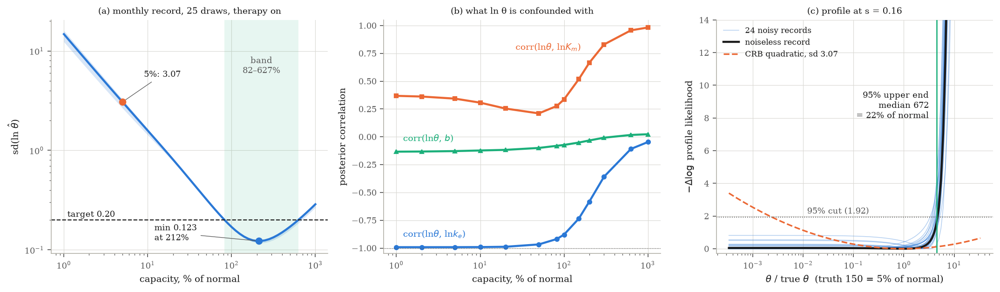

# Practical identifiability of enzyme capacity at 5% of normal

**Brief of 1 October 2026, worked on the repository's own footing.** Every number comes from a script in this directory. `out/<script>.txt` holds its printed output and `fig/` the figures. The footing is imported from `audit/n4_theta_scope.py`, not restated, and `core.fim` reproduces `n4.sd_ln_theta` to 1e-13.

## The answer in one paragraph

The brief's central mechanism holds. At 5% of normal, ln θ and ln k_e are confounded with correlation −0.992, and k_e carries 98% of Var(ln θ̂). But k_e is not the only binding constraint. With k_e known exactly, the current record still gives 0.39, twice the target. With k_e, K_m and the load bias all known, it gives 0.194: the assay and load-record noise alone sit at the target. So no amount of k_e knowledge rescues the current design.

Borrowing k_e across a real cohort, at zero new measurement, buys a factor of 2–7. That is 3.07 → 1.33 at 16 patients and → 0.81 at 64, with Monte Carlo spreads of 0.90 and 0.46. It never reaches 0.20. Even that gain depends on k_e being genuinely shared: at the repository's 33% between-patient spread, 64 patients give 1.62.

A washout transient is worse than the brief expects. The enzyme is not saturated (m/K_m = 0.1 at normal, not 10), so the relaxation rate is λ = k_e + θg′(m), not k_e. The transient pins λ, while θ stays confounded with the unrecorded load and K_m.

The one measurement that clears the target on its own is a calibrated, off-therapy measurement of the enzymatic flux, good to about 19%. Its row carries no k_e term.

## What the repository contains, and where the brief departs from it

| the brief says | the repository has | consequence |
|---|---|---|
| "~24 patient records" | `design.run.SEEDS = range(24)`: **24 draws of one simulated patient's intake sequence**. There is no patient data anywhere in the repository (README: "parameter values are illustrative, not fitted"). | A joint fit "across the 24 records" cannot share k_e across patients, because they are not patients (Task 2). There are no complete-deficiency records (Task 5). |
| "steady state only" | The 3.07 carries the **booked dose train**: Δ(t), D = 6000 every 14 d, 3.5 d half-life, known, acting on the enzyme channel. Draws are quasi-steady (marker settles in hours), and the load varies by 10% day to day. | Without the dose train the 5% figure is **8.59**, not 3.07. With constant load too, the FIM is singular. |
| FIM over (θ, k_e, K_m, L) of ln m | Flux-space FIM over (ln θ, ln K_m, b, ln k_e). b is a load-recording bias with a 5%·L prior; K_m has **no prior**; σ combines a 5% assay CV and a 5% load-record scatter. | Equivalent to the brief's ln m form to first order. The finite-difference ln m route agrees to 4e-8, and per-draw ln m noise gives 3.045 against 3.067. |
| "m/K_m ~ 10 at normal" | m = 10, K_m = 100: **m/K_m = 0.1**, ε = K_m/(K_m+m) = 0.909. | The enzyme runs at 9% saturation at normal, 35% at 5% untreated, and ≤8% under therapy. This undermines the "saturated" premises of Task 6. |
| "figure caption: median and range across records" | `n4_theta_scope.py` → `tab_S_scope`, Section 11. Each seed is scored by its own FIM **at the truth**: nothing is fitted. | |
| "upper bound ruling out capacity above ~25%" | `n6_profile_vs_crb.py`: the median upper end of a **profile-likelihood** 95% interval, on 6 records with the k_e prior in force. It prints 708 (24%). | A prior-driven bound, not a set-identification result (Task 4). |

The fixed parameters are normal θ = 3000, K_m = 100 and k_e = 5 /d, with L = 322.73 held as capacity falls (convention A). At 5% (θ = 150), m = 54.0 and s = θg/L = 0.163. Time is in days.

## Scenario table: sd(ln θ̂) at θ = 5% of normal

| scenario | sd(ln θ̂) | source |
|---|---|---|
| **current design**: 25 monthly draws, therapy on, k_e prior 0.8 | **3.07** [2.66, 3.26] | t1, = n4 |
| … with no therapy ("steady state only") | 8.59 | t1 |
| … plus one untreated baseline draw | 2.31 | t5 |
| … with k_e known exactly | 0.39 | t1, t5 |
| … with k_e, K_m and load bias all known | 0.194 | t1 |
| **joint cohort fit**, 16 patients at 5%, k_e shared exactly | **1.33** (Monte Carlo 0.90) | t2 |
| joint cohort fit, 64 patients | **0.81** (MC 0.46) | t2 |
| joint cohort fit, 64 patients, k_e varying 33% between patients | 1.62 | t2 |
| joint cohort fit, any size, k_e shared (floor) | → 0.39 | t2 |
| **washout**: diet withdrawn, hourly for 48 h, k_e prior 0.8 | **9.4** (383 with no priors) | t7 |
| washout + the monthly record | 1.39 | t7 |
| **washout + measured load** (unrecorded load to 1% of L) + record | **0.62** | t7 |
| sixfold load step then withdrawal, + record, unrecorded load to 1% | 0.165 (not clinically admissible) | t7 |
| drug burst, admissible peak, 15-min sampling for 72 h, + record | 1.34 | t7 |
| drug burst + record + k_e to 2.5% | 0.20 | t7 |
| **direct enzymatic flux**: one untreated reading to 10% / 20% | **0.11 / 0.21** | t5 |
| measured load, exact, with the monthly record | 2.67 | t5 |

## Which hypotheses held

| # | hypothesis | verdict |
|---|---|---|
| 1 | sd ≈ 0.17 at normal, ≈ 3.07 at 5%, band 82–627% | **Held exactly**: 0.1699, 3.0673 and 82.4–627.1%. But it is on the dose-train footing, for one simulated patient. |
| 2 | U-shape with its minimum near 200–250% | **Held**: minimum 0.1226 at 212%. |
| 3 | corr(θ, k_e) → −1 as s falls | **Held**: −0.879 at normal, −0.992 at ≤10%. The other arm of the U is a different confounder: corr(θ, K_m) → +0.98 at 1000%, the linear regime where only θ/K_m is seen. |
| 4 | amplification (1−s)/s = 5.1 at s = 0.16, 0.18 at s = 0.845 | **Held** as the fixed-(m, L, K_m) derivative. The posterior's effective factor β is −4.44 and −0.187. |
| 5 | the binding constraint is k_e, not assay noise | **Partly wrong.** k_e is the dominant term, but exact k_e leaves 0.39, and with every nuisance known the noise alone gives 0.194. |
| 6 | elasticity −s/(sε + 1 − s) | **Held** to 3e-10 against Richardson differences, and per draw under therapy with Δ in the denominator. |
| 7 | m/K_m ≈ 10 at normal | **Wrong**: 0.1. The fitted ε at normal is 0.90909. |
| 8 | the 24 records are fit one at a time | **Yes, but they are not patients and are not fitted.** Pooled, they are one patient with 600 draws: 1.09. |
| 9 | borrowing k_e across the cohort buys a lot for nothing | **Partly**: a factor of 2.3 at 16 patients and 3.8 at 64 (FIM). It never reaches 0.20, and it collapses if k_e varies between patients. |
| 10 | ~83% of the variance at the band edge is n-independent | **Held**: 84.3% from the exact split, 83.9% from the sd(n) fit. The implied Var(ln k_e) is 0.638 (sd 0.80), which *is* the prior. |
| 11 | 15× sampling moves the edge only a few percent (82 → 75%) | **Held**: 82.4% → 75.1%. |
| 12 | set identification reproduces the ~25% upper bound | **No.** Non-negativity alone gives 30% (907), and only because the record pins K_m; with K_m unbounded there is no bound. The 22–24% is the k_e prior's lower tail. |
| 13 | direct flux > k_e > load, in value | **Held.** Flux alone reaches 0.20 at Y ≤ 19.3%; k_e and load never reach it alone. |
| 14 | a complete-deficiency record gives k_e for free | **No such record exists.** In the parent model θ = 0 has no steady state. One would give k_e only to its load-record precision (~5%). |
| 15 | λ → k_e because the enzyme is saturated, so a transient gives k_e without θ | **Premise wrong**: not saturated. λ ≈ k_e at 5% only because θ is small: θg′ is 11–16% of λ, which still matters. |
| 16 | FD regression: EIV attenuation, MA(1) correlation of −0.5 | **Worse than attenuation, and not from noise in m**: the noisy difference ψ sits on both sides of the regression and flips coefficient signs. **MA(1) of −0.5 held**: −0.47 to −0.49 in the equation error, −0.30 to −0.33 after fitting. See Task 6. |
| 17 | the integral form is much better conditioned | **Only the 2-column saturated form**, and it cannot return θ at all. The general integral forms have larger cond(X) yet are far better estimators. |
| 18 | τ tension between derivative noise and aliasing | **Exists only for derivative estimators**: optimum 0.9–1.6/λ. For the efficient estimator, denser is never worse at fixed duration. |
| 19 | conditioning depends strongly on the excursion | **Held**: cond[1, m, m²] goes from 76 to 18, and sd from 2.9 to 0.48, as the peak m/K_m goes from 0.7 to 7.4. |

---

## 1. Identifiability (`t1_identifiability.py`)

- **U-curve, 1–1000%.** 14.75 at 1%, 3.07 at 5%, 0.17 at 100%, minimum **0.1226 at 212%**, 0.29 at 1000%. The band is 82.4–627.1%. Below the band sd(ln θ̂) ∝ 1/s, almost exactly.
- **Mechanism.** corr(ln θ, ln k_e) runs −0.992 (1–10%), −0.967 (50%), −0.879 (100%), −0.583 (200%), −0.047 (1000%). corr(ln θ, ln K_m) rises from +0.21 at 50% to +0.98 at 1000%. corr(ln θ, b) stays between −0.13 and +0.02.
  - **Low-capacity arm**: θ against k_e, the brief's mechanism.
  - **High-capacity arm**: θ against K_m. There m ≪ K_m, g ≈ m/K_m, and the record sees θ/K_m.
- **Variance attribution at 5%, with each nuisance known.** None 3.07; k_e 0.388; K_m 2.885; b 3.046; k_e + b 0.298; all three 0.194. k_e's share of the variance is 98.4% at 5%, 77% at normal and 1% at 627%.
- **Elasticity.** The analytic form matches numerical differentiation to 3.3e-10 untreated, and to 9e-10 per draw on therapy (where (θ+Δ)g enters the denominator).

  | | s | m/K_m | ε | d ln m/d ln θ |
  |---|---|---|---|---|
  | normal | 0.845 | 0.100 | 0.909 | −0.9154 |
  | 5% | 0.163 | 0.540 | 0.649 | −0.1729 |
- **Profile likelihood at s = 0.16**, 24 records, ln θ grid from 0.05 to 4967.
  - **Lower side: there is no lower bound.** The profile is flat to within 0.05 log-likelihood units from 0.01× to 2× the truth. All 24 intervals run to the grid floor. The MLE has median 3.8 (truth 150), and 54% of records put it below 15.
  - **Upper side: a wall.** The 95% upper end has median **672 (22.4% of normal)**, range 451–821; the noiseless expected profile gives 672 too. At the wall, k_e has been driven to ~1.4. That is about 1.6 prior sd below its centre, so it is the k_e prior that closes it.
  - **The CRB is the wrong shape entirely.** Its sd of 3.07 implies a symmetric factor of 166,704. The likelihood is instead a one-sided plateau with a cliff about 4.5× above the truth.

## 2. Joint fit (`t2_cohort.py`)

**What the records are.** They are not patients. Each is one diet history of the same θ = 150, K_m = 100, k_e = 5 patient, scored separately (median 3.07, range 2.66–3.26). Pooling all 24 as one patient with 600 draws gives 1.09 at 5% and 0.147 at normal.

**A real cohort.** N patients each have their own θᵢ and their own load-diary bias bᵢ. K_m is shared, and ln k_e,ᵢ = ln k_e,pop + ηᵢ with ηᵢ ~ N(0, ω²). The population prior is σ_pop² = 0.8² − ω², so each patient's marginal prior stays 0.8 and N = 1 reproduces n4 exactly (3.0820 against 3.0820). The full shared (K_m, k_e) posterior reaches each θᵢ. On `q14_hierarchical.py`'s composition (5/8/10/15/20%) this reproduces q14's 1.578 and 0.969 within 4%, as 1.63 and 0.975.

| patients at 5% | ω = 0 | ω = 0.2 | ω = 0.33 | ω = 0.5 | population sd(ln k_e), ω = 0 |
|---|---|---|---|---|---|
| 1 | 3.08 | 3.08 | 3.08 | 3.08 | 0.69 |
| 16 | **1.33** | 1.59 | 1.92 | 2.38 | 0.29 |
| 64 | **0.81** | 1.19 | 1.62 | 2.18 | 0.16 |
| 1024 | 0.43 | 0.98 | 1.48 | 2.08 | 0.04 |

- **Monte Carlo check.** I fitted the joint MAP across N patients, with priors read as noisy pseudo-observations.

  | N | FIM | MC RMSE | robust half-width (16–84%) | fits off by > 4.5× |
  |---|---|---|---|---|
  | 1 | 3.08 | 6.9 | 6.6 | 38% |
  | 16 | 1.33 | 1.46 | 0.90 | 4% |
  | 64 | 0.81 | 0.49 | 0.46 | 0% |

  At 64 patients the FIM is *pessimistic* (0.81 against an MC spread of 0.46–0.49), and the MAP is biased high by a median 0.12 in log units. I have not isolated why. The likelihood in ln θ is far from quadratic at 5% (Task 1), so the FIM cannot be trusted in either direction there. Below about 8 patients it is meaningless.
- **The answer to the main question.** Borrowing k_e across a disease cohort, with no new measurement, takes one patient from 3.07 to about 1 at 16 patients and about 0.5–0.8 at 64. It cannot reach 0.20 on monthly records, because even exact k_e leaves 0.39.
- **Which kind of uncertainty the 0.8 is decides almost everything.** If it is a shared-but-unknown constant, the cohort helps. If it is between-patient spread (ω), the cohort measures the population and not the patient. The repository's own R1 figure of a 33% between-patient CV leaves 1.62 at 64 patients. Nothing in the repository says which kind the 0.8 is.

## 3. Variance decomposition (`t3_variance.py`)

Exact split: Var(ln θ̂) = Var(ln θ̂ | k_e) + β²·Var(ln k_e).

- **At the band edge** (θ = 2472, s = 0.815) the k_e term is **84.3%** of the variance. A fit of sd(n) = √(floor² + c²/n) over n = 8–400 gives floor 0.1834 and c 0.4014, which puts the floor at 83.9% at n = 25. The implied **Var(ln k_e) = 0.638, sd 0.80**: the prior itself. The data have taught nothing about k_e.
- The conditional term scales roughly as 1/n: n·Var stays between 0.115 and 0.168 for n from 6 to 400. The k_e term stays flat at 0.0335 ± 0.0004.
- **15× sampling** (every 2 days, 365 draws) moves the edge from **82.4% to 75.1%**, which is 8.9%.
  - That is more than the k_e-held limit allows (79.9% with infinitely many draws). Dense sampling across dose phases does teach k_e a little: Var(ln k_e) falls 4.3%.
  - So "n-independent" is nearly, not exactly, true.
- The edge moves with the k_e prior: 43.7% of normal at a prior sd of 0.4, 24.6% at 0.2 and 15.6% at 0.1.

## 4. Set identification (`t4_set.py`)

**The bound, from the balance alone.** The balance gives θ = (L − k_e·m)/g(m). Non-negativity of every flux then gives

**θ_max = (L − k_e,lo·m)(K_m,hi + m)/m**

The lower end is 0 whenever k_e,hi·m ≥ L, which at 5% means any k_e above 5.97 /d, only 1.2× nominal.

| k_e floor | K_m ≤ 100 | 107 | 150 | 200 | 500 | unbounded |
|---|---|---|---|---|---|---|
| 0 (non-negativity only) | 30.7% | 32.1% | 40.6% | 50.6% | 110% | ∞ |
| 1.04 (the 0.8 prior's 95% low end) | 25.3% | 26.5% | 33.5% | 41.8% | 91% | ∞ |

- **On the actual noisy dose-train records** I ran a constrained profile (k_e > 0, no k_e prior, b prior 5%). Its upper end is **907 = 30.2%** in all 24 records, with k_e at 0 at the bound; the noiseless record gives the same.
- **Non-negativity bounds θ at 30% only because the dose train pins K_m to ~6%.** With K_m unconstrained there is no upper bound. Adding the k_e prior gives 672 (22.4%).
- **So the reported ~25% is the k_e prior's lower tail plus K_m from the record, not a consequence of non-negativity.** Analytically, the 95% low end of the prior gives 25.3%.

## 5. Value of additional measurements (`t5_value.py`)

Every number is at θ = 5% of normal on the current monthly record.

- **(a) k_e known to a factor F (1 sd).** The ln k_e prior sd becomes ln F. F = 1.05 → 0.445; 1.1 → 0.576; 1.2 → 0.895; 1.5 → 1.77; 2.0 → 2.76. Exact gives 0.388. **It never reaches 0.20.** The 95% reading of F gives 0.40 at F = 1.05.
- **(b) load measured to X%** (bias prior and per-visit scatter both X%). 1% → 2.70; 5% → 3.07; 20% → 3.75. Exact gives 2.67. **It never reaches 0.20.**
- **(c) one direct enzymatic-flux reading F_enz = θ·g(m) at an untreated visit.** Its row is (θg, −θK_m m/(K_m+m)², 0, 0), with zero derivative in k_e and in b. The untreated visit's marker draw alone takes 3.07 → 2.31, and is credited separately. Y = 5% → 0.071; 10% → 0.112; 20% → 0.206; 30% → 0.303. **One reading reaches 0.20 at Y ≤ 19.3%**, and three averaged readings at Y = 30% give 0.18.
- **(d) combinations.** k_e to 1.05 plus load to 1% gives 0.305; k_e exact plus load exact gives 0.204. A 20% flux reading plus k_e to 1.2 plus load to 2% gives 0.199. A 30% flux reading plus *exact* k_e gives 0.226, so k_e cannot rescue a poor flux reading.
- **Ranking by precision gained per unit of measurement precision.** Direct flux ≫ k_e ≫ load.
  - Elasticities of sd(ln θ̂) to each measurement's own sd: 0.90 for flux, 0.79 for k_e and 0.15 for the load.
  - Only the flux reading clears the target alone, at 19%. For scale: the only repeatability figure the repository carries for the 1-¹³C-propionate breath test is a between-visit mean of 14% (`PHASE4_SUMMARY.md`). But that is for an uncalibrated relative reading, which is the wrong kind of measurement (next point).
- **Two conditions on (c).**
  - **It must be taken off therapy.** On therapy any PCC flux measurement sees (θ + Δ)g with Δ/θ = 3–40.
  - **It must be absolutely calibrated.** The repository's 1-¹³C-propionate breath test is modelled as y = c·F with an unknown recovery c (`u2_breath_functional.py`), and under that model one reading is worth nothing.
- **Complete deficiency.** The repository holds no patient records, so there is no θ ≈ 0 record to read k_e from.
  - In the parent model (`ParamsC`) a θ = 0 patient has no steady state at all: R0 is set so the alternative route alone peaks at 500 against a load of 600.
  - If such a patient existed under model A, k_e = (L − b)/m would carry the anchor's own load bias, ~5–7%. Transferred to a 5% patient that gives 0.45–0.50 if k_e is shared exactly, 1.0 at ω = 0.2 and 1.5 at ω = 0.33.

## 6. Dynamic estimators (`t6_estimators.py`)

**The relaxation rate at 5%.** λ = 5.63–5.94 /d (1/λ = 4.0–4.3 h), and θg′ is 11–16% of it along a washout. At normal, θg′ is 83% of λ.

**The brief's (b) cannot identify θ in principle.** In m_{k+1} − m_k = (L₀ − θ)τ − k_e∫m, θ enters only through L₀ − θ, because a saturated enzyme is a constant sink.

**Two benches.**
- **TB-A, the target.** θ = 150, diet (half the load) withdrawn, hourly for 48 h, 5% CV. Its FIM sd is **383 with no priors**, so nothing can be estimated there and the bench only shows how each estimator fails.
- **TB-B, a measurement bench, not a design.** θ = 600, load raised sixfold for 24 h then withdrawn, every 15 min, 1% CV. Its FIM sd is 0.089.

| estimator | cond(X) A / B | ln θ̂ on TB-A: median bias, RMSE | ln θ̂ on TB-B: median bias, RMSE (robust) | ln k̂_e median bias, A / B |
|---|---|---|---|---|
| (a) FD, left point | 93 / 26 | −4.6, 4.9; θ̂ ≤ 0 in 56% | θ̂ ≤ 0 in **100%** | +0.21 / +0.33 |
| (a) FD, midpoint | 104 / 26 | −4.0, 4.4; θ̂ ≤ 0 in 44% | θ̂ ≤ 0 in **100%** | +0.03 / +0.33 |
| (b) integral, saturated (brief's) | 10 / 3 | θ not identified | θ not identified | **+0.11 / +0.23** |
| (b′) integral, general, K_m profiled | 575 / 19 | +9.8, 9.5 | +0.03, 0.32 (0.24) | +1.7 / −0.01 |
| (b″) integral, cumulative | 5410 / 138 | +9.3, 8.5 | +0.04, 0.21 (0.19) | +0.7 / −0.01 |
| (c) NLS through the ODE | 2.8e4 / 185 | +1.1, 4.3 | **−0.01, 0.079 (0.085)** | 0.00 / 0.00 |
| (c) EKF + RTS, one pass | — | +0.15, 1.65* | −0.02, 3.2 (1.07) | +0.15 / +0.08 |
| (c) iterated EKF smoother | — | +0.11, 1.48* | −0.01, 0.33 (**0.082**) | 0.00 / 0.00 |

TB-B's FIM sd is 0.089, so NLS attains it. The iterated smoother's robust spread matches it too, but a few fits fail and inflate its RMSE.

\* On TB-A the Kalman estimators return their own 1.5-sd prior on ln θ: the data add nothing.

- **The bias in (a) is worse than attenuation, and it is not classical errors-in-variables in m.** The median lumped coefficients on TB-A are K_m −30 against 100 and L₀K_m −5400 against +16,100; on TB-B, K_m is −264. On TB-B the median coefficients relative to truth are (−1.59, −2.06, 1.39, −2.64) with *noiseless* m in the m and m² columns, and (−1.60, −2.07, 1.39, −2.64) with noisy m. The two agree. So the whole bias comes from ψ, the noisy difference, sitting as a regressor (−ψ) while also inside the response (ψ·m). That is endogeneity, and it flips signs rather than shrinking coefficients towards zero.
- **Discretisation bias is separate and large.** On *noiseless* TB-B samples the left-point form unlumps to θ = 56 against 600; the midpoint form gives 600.3. On TB-A the left point gives 135.5 against 150.
- **MA(1) holds where it should** (`t6b_ma1.py`). At the *true* coefficients, the equation error has lag-1 autocorrelation −0.47 (TB-A) and −0.49 (TB-B), the predicted −0.5; it is the same with noiseless m. The *fitted* residuals show only −0.30 to −0.33, because OLS absorbs part of the shared noise through the biased coefficient on −ψ. So a residual check after fitting understates the correlation the estimator actually faces.
- **Conditioning is not the issue.** The brief's saturated integral form is the best conditioned (cond 3–10), but it estimates the wrong things: k_e biased high, and no θ. The general per-interval integral form is the FD form, divided through instead of multiplied, so it is linear in (L₀, θ, k_e) given K_m and has no ψ·m product. The cumulative integral form is near-unbiased despite cond 138. NLS and the iterated EKF smoother are efficient.
- **About the smoothers.** A single EKF pass from a prior centre up to 20× off is unreliable. The iterated smoother (Bell 1994), damped to 0.5 log units per pass, is Gauss–Newton on the MAP objective. It reached costs at or below those of a multi-start least-squares fit.

## 7. Experiment design (`t7_design.py`)

**The washout at 5%, hourly for 48 h.** sd(ln θ̂) down the ladder of what has to be known in advance; each column adds to the one before.

| design | nothing | k_e 0.8 | + K_m from the record | + L₀ to 5% of L | + L₀ to 1% | k_e exact |
|---|---|---|---|---|---|---|
| withdraw half the load (the diet) | 383 | 9.4 | 4.1 | 1.5 | 0.63 | 0.10 |
| load ×3 for 24 h, then out | 9.4 | 7.2 | 0.86 | 0.58 | 0.24 | 0.08 |
| load ×6 for 24 h, then out | 3.1 | 3.0 | 0.57 | 0.40 | **0.18** | 0.07 |

- **What reaches 0.20.** A washout needs **all** of: an excursion well past K_m (at hourly sampling a ×4 load step just misses, at 0.205, and ×6, with m reaching 3.6·K_m, passes), the unrecorded load L₀ known to about 1% of L, K_m taken from the monthly record, and the k_e prior.
  - The ×6 design reaches 0.176 hourly over 48 h, 0.130 at 15-minute sampling, and 0.150 hourly over 96 h. That is 49–193 samples.
  - A sixfold propiogenic load is not admissible in PA.
  - A pure withdrawal never reaches 0.20 short of exact k_e. Joining the washout to the monthly record changes little: 0.62 and 0.165.
- **The binding unknown in a washout is the unrecorded load L₀, then k_e, not the sampling.** The transient fixes λ and a level. L₀ absorbs the level, and λ = k_e + θg′ cannot be split without curvature.
- **The result is insensitive to the assumed L₀/L share:** 0.183 at 0.3·L, 0.176 at 0.5·L, 0.179 at 0.7·L.
- **The τ tension.**
  - For the efficient estimator at fixed duration, denser sampling is never worse. Over 48 h the half-load washout gives 0.36 at 5-minute sampling and 1.04 at 4-hourly.
  - At a fixed N = 24 samples the optimum is τ ≈ 0.3/λ (1.3 h), so the samples span about 7/λ.
  - The tension is real **only for derivative estimators**. A forward difference is best at τ ≈ 0.88/λ (3.7 h) with the derivative still 43% wrong in RMS; a central difference is best at τ ≈ 1.57/λ (6.7 h) with 19% error. That is why every FD estimator fails on TB-A.
- **The excursion.** As the peak marker goes from 0.68·K_m to 7.4·K_m, cond[1, m, m²] over the path falls from 76 to 18. sd(ln θ̂) falls from 2.94 to 0.48 (k_e prior and K_m from the record), or from 0.46 to 0.15 (adding L₀ to 1%). The gain is steepest up to about 2–3·K_m, as the brief expected.
- **The drug as the forcing input.**
  - The kernel is an indirect rise peaking at 13 h with a 3.5-day decay. The drug adds no substrate and leaves k_e untouched. First dose, every 15 min for 72 h.
  - Results, from the burst alone with the k_e prior to the burst plus the record (L₀ to 1%):

    | peak Δ (Δ/θ) | burst + k_e prior | burst + record |
    |---|---|---|
    | 150 (1) | 6.1 | 1.22 |
    | 450 (3) | 4.4 | 0.86 |
    | 1500 (10) | 1.9 | 1.02 |
    | 2850 (19), the admissible ceiling | 1.8 | 1.26 |
    | 6400 (43), the booked dose | 2.3 | 1.69 |

    The booked dose is inadmissible at 5%: it would take the enzyme to 2.2× normal.
  - **κ at 12% costs +4–38%** over κ known, the most at peak Δ = 450. κ free costs a little more.
  - **With k_e exact the burst gives 0.09.** The burst plus record reaches 0.20 with k_e known to **2.5%**, whether κ is known or at 12%, even with L₀ unknown.
  - So the drug is a better perturbation than a washout, because it adds no load and does not depend on L₀. It converts the problem back into "know k_e to a few per cent", which no published source supplies.

## Assumptions not supplied by the repository, and their sensitivity

| assumption | value used | sensitivity |
|---|---|---|
| between-patient sd ω of ln k_e (the 0.8 split into population and individual parts) | swept 0–0.8 | decisive for Task 2: 0.81 at ω = 0, 1.62 at ω = 0.33, 64 patients |
| unrecorded share of the load, L₀/L | 0.5 | ±0.2 moves the best washout by under 4% |
| L₀ constant through a washout | assumed | the repository withdraws the fast because fasting *raises* it (`u15`); the glucose-protected withdrawal (`u17`) is unverified |
| drug kernel | 13 h rise to peak, 3.5 d decay | peak timing from `q1`; amplitude ceiling from n4 |
| the meaning of "k_e known to a factor F" | 1-sd factor | the 95% reading is printed beside it: F = 1.05 gives 0.40 rather than 0.44 |
| direct flux: off therapy and absolutely calibrated | assumed | with an unknown recovery factor (the repository's breath-test model), one reading is worth nothing |
| washout noise | 5% CV per sample, independent | the 1% CV bench is used only to measure estimator mechanics |
